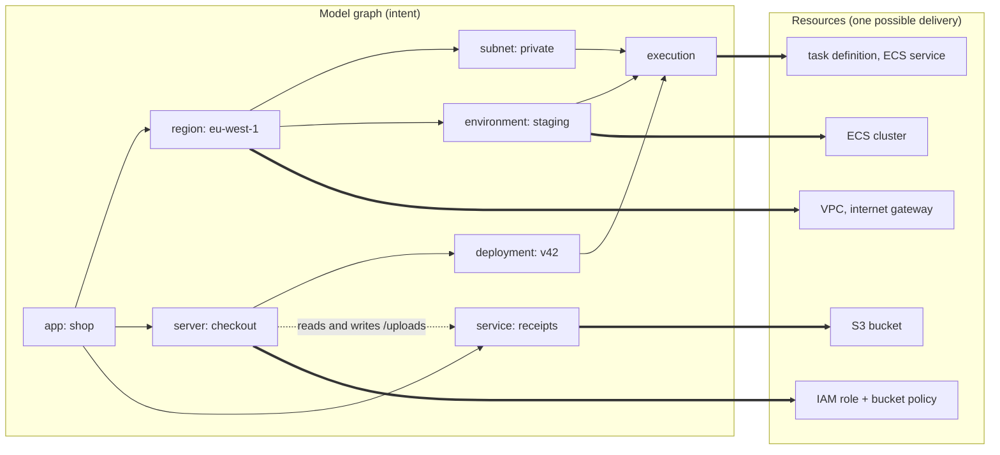

# Octo

https://octo.quadnix.com/

Octo is an infrastructure-as-code framework where you write intent, and the cloud resources are
derived from it. You describe an app, the accounts and regions it runs in, its environments, and the
servers and services it needs. Modules turn that description into Terraform, and your existing
Terraform or OpenTofu toolchain applies it.

> Disclaimer,
> This library is still under development and is currently in version `0.x.x`.
> We plan to release version `1.x.x` when it is deemed ready for production use.

## The idea

Terraform describes infrastructure as an inventory of cloud primitives: VPCs, subnets, roles,
policies. Reading it tells you what exists, not what it is for. Octo splits that description into two
layers.

**The model graph is the intent.** It is a picture of the infrastructure that someone who is not a
DevOps engineer can read: an app, running in a region, with a server deployed into an environment,
reading from a storage service. Every model is a node, and the graph is what Octo diffs, stores, and
reports on.

**Modules are the delivery.** A module is an opinionated answer to one question, such as what a
region is made of, or what it takes to run a server. It reads the models it is given and produces
the cloud resources behind them.



Nothing on the left mentions AWS. The same graph could be delivered by a different set of modules:
other AWS services, or another cloud. Changing the delivery means changing which modules the project
uses. The intent stays as it is, and so does its history.

### What belongs in the graph

The vocabulary of models is fixed on purpose, so every Octo graph reads the same way. It grows only
when a new kind of node earns its place.

| Model         | What it represents                                                                            |
|---------------|-----------------------------------------------------------------------------------------------|
| `app`         | The root of the graph.                                                                        |
| `account`     | A cloud account the app runs in.                                                              |
| `region`      | A physical or logical boundary that separates one set of infrastructure from another.         |
| `subnet`      | A subdivision of a region, such as its public and private halves. A region may have just one. |
| `environment` | A stage the app runs in, such as staging or production.                                       |
| `server`      | Something that runs your code.                                                                |
| `deployment`  | One version of a server.                                                                      |
| `execution`   | A deployment running in an environment and a subnet.                                          |
| `service`     | Something the app uses without running it, such as a database or a bucket.                    |
| `image`       | A container image that servers run.                                                           |
| `filesystem`  | A filesystem that executions mount.                                                           |
| `pipeline`    | A build or delivery pipeline.                                                                 |

A few rules follow from treating the graph as intent:

- **A model does not have to become a resource.** It holds its meaning even when a module creates
  nothing for it. An `app` never becomes a resource. For a serverless platform, a single `subnet` can
  cover the whole region.
- **Components are not models.** VPCs, internet gateways, certificates, and private links exist to
  make the infrastructure work. Modules create them, and the graph does not show them.
- **Properties are overlays.** "This server sits behind HTTPS" or "checkout can read the receipts
  bucket" is an overlay on existing nodes. The module turns it into a certificate or an IAM policy.
- **Behavior is documentation.** Cold starts, request size limits, and pricing are properties of the
  technology a module chooses. They are described in the module's docs, never in the graph.

### Modules are opinionated

A module is not meant to fit every case. The ALB module in `@quadnix/octo-aws-cdk` routes to ECS
executions and nothing else. A generic module needs an option for every case, and those options grow
until it is as hard to use as the raw resources. Octo prefers narrow modules with clear boundaries.

Modules publish **anchors**, which describe what they created and what they expect from each other.
Octo checks those anchors before anything reaches the cloud, so pairing two modules that were not
built to work together fails with a message instead of halfway through an apply.

`@quadnix/octo-aws-cdk` is Quadnix's own module library for AWS. It shows how a real set of modules is
built, and you can use it as it is, extend it, or replace any part of it with your own. A library for
another cloud would share nothing with it except the model graph.

## How a change runs

Octo splits a change into four steps. Each one is its own command.

```bash
octo generate -o .octo-tf      # intent -> one Terragrunt folder per module
octo validate ...              # a report of the planned changes, read against intent (optional)
octo apply ...                 # Terragrunt applies the folders
octo commit ...                # the outputs are recorded in Octo's state
```

Nothing reaches the cloud before `apply`, and a pipeline can put a human between any two steps. Octo
works out a change by comparing the graph you describe now with the one it stored after the last
run. It does not read your cloud account to find out what exists.

## Getting started

You need Node.js 20 or newer, Terraform or OpenTofu 1.6 or newer, Terragrunt 0.78 or newer, and AWS
credentials if you deploy to AWS.

```sh
npx @quadnix/octo-build create-app -t aws-s3-website -n hello-website
```

The [documentation](https://octo.quadnix.com/) walks through deploying it, then covers the
fundamentals, the AWS module catalog, and how to build your own modules.

## Repository layout

This is an NX monorepo.

| Path                            | What it is                                                                   |
|---------------------------------|------------------------------------------------------------------------------|
| `packages/octo`                 | The framework: models, modules, overlays, anchors, resources, and the graph. |
| `packages/octo-aws-cdk`         | Quadnix's AWS modules and resources.                                         |
| `packages/octo-build`           | The `octo` CLI.                                                              |
| `packages/octo-event-listeners` | Logging and change reports.                                                  |
| `packages/octo-templates`       | Tested starting projects, used by `create-app`.                              |
| `apps/octo-docs`                | The documentation site.                                                      |
| `docs/`                         | Internal plans, standards, and open items.                                   |
