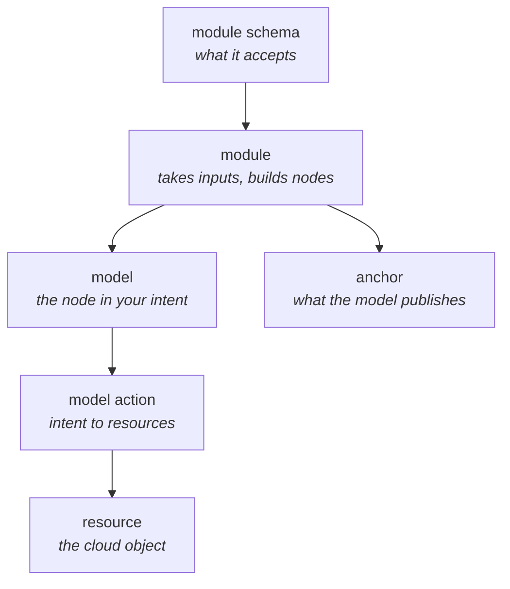

Sooner or later the shop needs something our AWS library does not have. Checkout has to publish
order events onto a queue, and there is no queue module to load. At that point you write one, and
the question is what "one" consists of.

A module is not a single file. It is a small set of pieces with clearly divided jobs, and this page
is what each one is for and which of them you actually need. The pages in this section build them,
using the shop's order queue as the example throughout.

## The pieces



| Piece                                                          | Job                                                | Needed                         |
|----------------------------------------------------------------|----------------------------------------------------|--------------------------------|
| [Module](/docs/building-modules/create-a-module)               | Takes typed inputs, builds the nodes               | Always                         |
| Module schema                                                  | Declares what the module accepts, and validates it | Always                         |
| [Model](/docs/building-modules/create-a-model)                 | The node that appears in your intent               | Usually                        |
| [Anchor](/docs/building-modules/create-an-anchor)              | What the model publishes for other modules to find | If anyone else needs it        |
| Model action                                                   | Turns a change in the model into resources         | If the module creates anything |
| [Resource](/docs/building-modules/create-a-terraform-resource) | One cloud object, and its Terraform                | If nothing existing fits       |
| [Overlay](/docs/building-modules/create-an-overlay)            | A fact spanning two models                         | Only for relationships         |

The two you can often skip are the resource and the overlay. A module that composes resources
somebody else already wrote, an SQS queue from a library you depend on, needs no resource of its
own. An overlay only earns its place when a fact belongs to two models at once.

## The layout

Each `create-*` command writes its own part of this, in the order the commands are listed below:

```text
src/
├── index.ts
├── anchors/
│   └── shop/
│       ├── shop-queue.anchor.ts
│       └── shop-queue.anchor.schema.ts
├── modules/
│   └── service/
│       └── shop-queue-service/
│           ├── index.ts
│           ├── index.schema.ts                          module inputs
│           ├── shop-queue-service.module.ts             the module
│           └── models/
│               └── service/
│                   ├── index.ts
│                   ├── shop-queue-service.model.ts      the model
│                   ├── shop-queue-service.schema.ts     the model's serialized shape
│                   └── actions/
│                       └── add-shop-queue-service.model.action.ts
└── resources/
    └── shop-queue/
        ├── index.ts
        ├── index.schema.ts
        └── shop-queue.resource.ts
```

Modules live under their model type, so a region module is under `modules/region/` and a service
module under `modules/service/`. Resources and anchors are shared across modules and live at the top
level. This is the layout `@quadnix/octo-aws-cdk` uses, and the layout the generators assume.

## The generators

```bash
octo create-module              -n shop-queue-service -t service --package @shop
octo create-model               -n shop-queue-service -t service --package @shop
octo create-terraform-resource  -n shop-queue --package @shop
octo create-external-resource   -n shop-catalog-entry --package @shop
octo create-anchor              -n shop-queue --family shop -t service --package @shop
octo create-overlay             -n shop-queue-service --overlay shop-queue-access -t service --package @shop
```

`--package` is the namespace your constructs are registered under, and it keeps a class called
`ShopQueue` in your library distinct from one somebody else publishes. Pick one for your whole
library and use it everywhere.

`-t` is the model type this belongs to, from the fixed set of [models](/docs/fundamentals/models).
Everything the generators write is marked `Fix me` where you have a decision to make, and they are
worth reading rather than deleting: several of them explain a mistake that only shows up after a
real apply.

## Registration

Every construct is registered by its decorator running, and a decorator only runs when its file is
imported. `src/index.ts` is where that happens, and the generators maintain it:

```typescript title="src/index.ts"
import './anchors/shop/shop-queue.anchor.js';
import './modules/service/shop-queue-service/models/service/index.js';
import './resources/shop-queue/index.js';

export { ShopQueueServiceModule } from './modules/service/shop-queue-service/index.js';
```

Modules are exported because the definition file names them by class. Everything else is imported
for the side effect. A construct missing from this file does not exist as far as Octo is concerned,
and the symptom is usually `No matching action given for diff!` during generate.

Then build, and point the definition file at the built output:

```yaml title="octo.yaml"
imports:
  - className: ShopQueueServiceModule
    importPath: "./dist/index.js"
```

## The order to build in

Work outwards from the thing you want to exist.

Start with the **resource**, because it is the only piece that has to match a provider's reality,
and it is where the surprises are. Get its Terraform right, in isolation.

Then the **model and its action**, which is the decision about what a request means. Then the
**module and its schema**, which is what a user of your library actually types. Then the **anchor**,
once you know what other modules will need from you.

Doing it the other way round means designing an interface before you know what it costs.
