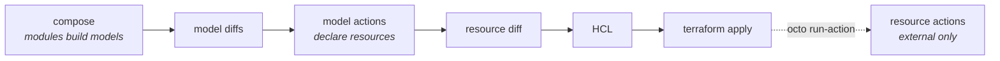

Somewhere between "checkout needs the receipts" and `aws_iam_policy`, a decision gets made: seven S3
actions for read, three for write, scoped to one directory. In a Terraform repository that decision
lives in whichever file somebody typed it into, and it is made again, slightly differently, the next
time somebody needs it.

An **action** is where that decision lives in Octo. It is a small class that watches for one kind of
change and says what that change means, and because it is attached to the change rather than to a
file, Octo can report the resources it produced underneath the request that caused them.

There are two kinds, and they sit at different layers.

## Model actions

A model action turns a change in intent into resources. This is the only place a model becomes
infrastructure.

```typescript

@Action(AwsS3StorageService)
export class AddAwsS3StorageServiceModelAction implements IModelAction<AwsS3StorageServiceModule> {
  filter (diff: Diff): boolean {
    return diff.action === DiffAction.ADD
      && diff.node instanceof AwsS3StorageService
      && hasNodeName(diff.node, 'service')
      && diff.field === 'serviceId';
  }

  async handle (diff, actionInputs, actionOutputs): Promise<ActionOutputs> {
    const { bucketName } = diff.node;
    const { awsAccountId, awsRegionId } = actionInputs.metadata;

    const s3Storage = new S3Storage(`bucket-${bucketName.replace(/[^\w-]/g, '-')}`, {
      awsAccountId,
      awsRegionId,
      Bucket: bucketName,
      permissions: [],
    });

    actionOutputs[s3Storage.resourceId] = s3Storage;
    return actionOutputs;
  }
}
```

Octo produces a diff for every model in the graph, and offers each diff to every registered action.
`filter()` answers whether this one is yours. It is normally a check on three things: which node,
what happened to it, and which field.

`handle()` declares the resources. It does not create anything and it does not call AWS. It adds
resources to `actionOutputs`, and Octo takes it from there.

The second argument carries everything the action needs from its module:

|             |                                                                                                                                                        |
|-------------|--------------------------------------------------------------------------------------------------------------------------------------------------------|
| `inputs`    | The module's inputs, resolved, exactly as the definition file gave them.                                                                               |
| `metadata`  | Whatever the module's `registerMetadata()` worked out. In the shop's storage module, the account and region IDs it resolved from the region's anchors. |
| `models`    | The models this module produced.                                                                                                                       |
| `overlays`  | The overlays this module produced.                                                                                                                     |
| `resources` | Resources declared so far by earlier actions in this run.                                                                                              |

That `resources` entry is how one action reaches another's work. When checkout is granted access to
the receipts bucket, the overlay's action looks up `iam-role-ServerRole-checkout`, which the
server's own action declared moments earlier, and adds a policy to it.

## Overlay actions

An [overlay](/docs/fundamentals/overlays) is a node that spans several models, and it has actions of
the same shape. The shop's S3 access grant is one:

```typescript

@Action(AwsEcsServerS3AccessOverlay)
export class AddAwsEcsServerS3AccessOverlayAction implements IModelAction<AwsEcsServerModule> {
  async handle (diff, actionInputs, actionOutputs): Promise<ActionOutputs> {
    const properties = diff.node.properties;

    const iamRole = actionInputs.resources[`iam-role-${properties.iamRoleName}`] as IamRole;
    iamRole.addS3BucketPolicy(properties.iamRolePolicyId, properties.bucketName,
      properties.remoteDirectoryPath, { allowRead: properties.allowRead, allowWrite: properties.allowWrite });

    // ... and the matching statement on the bucket itself
  }
}
```

Both halves of the shop's permission, the policy on the role and the policy on the bucket, come out
of that one action. Which is the answer to a question the report raises: why does adding a server
change a resource in the receipts module's folder. Because one action, owning one request, touched
two resources.

## Resource actions

A resource action creates, updates, or destroys one piece of real infrastructure, by talking to a
provider directly.

```typescript

@Action(MyExternalThing)
export class AddMyExternalThingResourceAction implements IResourceAction<MyExternalThing> {
  filter (diff: Diff): boolean {
    return diff.action === DiffAction.ADD && diff.node instanceof MyExternalThing;
  }

  async handle (diff: Diff): Promise<MyExternalThing['response']> {
    // an SDK call, a script, an HTTP request
    return { id: created.Id };
  }
}
```

These belong only to [external resources](/docs/building-modules/create-an-external-resource), the
ones whose lifecycle Terraform does not manage. Registering a resource action for a Terraform
resource throws, because Terraform already owns that resource and two owners is worse than either.

What `handle()` returns becomes the resource's `response`, which is how the ARN or ID gets recorded.
An action with nothing to report, such as a delete, returns nothing.

They run mid-apply, invoked by Terraform through `octo run-action`, and on delete they run during
`octo commit` instead, because by apply time the resource's configuration is already gone.

## When each one runs



Model actions run on every generate, validate, and commit, because each of those has to know the
full desired resource graph. They are cheap, and they must be deterministic: the same inputs have to
produce the same resources with the same resource IDs, every time. A resource ID that depends on a
timestamp, a random value, or the current AWS state will read as a delete and a create on the next
run.

Resource actions run only during an apply, and only for external resources.

## Registering one

An action is found through Octo's container, so it needs a factory alongside it:

```typescript

@Factory<AddAwsS3StorageServiceModelAction>(AddAwsS3StorageServiceModelAction)
export class AddAwsS3StorageServiceModelActionFactory {
  private static instance: AddAwsS3StorageServiceModelAction;

  static async create (): Promise<AddAwsS3StorageServiceModelAction> {
    if (!this.instance) {
      this.instance = new AddAwsS3StorageServiceModelAction();
    }
    return this.instance;
  }
}
```

The `@Action` decorator registers the class against the node it watches; the `@Factory` decorator
tells Octo how to construct it. Both run when the file is imported, which is why `src/index.ts`
imports every construct file for its side effect. The `create-*` commands write both for you.

## When no action matches

A diff that no action accepts is an error, not a no-op. Octo throws a
`NoMatchingActionFoundTransactionError`, and the error carries the diff itself: which node, which
field, which action. That is usually one of two things. A model changed in a way its module never
handled, or a construct file is missing from `src/index.ts`, so its decorators never ran and the
action was never registered.

Failing there is the point. A diff nobody handles means Octo cannot say what a piece of your intent
implies, and generating a folder that silently leaves it out would send that gap all the way to the
apply.
