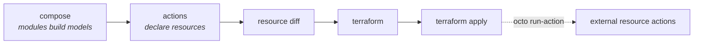

Somewhere between "checkout needs the receipts" and `aws_iam_policy`, a decision gets made: seven S3
actions for read, three for write, scoped to one directory. In a Terraform repository that decision
lives in whichever file somebody typed it into, and it is made again, slightly differently, the next
time somebody needs it.

An **action** is where that decision lives in Octo. It is a small piece of code that watches for one
kind of change and says what that change means, and because it is attached to the change rather than
to a file, Octo can report the infrastructure it produced underneath the request that caused it.

Actions belong to whoever writes the [module](/docs/fundamentals/modules), so you never call one
yourself. They are worth understanding anyway, because they explain what a run does with the
infrastructure you asked for.

## What one produces

The shop's storage module has an action watching for a service being added. When one is, that action
says what the service is made of: a bucket, named after the service, in the account and region the
module worked out from the graph. It creates nothing and calls nothing. It declares the
[resources](/docs/fundamentals/resources), and Octo takes it from there.

Actions can also read what another action has already declared, and that is where a report gets its
most surprising line. Granting checkout access to the receipts bucket is one action owning one
request, and it touches two resources: a policy on checkout's IAM role, and a matching statement on
the bucket. So adding a server changes a resource in the receipts module's folder, which looks wrong
until you know that one request is meant to land in both places.

## When they run

Actions that declare resources run on `generate`, `validate`, and `commit`, because each of those
has to know the full desired shape of your infrastructure. They are cheap, and they are required to
be deterministic: the same inputs produce the same resources under the same names, every run.
Anything else, a timestamp or a random suffix in a name, would read as a delete and a create on the
next run.

The second kind runs during an apply, and only for an [external
resource](/docs/fundamentals/resources), the kind Terraform does not manage. Terraform invokes it
mid-apply, through `octo run-action`, and what it returns is recorded as that resource's response. A
delete is the exception: by the time Terraform would run it the resource is already gone from the
configuration, so `octo commit` runs it instead. That is one of the reasons a run has to end in a
commit.

## When nothing matches

A change that no action accepts is an error rather than a silent no-op, and the message carries the
change it could not place. Generating a folder that quietly leaves out a piece of your intent would
carry that gap all the way to the apply. [Troubleshooting](/docs/using-octo/troubleshooting) covers
what the message means when you meet it.

Writing actions is part of [Create a Module](/docs/building-modules/create-a-module), and their
contracts are [`IModelAction`](/api/octo/interface/IModelAction) and
[`IResourceAction`](/api/octo/interface/IResourceAction).
