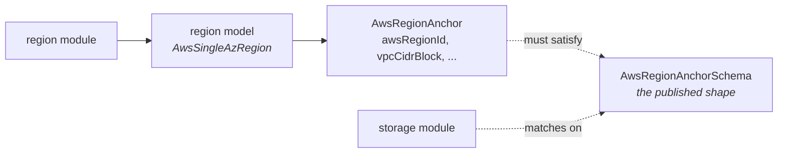

Before it can create the receipts bucket, the shop's storage module has to know which AWS region the
shop deploys into. That value belongs to the region module, and the obvious way to get it is to
import `AwsSingleAzRegion` and read the field. Do that and the two modules are married: the region
module can no longer rename a field, split a class, or move it to another package without breaking a
module it has never heard of. A team that wants to swap the region module for their own now has to
reimplement that class exactly.

An **anchor** is what a model publishes instead. It is a small named set of properties with a
schema, attached to a model, and other modules find it by matching on the shape rather than by
importing the class. The model stays an implementation detail of the library that defines it; the
anchor is the part that other people are allowed to depend on.



The two modules never meet. One publishes an anchor, the other asks for a shape, and the only thing
both of them import is the schema in the middle. Everything to the left of it, including the class
name `AwsSingleAzRegion`, is free to change.

## Publishing one

The shop's region module attaches an anchor when it builds the region:

```typescript
region.addAnchor(new AwsRegionAnchor('AwsRegionAnchor', {
  awsRegionAZs: ['eu-west-1a'],
  awsRegionId: 'eu-west-1',
  regionId: 'eu-west-1',
  vpcCidrBlock: '10.0.0.0/16',
}, region));
```

The schema is the contract:

```typescript
export class AwsRegionAnchorSchema extends BaseAnchorSchema {
  override properties = Schema<{
    awsRegionAZs: string[];
    awsRegionId: string;
    regionId: string;
    vpcCidrBlock: string;
  }>();
}
```

Four fields, all of them things another module might reasonably need, and none of them a class
reference. Treat a change to that shape as a breaking change to your library, because that is what
it is.

## Consuming one

```typescript
const [matchingAnchor] = await region.getAnchorsMatchingSchema(AwsRegionAnchorSchema, [], {
  searchBoundaryMembers: false,
});
const awsRegionId = matchingAnchor.getSchemaInstance().properties.awsRegionId;
```

That is the storage module in `@quadnix/octo-aws-cdk`, working out which AWS region to put the
shop's bucket in. It imports the anchor schema and nothing else. Any anchor whose serialized form
satisfies `AwsRegionAnchorSchema` comes back, regardless of which library produced it, so a region
module somebody writes in-house works here without either side knowing about the other.

Anchors that do not satisfy the schema are skipped rather than reported as errors, which is why the
first return value is normally destructured directly: you asked for a shape, and you get the anchors
that have it.

The second argument narrows by property value, which is how the server module picks one directory
out of a bucket that has several:

```typescript
const matchingAnchors = await service.getAnchorsMatchingSchema(
  AwsS3StorageServiceDirectoryAnchorSchema,
  [{ key: 'remoteDirectoryPath', value: 'uploads' }],
  { searchBoundaryMembers: false },
);
if (matchingAnchors.length !== 1) {
  throw new ModuleError('Cannot find remote directory in S3Storage service!', this.constructor.name);
}
```

Note what that failure means. Ask the shop's server module for a directory the receipts bucket does
not have, and the run stops during compose, with a message about the directory. No Terraform is
written, and nothing is created.

## Where the search looks

By default the search covers the whole [boundary](/docs/fundamentals/dependencies#boundaries) of the
node you started from, meaning everything reachable through the graph's edges. Pass
`searchBoundaryMembers: false` and only that one node is searched.

Prefer `false` when you already hold the node you want the anchor from, which is the common case
inside a module: you were handed the region, so search the region. The broad search is for the cases
where you know something exists somewhere in the graph but not which node carries it.

## Naming and uniqueness

An anchor's ID is unique within its parent, and most anchors are named after their class:
`AwsRegionAnchor`, `AwsIamRoleAnchor`. When a model can carry several of the same kind, the ID has
to distinguish them, and the receipts bucket does exactly that, one directory anchor per directory:

```typescript
const remoteDirectoryPathHash = CommonUtility.hash(remoteDirectoryPath).substring(0, 12);
const directoryAnchorName = `AwsS3StorageServiceDirectoryAnchor-${remoteDirectoryPathHash}`;
```

Which is why the shop's state file contains `AwsS3StorageServiceDirectoryAnchor-fb611de45b88`. The
suffix is derived from `uploads`, so it is the same on every run.

## Borrowed anchors

A model can hold an anchor that another model declared. The anchor still knows its parent, so
`getParent()` returns the model that published it, not the one holding it.

That is what lets an [overlay](/docs/fundamentals/overlays) exist. An overlay is built from anchors
rather than from models: the shop's S3 access overlay holds checkout's IAM role anchor and the
receipts bucket's directory anchor, and joining them is the whole content of the overlay. Because
those are anchors, the overlay has no idea which classes are on either end.

## When the shape has to change

A schema change breaks every consumer, and sometimes it is the right thing to do anyway. Octo has an
escape hatch for the migration: register the schema you have, the schema your module expects, and a
function between them, and the lookup keeps working while consumers catch up. [Translating between
schemas](/docs/techniques/schema#translating-between-schemas) is how.
