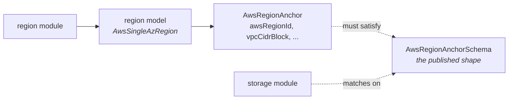

Before it can create the receipts bucket, the shop's storage module has to know which AWS region the
shop deploys into. That value belongs to the region module, and the obvious way to get it is to
import the region class and read the field. Do that and the two modules are married: the region
module can no longer rename a field, split a class, or move it to another package without breaking a
module it has never heard of. A team that wants to swap in their own region module now has to
reimplement that class exactly.

An **anchor** is what a model publishes instead. It is a small named set of properties with a
schema, attached to a model, and other modules find it by matching on the shape rather than by
importing the class.

The two modules never meet. One publishes an anchor, the other asks for a shape, and the only thing
both of them import is the schema in the middle. Everything to the left of it, the class name
included, is free to change.

## What is in one

The region anchor in our AWS library publishes four values: the AWS region ID, its availability
zones, Octo's own region ID, and the VPC's address range. All four are things another module might
reasonably need, and none of them is a class reference.

That shape is the contract. A module asks for `AwsRegionAnchorSchema` and gets back every anchor in
reach whose properties satisfy it, whoever produced them, so a region module written in-house works
with the storage module without either side knowing the other exists. Changing the shape is a
breaking change to your library, in the way that renaming a field of the model behind it is not.

A search can also narrow by value, which is how the server module picks one directory out of a
bucket that has several. Ask for a directory the receipts bucket does not have and the run stops
while modules are still composing, with a message naming the directory. No Terraform has been
written and nothing has been created, which is the cheapest place for that mistake to land.

## How far a search reaches

By default it covers the whole [boundary](/docs/fundamentals/dependencies#boundaries) of the node it
starts from, meaning everything reachable through the graph's edges from there. A module that was
handed the exact node it wants can narrow the search to that one node, and usually should.

## An anchor can be borrowed

A model can hold an anchor that another model published. The anchor still belongs to its original
model and still says so.

That is what makes an [overlay](/docs/fundamentals/overlays) possible. The shop's access grant is
built out of checkout's IAM role anchor and the receipts bucket's directory anchor, and joining
those two is the whole content of it. Because they are anchors, the overlay has no idea which
classes are on either end.

## When the shape has to change

A schema change breaks every consumer, and it is sometimes still the right thing to do. The way
through is to publish both shapes from your model for a release, and to remove the old one once
nothing matches it any more. [Schema](/docs/techniques/schema#when-a-shape-has-to-change) covers
what that costs.

Publishing and consuming anchors in code is [Create an
Anchor](/docs/building-modules/create-an-anchor).
