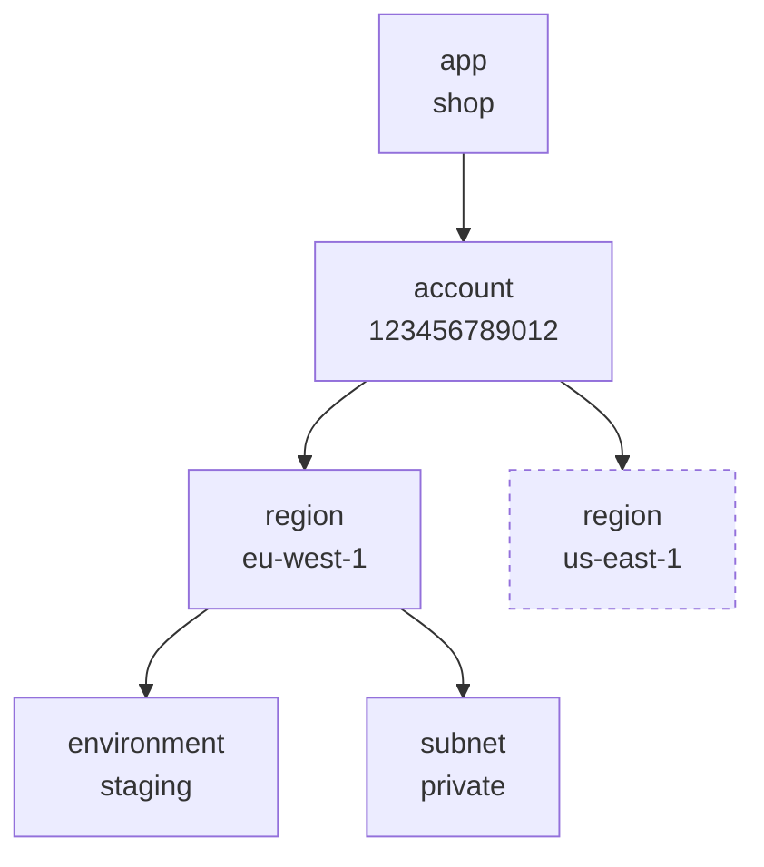

Terraform works out the order to do things in by watching which resource reads which other
resource's attribute. That covers most cases and misses the ones that hurt. Deleting checkout's IAM
role requires first removing the statement in the receipts bucket policy that names it, and no
attribute reference points that way: the policy references the role, not the reverse. Get the order
wrong and the delete fails partway, with the role gone and a policy pointing at nothing.

A **dependency** is an edge between two nodes in Octo's graph, and it carries more than "these two
are related". It carries the ordering rules that go with the relationship, written down once by
whoever built the pieces rather than rediscovered during an apply. Models, resources, and overlays
all use the same edge.

## Two kinds of edge

A **parent and child** edge says one node cannot exist without the other. The region is a child of
the account; the deployment is a child of the server. Three rules come out of that on their own: the
parent is created first, the child is deleted first, and the child's identity includes the parent's.

A **relationship** edge says two nodes are connected without either owning the other. An
[overlay](/docs/fundamentals/overlays) uses these to join models that have no parent between them.

## Ordering rules

An edge can carry rules of the form: before this happens to one node, that must already have
happened to the other. The bucket and the role have two of them, in opposite directions.

The first orders the create: the role has to exist before the bucket policy can name it. The second
orders the delete: the policy statement has to go before the role does. Neither is expressible as an
attribute reference, and both are true no matter which module the role came from. The second one is
why removing checkout from the shop's definition file tears the stack down in an order that works
rather than failing halfway.

Octo sorts a run by walking these rules, so that everything a change depends on lands in an earlier
step. Inside one generated folder that becomes `depends_on` between blocks. Across folders it
becomes a Terragrunt `dependency`, which is what puts the receipts folder after the checkout folder.

When the rules cannot be satisfied, because two nodes each require the other to go first, Octo
throws rather than picking one. A circular dependency is a bug in a module, and it is far cheaper to
find while composing than halfway through an apply.

## Boundaries

The same edges decide what a module is allowed to see.

When a module looks for something another module built, it does not search the whole graph. It
searches the **boundary** of the node it was handed: everything reachable by walking up and down
from there.

Starting from `eu-west-1`, the boundary is every solid node: up through the account to the app, and
down through the environment and the subnet. The dashed region is in the same graph and out of
reach, because the walk never goes sideways into a sibling's descendants. A module handed one region
cannot accidentally match something belonging to another.

It is also why the server module can find the receipts bucket at all. Checkout was handed the
receipts service directly, so there is an edge between them, and the search follows it.

## What this buys you

The order of an apply is a property of the graph, not of the order you listed modules in
`octo.yaml`. Module order decides which module can see which. Dependency edges decide what happens
when.
