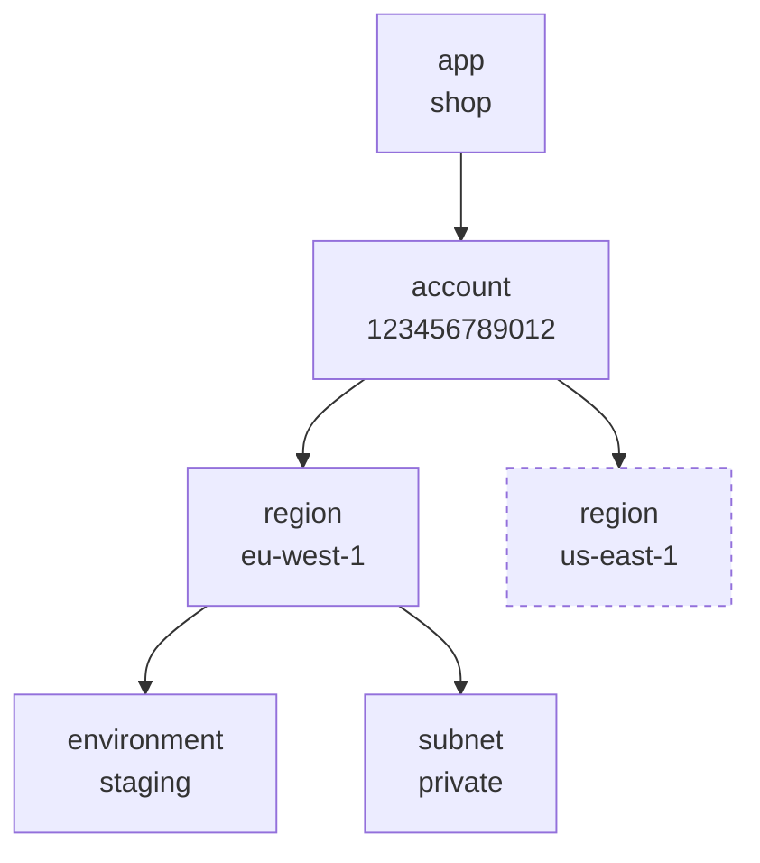

Terraform works out the order to do things in by watching which resource reads which other
resource's attribute. That covers most cases, and misses the ones that hurt. Deleting checkout's IAM
role requires first removing the statement in the receipts bucket policy that names it, and there is
no attribute reference pointing that way; the bucket policy references the role, not the reverse.
Get the order wrong and the delete fails partway, with the role gone and a policy referring to
nothing.

A **dependency** is the edge between two nodes in Octo's graph, and it carries more than "these two
are related". It carries ordering rules, stated as pairs of actions, so that a case like the one
above is written down once by whoever built the resource rather than rediscovered during an apply.

Every graph in Octo is made of them. Models, resources, and overlays all use the same edge.

## Two kinds of edge

A **parent and child** edge says one node cannot exist without the other. In the shop, the region is
a child of the account, and the deployment is a child of the server. Octo derives three rules from
that automatically: the parent is created before the child, the child is deleted before the parent,
and the child's identity includes the parent's.

```typescript
account.addChild('accountId', region, 'regionId');
```

The two field names are what each side is identified by, and they are what the ordering rules are
written against.

A **relationship** edge says the two are connected without either owning the other. An
[overlay](/docs/fundamentals/overlays) uses these: it joins two models that have no parent between
them, and neither model's existence depends on the other.

```typescript
const { thisToThatDependency } = this.addRelationship(anchorParent);
```

## Behaviors

A behavior is one ordering rule on one edge, and it reads as a sentence: when this field of the
source node gets this action, that field of the target node must have had that action applied first.

Here is the real pair from the S3 storage resource, which is what makes the shop's teardown work:

```typescript
// Before updating s3-storage, the principal resource must have been added.
s3StorageToPrincipalResourceDep.addBehavior(
  'update-permissions', DiffAction.UPDATE,
  'resourceId', DiffAction.ADD,
);

// Before deleting the principal resource, s3-storage must have been updated.
principalResourceToS3StorageDep.addBehavior(
  'resourceId', DiffAction.DELETE,
  'update-permissions', DiffAction.UPDATE,
);
```

Two rules, in opposite directions, on the two edges between the bucket and the IAM role. The first
orders the create: the role has to exist before the bucket policy can name it. The second orders the
delete: the policy statement has to go before the role does. Neither is expressible as an attribute
reference, and both are true regardless of which module the role came from.

When you remove checkout from the shop's definition file, that second rule is why the destroy
happens in an order that works.

## Ordering an apply

Octo sorts a run by walking these rules. It collects the diffs, then arranges them so that every
behavior's precondition lands in an earlier step than the thing that depends on it. What comes out
is a sequence of steps, each holding the changes that can be applied together.

Within one Terragrunt folder, that ordering is turned into `depends_on` between the generated
blocks. Across folders it becomes a Terragrunt `dependency` block, which is what you saw in the
shop's receipts folder pointing at the checkout folder.

If the rules cannot be satisfied, because two nodes each require the other to go first, Octo throws
rather than picking one. A circular dependency is a bug in whoever wrote the modules, and it is much
cheaper to find it during compose than halfway through an apply.

## Boundaries

Dependencies also decide what a module can see.

When a module searches for something another module produced, it does not search the whole graph. It
searches the **boundary** of the node it started from: everything reachable through parent, child,
and relationship edges from there. Starting at the shop's region, the boundary reaches up to the
account and the app, down to the environments and subnets, and across any relationship edge attached
to them.



Starting from `eu-west-1`, the boundary is every solid node in that picture: up through the account
to the app, and down through the environment and the subnet. The dashed region is in the same graph
and outside the boundary, because the walk goes up and down from where it started, never sideways
into a sibling's descendants. A module handed one region cannot accidentally match an anchor
belonging to another.

That is also why the server module can find the receipts bucket's directory anchor. Checkout was
handed the receipts service directly, so there is an edge between them, and the search follows it.

Searches take an option to turn this off:

```typescript
const [anchor] = await region.getAnchorsMatchingSchema(AwsRegionAnchorSchema, [], {
  searchBoundaryMembers: false,
});
```

With `searchBoundaryMembers: false`, only that one node is searched. Module authors use it when they
already hold the exact node and want the anchor it declared, not one that happens to match somewhere
else in the graph. It is the safer default when you have the node in hand.

## Where dependencies come from

You rarely construct one. `addChild()` and `addRelationship()` create the edges, and the models that
ship with Octo already call them: `app.addAccount()`, `region.addSubnet()`,
`server.addDeployment()`. Behaviors are added by resource authors, in the constructor of the
resource that knows the rule.

The one thing worth remembering as a user of modules is what these edges buy: the order of an apply
is a property of the graph, not of the order you listed modules in `octo.yaml`. Module order
controls which module can see which; dependency edges control what happens when.
