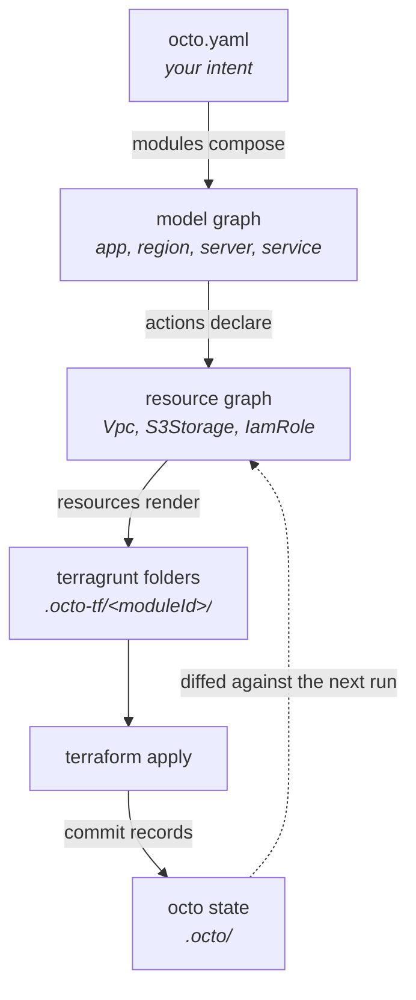

A definition file goes in and Terraform comes out. In between are five steps, and knowing their
names is what turns "the Terraform is not what I meant" into a question with an answer: which step
did something you did not expect.

The example is the shop from [Shop Stack](/docs/getting-started/shop-stack): an AWS account, a
region, a receipts bucket, and a checkout server that can read and write it. Eleven lines of YAML
described that server, and they became an IAM role in one folder and a bucket policy in another.



## You describe what you want

`octo.yaml` names [modules](/docs/fundamentals/modules), and gives each one an ID and a set of
inputs.

```yaml
modules:
  - moduleId: region-module
    moduleClass: AwsSingleAzRegionModule
    moduleInputs:
      account: "${{account-module.model.account}}"
      name: eu-west-1
      regionId: aws-eu-west-1a
      vpcCidrBlock: 10.0.0.0/16
```

The `moduleId` is the name that follows that instance through the rest of the run: it names the
folder Octo generates for it, which is why a report calls the VPC's folder `region-module`.

## Modules build the model graph

Each module runs and returns the [models](/docs/fundamentals/models) it created: an app, an account,
a region, a server. What comes out is one connected graph rooted at a single app, and it is
described entirely in those terms. Nothing in it mentions a VPC.

Inputs are checked against the module's schema before it runs, so a bad input fails here, naming the
input, rather than three layers down. Failing while composing costs nothing. Failing during an apply
costs a half-built stack.

## Actions turn models into resources

For every model in the graph, Octo asks the [actions](/docs/fundamentals/actions) registered for it
what that model means in cloud terms. Their answers are the
[resources](/docs/fundamentals/resources): the storage service becomes a bucket, the server becomes
an IAM role, the region becomes a VPC and an internet gateway.

This happens in full on every run. Octo does not diff your model graph against the last one; it
composes the whole thing again, so what it holds at the end of this step is the complete set of
resources your intent implies, not a list of changes.

## The diff

Octo now holds two resource graphs: the one your intent implies, derived moments ago, and the one it
recorded at the last commit. Comparing them is the diff, and it is what every report shows and what
`octo validate` correlates Terraform's plan against.

A change is one of [five things](/api/octo/enum/DiffAction), and the one worth knowing by name is
`replace`: a change that cannot be made in place, so the infrastructure is destroyed and created
again. Whoever wrote the resource declares that, with a reason, which is how a report can say why a
VPC is being recreated instead of leaving you to work it out from a plan.

## Resources render Terraform

One module produces one Terragrunt folder. Every resource in the desired graph writes itself into
its module's folder, whether or not it changed, and Terraform works out the creates and deletes
against its own state.

The interesting part is what happens when one resource points at another. The receipts bucket's
policy needs checkout's role ARN, and checkout came from a different module, so those two resources
are in different folders. Octo renders that reference as a Terragrunt `dependency` between the two
folders and writes the wiring on both sides. Nobody typed an address, and nobody put the folders in
order: the receipts folder applies second because of what it needs, not because of where it sits in
`octo.yaml`.

## Apply and commit

Terragrunt applies the folders in the order those dependencies imply. Then `octo commit` reads each
folder's outputs, records them as each resource's response, and saves both graphs, which becomes the
baseline the next run is diffed against. [The Lifecycle](/docs/getting-started/the-lifecycle) covers
the four commands and what each one is safe to do.

## Names

Every node has a context, and that string is its identity everywhere: in state, in diffs, in
reports.

```text
app=shop
account=123456789012,app=shop
service=shop-receipts-s3-storage,app=shop
@octo/s3-storage=bucket-shop-receipts
```

A model's context reads as a path from the node up to the app. A resource's reads as
`<package>/<name>=<resourceId>`. When a report prints `@octo/s3-storage=bucket-shop-receipts`, that
is a string you can search for in `.octo/resources-actual.json` and find the exact record.

## Who owns what

|                   | Owns                                                                                   |
|-------------------|----------------------------------------------------------------------------------------|
| You               | Intent. Which modules, with which inputs.                                              |
| The module author | What that intent means in cloud resources.                                             |
| Octo              | Composing the graph, diffing it, generating HCL, correlating plans, recording results. |
| Terraform         | Provider APIs, execution, state, and ordering within a folder.                         |
| Terragrunt        | Ordering between folders, backend generation, wiring outputs into inputs.              |

Terraform makes the cloud calls. The exception is an [external
resource](/docs/fundamentals/resources), the kind no provider can express, which Octo runs itself.
