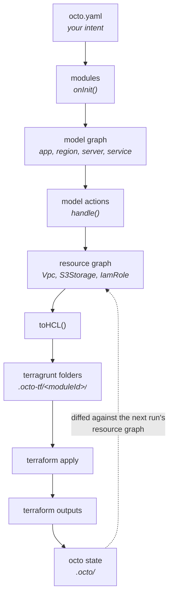

A definition file goes in and Terraform comes out, and in between are six transformations nobody
sees. That is fine until the Terraform is not what you meant, and then the useful question is which
of the six did something you did not expect: an input that never validated, an action that named a
resource after something that moves, a reference that resolved into a different folder than you
thought. This page walks the whole path once, so that each step has a name you can go back to.

The example is the shop from [Shop Stack](/docs/getting-started/shop-stack): an AWS account, a
region, a receipts bucket, and a checkout server that can read and write it. Eleven lines of YAML
described that server, and they became an IAM role in one folder and a bucket policy in another.

## The pipeline



Each arrow is a transformation, and each one is a place to look when something is not what you
expected.

## The definition file

`octo.yaml` names module classes, and gives each one an ID and a set of inputs.

```yaml
modules:
  - moduleId: region-module
    moduleClass: AwsSingleAzRegionModule
    moduleInputs:
      account: "${{account-module.model.account}}"
      name: eu-west-1
      regionId: aws-eu-west-1a
      vpcCidrBlock: 10.0.0.0/16
```

The `moduleId` does two jobs. It scopes everything that instance of the module produces, and it
becomes the name of the generated Terragrunt folder, which is why the report calls the VPC's folder
`region-module`. Loading the same class twice under two IDs gives two independent instances, and
that is how the shop gets several subnets out of one subnet module.

A `${{...}}` reference is resolved when the module that needs it runs, against what earlier modules
registered. [Composing Modules](/docs/using-octo/composing-modules) covers the forms it takes.

## Modules to models

Each module's `onInit()` runs, in the order the definition lists them, and returns the models,
overlays, and anchors it created.

```typescript

@Module<SimpleAppModule>('@octo', SimpleAppModuleSchema)
export class SimpleAppModule extends AModule<SimpleAppModuleSchema, App> {
  async onInit (inputs: SimpleAppModuleSchema): Promise<App> {
    return new App(inputs.name);
  }
}
```

Inputs are validated against the module's schema before `onInit` runs, so a bad input fails here,
with a message naming the input, rather than three layers down. A module that cannot satisfy what it
was asked for throws a `ModuleError` in `onInit`. Failing during compose costs nothing; failing
during an apply costs a half-built stack.

What comes out is one connected graph rooted at a single app. The nodes are
[models](/docs/fundamentals/models), and the edges are
[dependencies](/docs/fundamentals/dependencies), either parent and child or a peer relationship.

## Models to resources

Octo walks the model graph and, for each model, asks the [actions](/docs/fundamentals/actions)
registered for that class whether they apply. The ones that do declare resources. This is where the
storage service becomes a bucket:

```typescript

@Action(AwsS3StorageService)
export class AddAwsS3StorageServiceModelAction implements IModelAction<AwsS3StorageServiceModule> {
  filter (diff: Diff): boolean {
    return diff.action === DiffAction.ADD && diff.node instanceof AwsS3StorageService
      && hasNodeName(diff.node, 'service') && diff.field === 'serviceId';
  }

  async handle (diff, actionInputs, actionOutputs): Promise<ActionOutputs> {
    const { bucketName } = diff.node;
    const { awsAccountId, awsRegionId } = actionInputs.metadata;

    const s3Storage = new S3Storage(`bucket-${bucketName.replace(/[^\w-]/g, '-')}`, {
      awsAccountId,
      awsRegionId,
      Bucket: bucketName,
      permissions: [],
    });

    actionOutputs[s3Storage.resourceId] = s3Storage;
    return actionOutputs;
  }
}
```

:::info[Model actions run in full on every run]
Octo does not diff your model graph against the previous run's. It composes the whole graph from
scratch and runs every model action, so what it holds afterwards is the complete desired set of
resources, not a delta.

Change detection happens one layer down, between resource graphs. That is why a model action has to
be deterministic: the same inputs must produce the same resources with the same resource IDs. A
resource ID derived from something that moves will read as a delete and a create.
:::

## The diff

At this point Octo holds two resource graphs:

- **new**, which is what your intent implies, derived moments ago.
- **actual**, which is what Octo recorded at the last commit, read back from
  `.octo/resources-actual.json`.

Comparing them produces the resource diff. That is what every report shows, and what `validate`
correlates Terraform's plan against. A resource author shapes it by overriding `diffProperties()`:

```typescript
override async diffProperties(previous: Vpc): Promise<Diff[]> {
  if (!DiffUtility.isObjectDeepEquals(previous.properties, this.properties, ['awsAvailabilityZones'])) {
    return [
      new Diff(
        this,
        DiffAction.REPLACE,
        'resourceId',
        this.getContext(),
        'cidr_block is force-new on aws_vpc; a change recreates the VPC',
      ),
    ];
  }

  return [];
}
```

The reason string is what a reviewer reads when a plan shows a recreate. Saying `REPLACE` up front
is also what keeps that recreate out of the drift section, where it would read as something nobody
asked for. A diff carries one of `ADD`, `UPDATE`, `DELETE`, `REPLACE`, or `VALIDATE`.

## Resources to Terraform

Every resource in the desired graph writes itself out, whether or not it changed. Terraform works
out the creates and deletes against its own state; Octo always writes the full desired
configuration.

```typescript
override async toHCL(terraform: TerraformModuleScope): Promise<void> {
  const vpc = terraform.addOctoTerraformResource(this as Vpc, {
    provider: { accountId: this.properties.awsAccountId, regionId: this.properties.awsRegionId },
  });

  const tf = vpc.addTerraformResource('aws_vpc', this.resourceId, {
    cidr_block: this.properties.CidrBlock,
    enable_dns_hostnames: true,
    enable_dns_support: true,
    instance_tenancy: this.properties.InstanceTenancy,
  });

  vpc.output({
    VpcArn: terraform.raw(`${tf.address}.arn`),
    VpcId: terraform.raw(`${tf.address}.id`),
  });
}
```

Two things in there do more than they look like they do.

`output()` declares this resource's response keys. They become `output` blocks in the folder, which
is both how another folder consumes the resource and how `commit` reads the values back into Octo's
state.

`terraform.getRef(otherResource, 'VpcId')` is how one resource refers to another, and it resolves
late. If the producer lands in the same folder it renders as a native expression,
`aws_vpc.vpc-eu-west-1.id`. If it lands in a different folder it renders as `var.vpc_1_VpcId`, and
Octo writes the matching `variable` block, the Terragrunt `dependency` block, and the `inputs`
wiring that connects them. That is the mechanism behind the two folders in the Shop Stack: the
receipts bucket's policy names checkout's role ARN, checkout is a different module, so the receipts
folder gained a `dependency` block and applied second. Nobody wrote an address, and nobody ordered
the folders.

One Octo module produces one Terragrunt folder.

## Apply and commit

Terragrunt applies the folders in the order those dependency blocks imply. Then `commit` reads each
folder's outputs, writes them into each resource's response, saves the model and resource graphs,
and rolls `resources-actual.json` forward.

That recorded state is the baseline the next run's resource graph is diffed against, which closes
the loop in the diagram.

## Names

Every node has a context, and that string is its identity everywhere: in state, in diffs, in
reports, in dependency edges.

```text
app=shop
account=123456789012,app=shop
service=shop-receipts-s3-storage,app=shop
@octo/s3-storage=bucket-shop-receipts
```

A model's context reads as a path from the node up to the app. A resource's reads as
`<package>/<name>=<resourceId>`. When a report prints `@octo/s3-storage=bucket-shop-receipts`, that
is a string you can search for in `.octo/resources-actual.json` and find the exact record.

## Who owns what

|                   | Owns                                                                                   |
|-------------------|----------------------------------------------------------------------------------------|
| You               | Intent. Which modules, with which inputs.                                              |
| The module author | What that intent means in cloud resources.                                             |
| Octo              | Composing the graph, diffing it, generating HCL, correlating plans, recording results. |
| Terraform         | Provider APIs, execution, state, and ordering within a folder.                         |
| Terragrunt        | Ordering between folders, backend generation, wiring outputs into inputs.              |

Terraform makes the cloud calls, with one exception. An [external
resource](/docs/building-modules/create-an-external-resource) is code Octo runs itself, for a thing
no provider can express, and it is what created anything in your account Terraform did not. Our AWS
library has a single one, the module that publishes a container image, because Terraform has no
resource that puts an image into a registry. Any other is one somebody on your team wrote.
