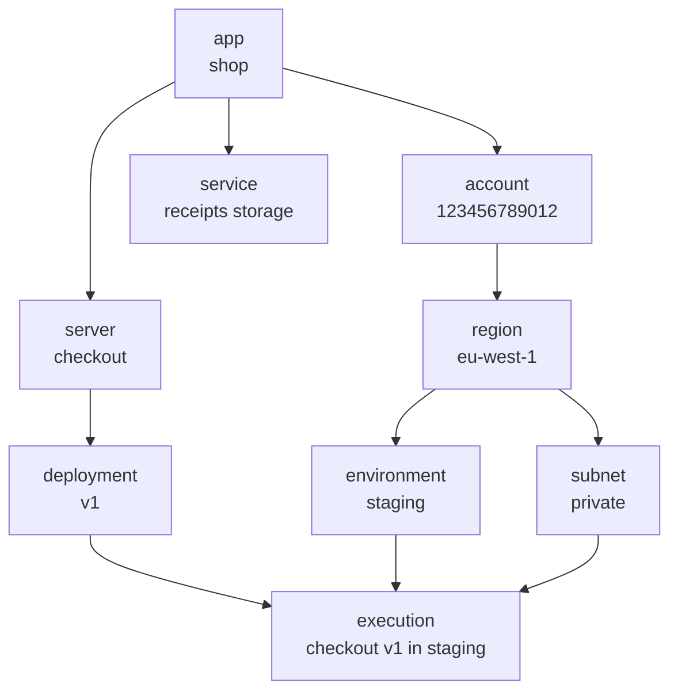

Ask two people at the same company what a region is and you get two answers, both correct. One means
`eu-west-1`. The other means the VPC, the subnets, the route tables, and the NAT gateway that make
up their footprint there. Neither definition is written down anywhere, so every conversation about
infrastructure begins by establishing which one is meant.

A **model** is a node in Octo's graph, and it fixes the first vocabulary: a small, closed set of
nouns that describe infrastructure without describing any cloud. An app. An account. A region. A
server. Nothing about a model says VPC, and that is the point, because the second vocabulary is
derived from it.

## The graph

Models form one connected graph, rooted at a single app. Here is the shop from [Shop
Stack](/docs/getting-started/shop-stack), which takes four of them, grown with a staging
environment, a subnet, and a running copy of checkout so that the shape is visible:



Two things about that shape are worth noticing before the table below.

The server hangs off the app rather than off the region, because checkout is one service in your
architecture regardless of where it runs. What runs where is the execution, which has three parents:
a deployment, an environment, and a subnet. An execution is the only model in the set that exists
because three other things are true at once.

The receipts service also hangs off the app, not off the region it was created in. A service is
something the shop depends on, and the module that created it recorded which region it sits in
without changing where it belongs in the graph.

## The models {#default-models}

| Model         | What it is                                                                     | Parent    |
|---------------|--------------------------------------------------------------------------------|-----------|
| `App`         | The application. One per project, the root of everything.                      |           |
| `Account`     | The cloud provider account this infrastructure is deployed into.               | `App`     |
| `Region`      | A geographical area you deploy into.                                           | `Account` |
| `Subnet`      | A sub-division of a region, typically to separate public from private.         | `Region`  |
| `Environment` | A runtime stage inside a region: `qa`, `staging`, `prod`.                      | `Region`  |
| `Filesystem`  | A network filesystem shared by the executions of a region.                     | `Region`  |
| `Server`      | One logical microservice: `checkout`, `search`, `payments`.                    | `App`     |
| `Deployment`  | One version of a server's code.                                                | `Server`  |
| `Execution`   | A deployment running in an environment, in a subnet.                           | all three |
| `Service`     | Something managed outside your own infrastructure: a bucket, a queue, a table. | `App`     |
| `Image`       | A container image, available to any region.                                    | `App`     |
| `Pipeline`    | A CI/CD pipeline. Not supported yet.                                           | `App`     |

That set is fixed. You do not add a thirteenth model type, and the reason is the same reason the
list is useful: a graph made of twelve known nouns can be read by a module that has never heard of
your company, and one made of arbitrary nouns cannot.

## What you extend instead

The models above carry almost nothing. `Region` holds a `regionId` and that is all; a region is not
opinionated about availability zones, because whoever is writing the region module gets to decide
that. So the model you actually use is a subclass:

```typescript

@Model<AwsSingleAzRegion>('@octo', 'region', AwsSingleAzRegionSchema)
export class AwsSingleAzRegion extends Region {
  readonly awsRegionAZs: string[];
  readonly awsRegionId: string;
  // ...
}
```

Subclassing keeps the node's name, which is what the rest of the system matches on. An
`AwsSingleAzRegion` is a `region` everywhere it matters, and a module that wants a region does not
need to know the subclass exists. `Service` goes further and requires it: on its own it carries
nothing but an ID, and calling `synth()` on a bare `Service` throws.

[Create a Model](/docs/building-modules/create-a-model) walks through writing one.

## Identity

Every model has a context, which is its path back to the app:

```text
app=shop
account=123456789012,app=shop
region=eu-west-1,account=123456789012,app=shop
service=shop-receipts-s3-storage,app=shop
```

That string is the model's identity in state, in diffs, in dependency edges, and in every report. It
is also derived, not stored, so a model's identity is a consequence of where it sits in the graph
rather than a name somebody assigned.

Which means: a model that moves gets a new identity, and Octo will read that as one thing removed
and another added.

## What a model does not do

A model creates nothing. It has no ARN, no ID from a provider, no notion of what a VPC is.
Everything in AWS that the shop consists of came from an [action](/docs/fundamentals/actions)
reacting to a change in one of these nodes, and lives in a [resource](/docs/fundamentals/resources)
instead.

The separation is what lets the same intent produce different infrastructure. Swap the region module
for one that spreads across three availability zones and the region node in that diagram does not
move.

## Finding each other

A module usually needs something another module built. It does not import the class and reach for a
field, because that would tie the two libraries together permanently. It matches on shape instead:

```typescript
const [regionAnchor] = await region.getAnchorsMatchingSchema(AwsRegionAnchorSchema);
const { awsRegionId } = regionAnchor.getSchemaInstance().properties;
```

The thing being matched is an [anchor](/docs/fundamentals/anchors), which is what a model publishes
about itself. There are matching queries for models, overlays, and resources too, all on the same
principle, and [Anchors](/docs/fundamentals/anchors) is where that idea is worked through properly.
