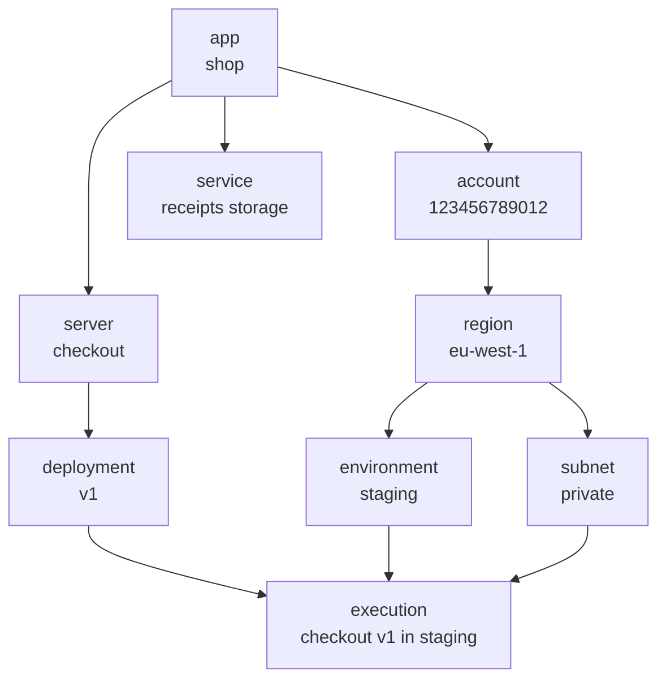

Ask two people at the same company what a region is and you get two answers, both correct. One means
`eu-west-1`. The other means the VPC, the subnets, the route tables, and the NAT gateway that make
up their footprint there. Neither definition is written down anywhere, so every conversation about
infrastructure begins by establishing which one is meant.

A **model** is a node in Octo's graph, and it fixes the first of those two vocabularies: a small,
closed set of nouns that describe infrastructure without describing any cloud. An app. An account. A
region. A server. Nothing about a model says VPC, and that is the point, because the cloud half is
derived from it.

## The graph

Models form one connected graph, rooted at a single app. Here is the shop from [Shop
Stack](/docs/getting-started/shop-stack), grown with a staging environment, a subnet, and a running
copy of checkout so that the shape is visible:

Two things about that shape are worth noticing.

The server hangs off the app rather than off the region, because checkout is one service in your
architecture regardless of where it runs. What runs where is the execution, which has three parents:
a deployment, an environment, and a subnet. An execution is the only model in the set that exists
because three other things are true at once.

The receipts service also hangs off the app rather than off the region it was created in. A service
is something the shop depends on, and the module that created it recorded which region it sits in
without changing where it belongs.

## The models {#default-models}

| Model         | What it is                                                                     | Parent    |
|---------------|--------------------------------------------------------------------------------|-----------|
| `App`         | The application. One per project, the root of everything.                      |           |
| `Account`     | The cloud provider account this infrastructure is deployed into.               | `App`     |
| `Region`      | A geographical area you deploy into.                                           | `Account` |
| `Subnet`      | A sub-division of a region, typically to separate public from private.         | `Region`  |
| `Environment` | A runtime stage inside a region: `qa`, `staging`, `prod`.                      | `Region`  |
| `Filesystem`  | A network filesystem shared by the executions of a region.                     | `Region`  |
| `Server`      | One logical microservice: `checkout`, `search`, `payments`.                    | `App`     |
| `Deployment`  | One version of a server's code.                                                | `Server`  |
| `Execution`   | A deployment running in an environment, in a subnet.                           | all three |
| `Service`     | Something managed outside your own infrastructure: a bucket, a queue, a table. | `App`     |
| `Image`       | A container image, available to any region.                                    | `App`     |
| `Pipeline`    | A CI/CD pipeline. Not supported yet.                                           | `App`     |

That set is fixed. You do not add a thirteenth, and the reason is the same reason the list is
useful: a graph made of twelve known nouns can be read by a module that has never heard of your
company, and one made of arbitrary nouns cannot.

The twelve carry almost nothing themselves. `Region` holds a region ID and that is all, because
whether a region means one availability zone or three is a decision for whoever writes the region
module. What that module actually puts in the graph is a subclass of `Region` carrying its own
fields, and it is still a region everywhere it matters: a module that asks for a region does not
need to know the subclass exists. [Create a Model](/docs/building-modules/create-a-model) is how one
is written.

## A model creates nothing

It has no ARN, no ID from a provider, no notion of what a VPC is. Everything in AWS that the shop
consists of came from an [action](/docs/fundamentals/actions) reacting to one of these nodes, and
lives in a [resource](/docs/fundamentals/resources) instead.

That separation is what lets the same intent produce different infrastructure. Swap the region
module for one that spreads across three availability zones, and the region node in that diagram
does not move.

## Where a model sits is what it is

A model's identity is its path back to the app, `region=eu-west-1,account=123456789012,app=shop`,
rather than a name somebody assigned it. So a model that moves to a different parent is read as one
thing removed and another added, the same way a renamed resource is.

What a model tells other modules about itself is separate from its position, and deliberately so.
That is an [anchor](/docs/fundamentals/anchors).
