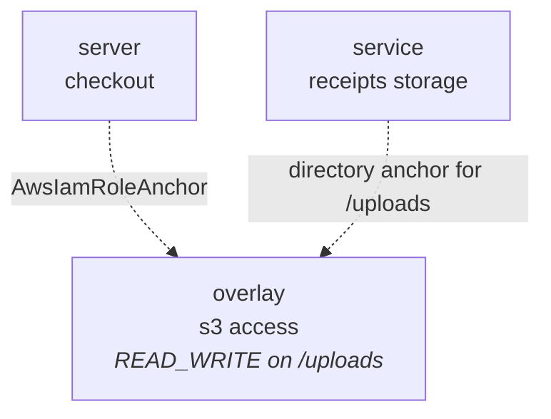

"Checkout can read and write the uploads directory of the receipts bucket" is a fact about two
things. Put it on the server and every server now carries a list of buckets, which means the server
model knows what S3 is. Put it on the storage service and every bucket carries a list of servers,
which means the storage model knows what an IAM role is. Either way, one of the two models has been
distorted by something that was never about it alone.

An **overlay** is a node for facts like that one. It joins several models, holds the properties of
the relationship itself, and has its own actions, its own diff, and its own place in state. The
models it joins stay as they were.

The shop already has one. When you gave checkout access to the receipts bucket in [Shop
Stack](/docs/getting-started/shop-stack), the server module built an `AwsEcsServerS3AccessOverlay`,
and it is the reason that one change touched resources in two different Terragrunt folders.

## What it looks like



```typescript

@Overlay('@octo', 'aws-ecs-server-s3-access-overlay', AwsEcsServerS3AccessOverlaySchema)
export class AwsEcsServerS3AccessOverlay extends AOverlay<
  AwsEcsServerS3AccessOverlaySchema,
  AwsEcsServerS3AccessOverlay
> {
  declare anchors: [AwsIamRoleAnchor, MatchingAnchor<AwsS3StorageServiceDirectoryAnchorSchema>];
  declare properties: AwsEcsServerS3AccessOverlaySchema['properties'];
}
```

The properties are the relationship, and nothing else:

```typescript
{
  allowRead: true,
    allowWrite
:
  true,
    bucketName
:
  'shop-receipts',
    iamRoleName
:
  'ServerRole-checkout',
    iamRolePolicyId
:
  'aws-ecs-server-s3-access-overlay-2bb8580c0e3c',
    remoteDirectoryPath
:
  'uploads',
}
```

## It joins anchors, not models

An overlay takes [anchors](/docs/fundamentals/anchors), which is the part that makes it reusable.
The access overlay holds checkout's IAM role anchor and the receipts bucket's directory anchor. It
never sees `AwsEcsServer` or `AwsS3StorageService`, so a different server module publishing the same
IAM role anchor works with it unchanged.

Adding an anchor also creates the dependency edges: the overlay depends on each anchor's parent
model, and each parent knows the overlay depends on it. That is what makes an overlay disappear when
either end does. Delete the receipts service from the shop's definition file and the access overlay
goes with it, and the policy statement naming it goes too.

An overlay cannot hold an anchor of its own, which would be a node pointing at itself, and Octo
throws if you try.

## Its own actions

An overlay is diffed like any other node, and the [action](/docs/fundamentals/actions) registered
for it declares what the relationship costs in infrastructure. This is where both halves of the
shop's permission are written:

```typescript

@Action(AwsEcsServerS3AccessOverlay)
export class AddAwsEcsServerS3AccessOverlayAction implements IModelAction<AwsEcsServerModule> {
  async handle (diff, actionInputs, actionOutputs): Promise<ActionOutputs> {
    const properties = diff.node.properties;

    const iamRole = actionInputs.resources[`iam-role-${properties.iamRoleName}`] as IamRole;
    iamRole.addS3BucketPolicy(properties.iamRolePolicyId, properties.bucketName,
      properties.remoteDirectoryPath,
      { allowRead: properties.allowRead, allowWrite: properties.allowWrite });

    // ... and the matching statement on the bucket resource
  }
}
```

One action, reaching two resources that belong to two different modules. Neither module had to know
about the other, and the report attributes both changes to the request that caused them.

## Identity

An overlay's ID has to be the same on every run for the same relationship, or Octo will see the old
one deleted and a new one created. The server module derives it from a hash of the inputs:

```typescript
const overlayIdSuffix = CommonUtility.hash(
  iamRoleAnchor.anchorId,
  directory.remoteDirectoryPath,
  directory.access,
).substring(0, 12);
const overlayId = `aws-ecs-server-s3-access-overlay-${overlayIdSuffix}`;
```

Which explains something you may have noticed in the shop's generated Terraform: the IAM policy is
called `aws-ecs-server-s3-access-overlay-2bb8580c0e3c`, and changing the access from `READ_WRITE` to
`READ` gives it a different name, because the access level is part of the hash. That is a deliberate
trade. A narrowed permission is a new policy and the old one goes, rather than a policy quietly
changing meaning under a name that stayed the same.

## When to reach for one

Use an overlay when a fact is genuinely about more than one model and putting it on either one would
teach that model something it should not know. Access grants, mounts, and peering are the shape.

Do not use one for a fact that belongs to a single model with extra configuration. A bucket's
versioning setting is a property of the bucket, not a relationship, and an overlay there is a node
with one anchor and no reason to exist.

[Create an Overlay](/docs/building-modules/create-an-overlay) walks through writing one.
