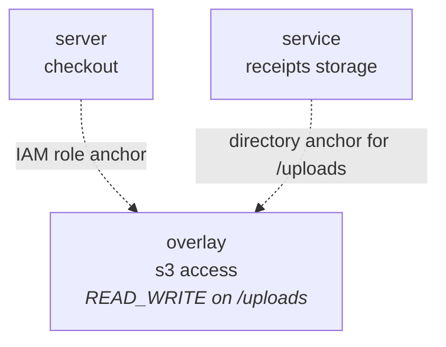

"Checkout can read and write the uploads directory of the receipts bucket" is a fact about two
things. Put it on the server and every server now carries a list of buckets, which means the server
model knows what S3 is. Put it on the storage service and every bucket carries a list of servers,
which means the storage model knows what an IAM role is. Either way, one of the two models has been
distorted by something that was never about it alone.

An **overlay** is a node for facts like that one. It joins several models, holds the properties of
the relationship itself, and has its own actions, its own diff, and its own place in state. The
models it joins stay as they were.

The shop already has one. Giving checkout access to the receipts bucket in [Shop
Stack](/docs/getting-started/shop-stack) built an S3 access overlay, and that overlay is why one
change touched resources in two different folders.

Its properties are the relationship and nothing else: which role, which bucket, which directory,
read or write.

## It joins anchors, not models

An overlay is built from [anchors](/docs/fundamentals/anchors) rather than from the models
themselves, and that is what makes it reusable. The access overlay holds checkout's IAM role anchor
and the receipts bucket's directory anchor. It never sees the server class or the storage class, so
a different server module publishing the same IAM role anchor works with it unchanged.

Holding an anchor also creates the edges to the models behind it, and those edges are what make an
overlay disappear when either end does. Remove the receipts service from the shop's definition file
and the access overlay goes with it, and so does the policy statement that named it.

## What it produces

An overlay is compared between runs like any other node, and the
[action](/docs/fundamentals/actions) registered for it says what the relationship costs. For the
shop that is both halves of one permission, the policy on checkout's role and the statement on the
receipts bucket, which is why the grant is a thing you can add and remove as a unit rather than two
edits that have to agree.

## Its name is derived from the relationship

An overlay's name has to come out the same on every run for the same relationship, so it is derived
from the things that define it. The shop's grant is
`aws-ecs-server-s3-access-overlay-937a53bb02a4`, and that string is also the name of the IAM policy
in the generated Terraform.

Narrow the access from read-write to read and the name changes, because the access level is one of
the things it is derived from. That is deliberate: a narrowed permission becomes a new policy and
the old one is removed, rather than a policy quietly changing meaning under a name that stayed the
same.

## When something is an overlay

When the fact is genuinely about more than one model, and putting it on either one would teach that
model something it should not know. Access grants, mounts, and peering are the shape.

A fact about a single model with extra configuration is not one. A bucket's versioning setting is a
property of the bucket, and an overlay there is a node with one anchor and no reason to exist.
[Create an Overlay](/docs/building-modules/create-an-overlay) walks through writing one.
