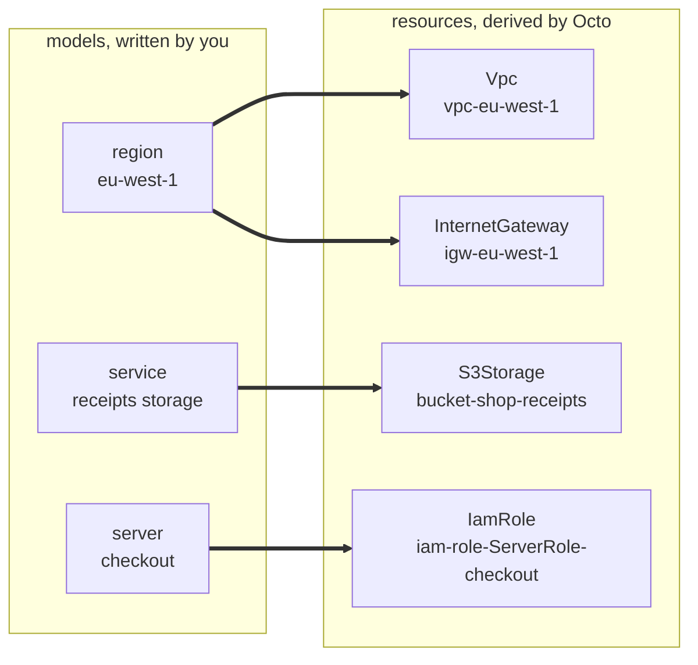
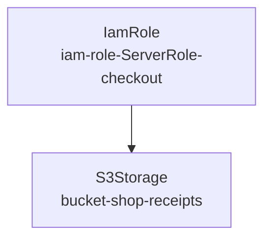

A Terraform plan tells you that `aws_s3_bucket_policy.bucket-shop-receipts-policy` will be created.
It cannot tell you which request that policy answers, because by the time Terraform sees it, the
request is gone: somebody translated "checkout needs the receipts" into HCL months ago and the
translation is all that survived.

A **resource** is Octo's record of one piece of cloud infrastructure, and it exists so that the
translation does not get thrown away. Where a [model](/docs/fundamentals/models) says what you want,
a resource says what exists, and Octo keeps the link between the two. That link is why the validate
report for the shop can print the bucket policy underneath the server that asked for it.

Here is the shop with both halves shown. On the left is what somebody wrote; on the right is what
Octo derived, and what actually costs money.



Three models on the left produced four resources on the right, and the double arrows are the record
Octo keeps. Ask what the receipts service is made of and the answer is one bucket; ask what
`bucket-shop-receipts` is for and the answer is the receipts service. Neither question can be asked
of a Terraform state file.

## What a resource holds

```typescript
new S3Storage('bucket-shop-receipts', {
  awsAccountId: '123456789012',
  awsRegionId: 'eu-west-1',
  Bucket: 'shop-receipts',
  permissions: [],
});
```

|              |                                                                                                                     |
|--------------|---------------------------------------------------------------------------------------------------------------------|
| `resourceId` | Its identity, unique across the infrastructure. Derived from the model that caused it.                              |
| `properties` | The configuration you want. What goes into Terraform.                                                               |
| `response`   | What the provider gave back: ARNs, generated IDs, endpoints. Empty until `commit`.                                  |
| `tags`       | Set in bulk by the project rather than by each module. See [Tagging Resources](/docs/using-octo/tagging-resources). |
| `parents`    | The resources this one is built on. A parent is created first and destroyed last.                                   |

`response` is the half that only exists after infrastructure does. Before the first apply,
`bucket-shop-receipts` has no ARN, because there is no bucket. After `octo commit`, its response
holds `arn:aws:s3:::shop-receipts`, and that is what another resource reads when it needs to point
at this one.

You never construct a resource yourself. A model [action](/docs/fundamentals/actions) declares it,
and Octo compares the declared graph against the one it recorded last time.

## Two kinds

Almost every resource is a Terraform resource. It extends `ATerraformResource` and implements
`toHCL()`, which contributes blocks to the folder its module owns:

```typescript
override async toHCL(terraform: TerraformModuleScope): Promise<void> {
  const bucket = terraform.addOctoTerraformResource(this as S3Storage, {
    provider: { accountId: this.properties.awsAccountId, regionId: this.properties.awsRegionId },
  });

  const tf = bucket.addTerraformResource('aws_s3_bucket', this.resourceId, {
    bucket: this.properties.Bucket,
  });

  bucket.output({ Arn: terraform.raw(`${tf.address}.arn`) });
}
```

Terraform owns its lifecycle entirely. Octo writes the configuration, reads the plan, and records
the outputs, and never calls AWS about it.

The other kind is an **external resource**, for the cases a provider genuinely cannot express. It
extends `AResource` instead, and its create, update, and delete are code you write, driven by
[resource actions](/docs/fundamentals/actions). Octo still puts it in the Terraform graph, wrapped
in a `null_resource` that shells back into `octo run-action` mid-apply, so ordering still works.
One resource in `@quadnix/octo-aws-cdk` is external, the container image it publishes, and every
other is a Terraform resource; the escape hatch is deliberately not the default. [Create an External
Resource](/docs/building-modules/create-an-external-resource) is the page for it.

One resource cannot be both. Registering a resource action for a Terraform resource throws.

## The resource graph

Resources form their own graph, parallel to the models. Its edges are ordering: a child is created
after its parent and destroyed before it.



That single edge is the shop's whole story in resource terms. The receipts bucket is a child of
checkout's IAM role, because the bucket policy names the role's ARN. Octo turned that edge into a
Terragrunt `dependency` block between the two folders, which is what made the roles apply before the
bucket policy did.

Nothing in that graph mentions the shop, or checkout, or receipts. The link back to intent is held
separately, and that is what the report reconstructs.

## The diff

On every run, Octo compares the resource graph your intent implies against the one it recorded at
the last commit. That comparison is the diff, and a resource controls its own half of it:

```typescript
override async diffProperties(previous: Vpc): Promise<Diff[]> {
  if (!DiffUtility.isObjectDeepEquals(previous.properties, this.properties, ['awsAvailabilityZones'])) {
    return [
      new Diff(
        this,
        DiffAction.REPLACE,
        'resourceId',
        this.getContext(),
        'cidr_block is force-new on aws_vpc; a change recreates the VPC',
      ),
    ];
  }

  return [];
}
```

A diff carries an action, and `REPLACE` is the one worth knowing about. It is not `UPDATE`. It says
the change cannot be made in place, and the infrastructure has to be destroyed and created again.
Declaring it here, with a reason, is what lets a report say why a VPC is being recreated instead of
leaving a reviewer to work it out from a plan.

| Action     | Means                                                                   |
|------------|-------------------------------------------------------------------------|
| `ADD`      | The resource did not exist.                                             |
| `UPDATE`   | A property changed, and can be changed in place.                        |
| `REPLACE`  | A property changed that cannot be changed in place. Destroy and create. |
| `DELETE`   | The resource is gone from intent.                                       |
| `VALIDATE` | Nothing changed, but the resource still wants checking.                 |

## Identity

A resource's identity is its `resourceId`, and its context is `<package>/<name>=<resourceId>`:

```text
@octo/s3-storage=bucket-shop-receipts
@octo/iam-role=iam-role-ServerRole-checkout
@octo/vpc=vpc-eu-west-1
```

Those strings are what `.octo/resources-actual.json` is keyed by, so a line in a report is greppable
in state.

They are also derived from the model that caused them, which has a consequence worth planning
around: change the bucket name in `octo.yaml` and the resource ID changes with it, so Octo sees one
resource gone and a different one arrived. Renaming is not a rename. It is a destroy and a create,
and for a bucket that means the objects inside it. Octo will tell you before it happens, in the
destroy list `octo apply` refuses to proceed past.
