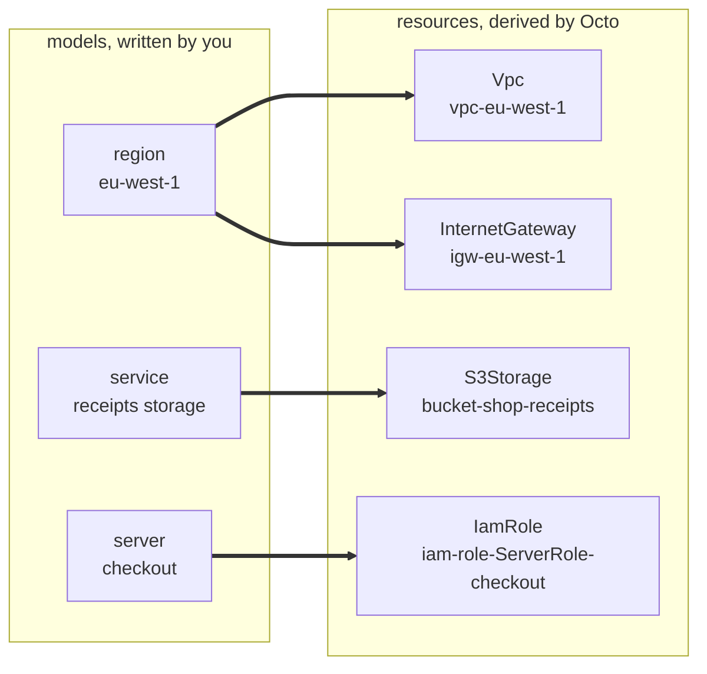

A Terraform plan tells you that `aws_s3_bucket_policy.bucket-shop-receipts-policy` will be created.
It cannot tell you which request that policy answers, because by the time Terraform sees it the
request is gone: somebody translated "checkout needs the receipts" into HCL months ago, and the
translation is all that survived.

A **resource** is Octo's record of one piece of cloud infrastructure. Where a
[model](/docs/fundamentals/models) says what you want, a resource says what exists, and Octo keeps
the link between the two. That link is why a report can print the bucket policy underneath the
server that asked for it.

You never write a resource. Each one is derived from a model, and the shop's four came out of three
things somebody asked for:

The double arrows are the record Octo keeps. Ask what the receipts service is made of and the answer
is one bucket; ask what `bucket-shop-receipts` is for and the answer is the receipts service.
Neither question can be asked of a Terraform state file.

## What a resource holds

|              |                                                                                    |
|--------------|------------------------------------------------------------------------------------|
| `resourceId` | Its name, unique across your infrastructure: the name its module gives it, followed by a short hash of where the model that caused it sits. |
| `properties` | The configuration you asked for. This is what becomes Terraform.                    |
| `response`   | What the provider gave back: ARNs, generated IDs, endpoints.                        |
| `parents`    | The resources this one is built on.                                                 |

`response` is the half that only exists once infrastructure does. Before the first apply,
`bucket-shop-receipts` has no ARN, because there is no bucket yet. `octo commit` is what fills it
in, and from then on it is what another resource reads when it needs to point at this one.

Those four are what shows up in a report and in state. Everything else a resource can do is for
whoever writes one, and lives on [`AResource`](/api/octo/class/AResource).

## Terraform's, or Octo's

Nearly every resource is Terraform's. Octo writes its configuration into the generated folder, reads
the plan, and records the outputs, and never calls the provider about it.

The exception is an **external resource**, for something no provider can express. Publishing a
container image is the one in our AWS library, because Terraform has no resource that puts an image
into a registry. Octo runs the create and the delete itself, and still keeps the resource in the
Terraform graph so that everything around it is ordered the same way.

Writing either kind is a module author's job: [Create a Terraform
Resource](/docs/building-modules/create-a-terraform-resource) and [Create an External
Resource](/docs/building-modules/create-an-external-resource).

## Order

A parent is created before its child and destroyed after it, and a resource has a parent only when
the cloud provider needs that parent to exist first. The shop has one such edge: the receipts bucket
is a child of checkout's IAM role, because S3 rejects a bucket policy naming a role that does not
exist yet. The role's own policy names the bucket too, but IAM accepts that before the bucket
exists, so no edge runs the other way. That one edge is what applies the role first and tears it
down last, without anybody stating an order.
[Dependencies](/docs/fundamentals/dependencies) is where those edges come from.

## Renaming is not renaming

A resource's name is derived from the model that caused it. Change the bucket name in `octo.yaml`
and the resource ID changes with it, so Octo sees one resource gone and a different one arrived.
Moving the model to another place in the graph does the same, because the hash in the ID is of
where the model sits.
That is a destroy and a create, and for a bucket it means the objects inside it.

When only the ID changes and the name the resource reaches the provider under stays, as when an
ALB is renamed but its target groups keep theirs, the provider would refuse a second resource of
that name while the first still exists. Octo writes a Terraform `moved` block instead, from the old
resource's blocks to the new one's, so Terraform treats the two as one: it updates the
infrastructure in place, or destroys it before it creates the replacement, never beside it.

Octo tells you before it happens: `octo apply` lists what would be destroyed and refuses to go on
until you pass `--auto-approve`.
