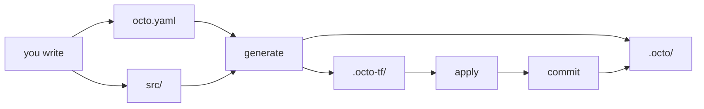

An infrastructure repository accumulates directories nobody can classify: some are source, some are
generated, some are state, and the difference only becomes clear the day somebody deletes the wrong
one. An Octo project has four directories that matter, and each one has a single answer to "is this
mine, is it generated, and does it go in git".

This is what the shop looks like after one full run.

```text
shop/
├── octo.yaml              # your intent
├── .octo/                 # Octo's state
├── src/                   # your own modules. Empty to start.
├── .octo-tf/              # the generated Terraform
├── package.json
├── tsconfig.json
├── tsconfig.build.json
├── eslint.config.js
├── .prettierrc
├── .gitignore
└── README.md
```

Everything below `package.json` is an ordinary TypeScript package, configured the way you would
configure any other. The four above it are Octo's, and all four are committed:



Two of them you write, and two Octo writes. The difference that matters is which one you can throw
away: `.octo-tf/` is derived from the other three and comes back identical on the next `generate`,
while `.octo/` is the only record that any of your infrastructure exists.

## octo.yaml

Your whole intent: which modules run, with what inputs, against which Terraform providers, writing
state where.

```yaml title="octo.yaml"
version: 1

env:            # values the shell can override
terraform:      # required version, required providers, provider blocks
settings:       # state provider, event listeners
imports:        # module classes to load, and where from
modules:        # the intent itself: module instances and their inputs
hooks:          # optional lifecycle callbacks
tags:           # optional tags applied to every resource a run produces
```

[The Definition File](/docs/using-octo/the-definition-file) covers each section.

The filename is a convention. The CLI reads whatever `OCTO_DEFINITION_FILE_PATH` points at, and the
generated scripts point it at `octo.yaml`. Keeping several, such as `octo.staging.yaml` and
`octo.prod.yaml`, is the normal way to separate deployments that must not share state.

## .octo/

Octo's memory of what your infrastructure is.

| File                               | What it holds                                                                                                                   |
|------------------------------------|---------------------------------------------------------------------------------------------------------------------------------|
| `models.json`                      | The model graph: models, anchors, overlays, and every dependency edge between them.                                             |
| `resources-actual.json`            | The resource graph Octo believes exists, with each resource's response and the mapping from Octo resource to Terraform address. |
| `resources-old.json`               | The previous resource graph, kept so a re-run can tell a settled state from a pending one.                                      |
| `<moduleId>.tfstate`               | One module's Terraform state, checked out into its folder before a Terraform command and back in after.                         |
| `resource-state-<resourceId>.json` | What an external resource's action produced, from the moment it ran until the commit that records it.                           |
| `local-state.lock`                 | The app lock, present only while a run holds it. `apply` and `commit` require it; a commit that succeeds releases it.           |
| `journal.<commandId>.<command>.*`  | The [journal](/docs/using-octo/what-octo-saves-and-when#the-journal) of the change under way, a few files per command.          |
| `archives/<lockId>/`               | The journal of each lock already released, moved out of the way. Kept on the machine, and gitignored.                           |

Where it lives comes from `settings.stateProvider.statePath`, resolved against the definition file
rather than the working directory. Losing it costs you both records at once: Octo believes it is
starting from nothing and proposes creating everything again, and Terraform has nothing left to say
otherwise. [State](/docs/fundamentals/state) covers what is in these files and where they can be
kept instead.

## src/

Empty in a new project, and it can stay that way. An app that composes only modules from
`@quadnix/octo-aws-cdk` needs nothing here.

When you write your own, the `create-*` CLI commands put them under `src/` and maintain
`src/index.ts`:

```typescript title="src/index.ts"
export { ShopRegionModule } from './modules/region/shop-region/index.js';
import './resources/shop-thing/index.js';
```

Modules are exported because the definition file names them by class. Everything else is imported
for the side effect of its decorator running, which is what registers a construct with Octo at boot.
Miss the import and the construct does not exist as far as Octo is concerned.

Build before the definition file can reference it:

```bash
npm run build
```

```yaml title="octo.yaml"
imports:
  - className: ShopRegionModule
    importPath: "./dist/index.js"
```

## .octo-tf/

One folder per module that produced resources, named after its `moduleId`, and rewritten on every
`octo generate`.

It is generated, and it is still committed. The Terraform in it is the code that actually creates
your infrastructure, so a reviewer looking at a pull request sees the four lines of YAML somebody
changed and the resources those four lines turned into, side by side, without running anything. It
is also the only place a change to a module version shows up: upgrade `@quadnix/octo-aws-cdk`,
regenerate, and the diff is exactly what the new version does differently.

Nothing in these folders should be edited by hand, because the next `generate` overwrites the files
Octo owns. It overwrites only those, so Terraform's lock file, its state, and the provider cache all
survive a regenerate, and those are the parts that stay out of git. A module you deleted from your
intent leaves an emptied folder behind, and that emptied folder is what makes the next apply destroy
its resources.

:::note[The `terraform.tfstate` in here is a working copy]
Terraform state is kept under `.octo/`, and Octo copies it into the folder before each Terraform
command and back out afterwards. The copy left behind in `.octo-tf/` is gitignored, and deleting it
costs nothing once the run that wrote it has finished.
[State Providers](/docs/techniques/state-providers#it-holds-terraforms-state-too) covers how the two
copies are kept in step.
:::

## A project that has outgrown one file

Once the shop has more than one deployment and modules of its own:

```text
shop/
├── octo.yaml                  # staging, and the default
├── octo.prod.yaml             # production, with its own statePath
├── .octo/                     # state for octo.yaml
├── .octo-prod/                # state for octo.prod.yaml
├── src/
│   ├── index.ts
│   ├── anchors/               # what your models expose for other modules to match on
│   ├── modules/
│   │   └── <model-type>/<module-name>/
│   ├── overlays/
│   ├── resources/
│   └── utilities/
└── package.json
```

That `src/` layout mirrors `@quadnix/octo-aws-cdk`, which is worth reading as a worked example, and
the `create-*` commands assume it. `octo create-module -n shop-region -t region --package @shop`
writes to `src/modules/region/shop-region/`.

The two definition files are how a deployment is kept from sharing state with another, and each one
needs its own `statePath` and its own output directory. [The Definition
File](/docs/using-octo/the-definition-file#several-definition-files) covers when that is the right
move and when an environment model is.

## What goes in version control

| Path                                           | Commit | Why                                                                |
|------------------------------------------------|--------|--------------------------------------------------------------------|
| `octo.yaml`                                    | Yes    | It is the intent.                                                  |
| `.octo/models.json`, `.octo/resources-*.json`  | Yes    | Octo's state. Without it the next run starts from nothing.         |
| `.octo/*.tfstate`                              | Yes    | Terraform's state. Without it the next apply rebuilds what exists. |
| `.octo/local-state.lock`                       | No     | The app lock. It exists only while a run holds it.                 |
| `.octo/journal.*`, `.octo/archives/`           | No     | The journal. A file per command would land in every change.        |
| `.octo-tf/**/*.tf`, `terragrunt.hcl`           | Yes    | The Terraform your change produced, reviewable next to the change. |
| `.octo-tf/**/*.tfstate*`, `.terragrunt-cache/` | No     | Terraform's own working files, written during an apply.            |
| `src/`, `package.json`, `tsconfig*.json`       | Yes    | Ordinary source.                                                   |
| `dist/`                                        | No     | Build output.                                                      |

The scaffolded `.gitignore` already says all of this.

State files hold the values Terraform returned, and some of those are secrets, so a repository
holding `.octo/` is one only the people running Octo should read. [State
Providers](/docs/techniques/state-providers) covers keeping state in a backend instead.
