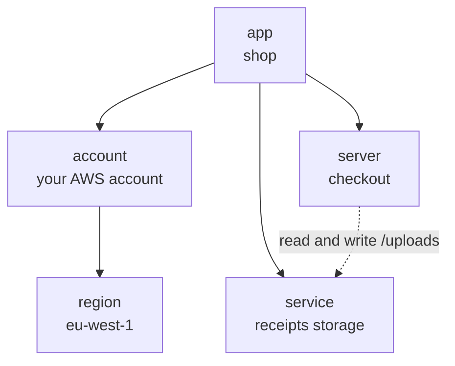
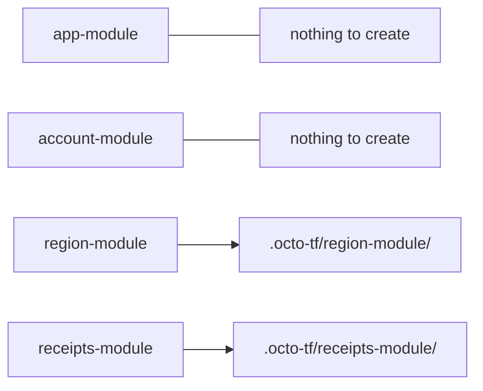
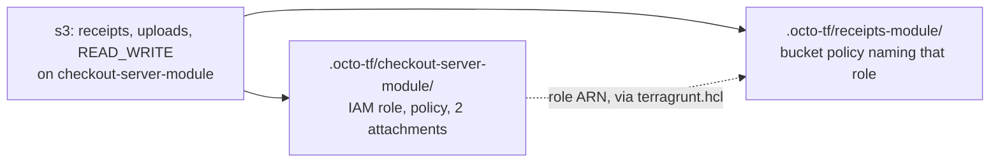

This page builds the shop, the application the rest of these pages refer back to. By the end it
exists in your own AWS account: a network to run in, a bucket where the checkout service keeps the
receipts customers upload, and permission for checkout to read and write that bucket and nothing
else.



Five nodes, none of which mentions AWS. The work happens in two passes: the first four go in
together and get applied, then checkout arrives on top of live infrastructure, which is where the
dotted line turns into a policy.

:::info[Costs]
Everything on this page is free to create in an empty AWS account: a VPC, an internet gateway, an S3
bucket with nothing in it, and an IAM role. The teardown at the end removes all of it.
:::

## The definition file

Give the shop a project of its own, so it does not share `.octo/` state with anything else you have
deployed:

```bash
npx @quadnix/octo-build create-app -t aws-s3-website -n shop
cd shop
```

Then replace `octo.yaml` with this, and delete the `website/` directory the template wrote:

```yaml title="octo.yaml"
version: 1

env:
  - key: AWS_ACCOUNT_ID
    kind: string
    value: "123456789012"      # your AWS account number
  - key: RECEIPTS_BUCKET_NAME
    kind: string
    value: shop-receipts       # your own name, not this one

terraform:
  requiredVersion: "1.6.0"
  requiredProviders:
    aws:
      source: hashicorp/aws
  providers:
    - providerType: aws
      accountId: "${env.AWS_ACCOUNT_ID}"
      regionId: eu-west-1
      spec:
        profile: default       # your profile in ~/.aws/credentials

settings:
  listeners:
    - type: LoggingEventListener
  stateProvider:
    type: LocalStateProvider
    statePath: .octo

imports:
  - className: SimpleAppModule
    importPath: "@quadnix/octo-aws-cdk/modules/app/simple-app"
  - className: AwsIniAccountModule
    importPath: "@quadnix/octo-aws-cdk/modules/account/aws-ini-account"
  - className: AwsSingleAzRegionModule
    importPath: "@quadnix/octo-aws-cdk/modules/region/aws-single-az-region"
  - className: AwsS3StorageServiceModule
    importPath: "@quadnix/octo-aws-cdk/modules/service/aws-s3-storage-service"

modules:
  - moduleId: app-module
    moduleClass: SimpleAppModule
    moduleInputs:
      name: shop

  - moduleId: account-module
    moduleClass: AwsIniAccountModule
    moduleInputs:
      accountId: "${env.AWS_ACCOUNT_ID}"
      app: "${{app-module.model.app}}"

  - moduleId: region-module
    moduleClass: AwsSingleAzRegionModule
    moduleInputs:
      account: "${{account-module.model.account}}"
      name: eu-west-1
      regionId: aws-eu-west-1a
      vpcCidrBlock: 10.0.0.0/16

  - moduleId: receipts-module
    moduleClass: AwsS3StorageServiceModule
    moduleInputs:
      region: "${{region-module.model.region}}"
      bucketName: "${env.RECEIPTS_BUCKET_NAME}"
      remoteDirectoryPaths:
        - uploads
```

Three values are yours. Your account number in `AWS_ACCOUNT_ID`, a `RECEIPTS_BUCKET_NAME` nobody has
taken, because S3 bucket names are unique across the whole of AWS rather than within your account,
and `spec.profile` if your credentials do not live under `default`.

Four sections carry the whole file, and [The Definition File](/docs/using-octo/the-definition-file)
covers each one properly. For now:

- `terraform` is the provider setup that would otherwise sit at the top of every `.tf` file. One
  entry per account and region you deploy into.
- `imports` lists the module classes this project uses, and where to import them from.
- `modules` is your infrastructure. Each entry loads one module under a `moduleId` of your choosing,
  with the inputs that module's schema declares.
- `${{...}}` is how one module receives what another produced. The account module
  is handed the app the app module built, not the string `"shop"`, and that is the difference
  between a list of four entries in Terraform and a graph in Octo.

## Generate

```bash
npm run octo:generate
```

```text
Definition file is valid and all modules were successfully imported.
INFO: Started "generate" on "shop".
INFO: Wrote 2 terragrunt folder(s) to ".octo-tf".
    written: [
      "receipts-module",
      "region-module"
    ]
INFO: Finished "generate" in 5ms.
```

Two folders for four modules. Every module contributes to the graph, but only some of them have
cloud resources to create:



An app is a name everything else hangs off, and an account is which credentials to use and which
provider block to render into the other folders. Neither creates anything. The region and the bucket
do.

Look at what it wrote:

```text
.octo-tf/
├── receipts-module/
│   ├── main.tf
│   ├── outputs.tf
│   ├── terragrunt.hcl
│   └── variables.tf
└── region-module/
    ├── ...
```

```hcl title=".octo-tf/receipts-module/main.tf"
terraform {
  required_version = ">= 1.6.0"
  required_providers {
    aws = {
      source = "hashicorp/aws"
    }
  }
}

provider "aws" {
  alias = "_123456789012-eu-west-1"
  region = "eu-west-1"
  allowed_account_ids = ["123456789012"]
  profile = "default"
}

resource "aws_s3_bucket" "bucket-shop-receipts" {
  provider = aws._123456789012-eu-west-1
  bucket = "shop-receipts"
}
```

That is ordinary Terraform, with no Octo in it. You can read it and `terraform plan` it by hand, and
it is checked into your repository so that a reviewer sees the resources a change produced next to
the intent that produced them.

## Validate

```bash
npm run octo:validate
```

This runs `terraform plan` on every folder and then reports the plans against what changed in your
intent. It creates nothing.

```text
shop — octo validate — changes (approximate)
2026-08-19 01:38:21 UTC · 3ms octo · 9.7s terraform

You added region=eu-west-1 (+1 other change). That creates 3 new things.
- 0 destroy   ± 0 replace   + 3 create   ~ 0 update

Your intent changed, so each folder was planned on its own against its dependencies' last
applied outputs. A cross-folder consequence of this change is invisible until apply. This
report can both understate what apply will do and overstate drift.

WHAT WILL CHANGE
  + added region=eu-west-1  [region=eu-west-1,account=123456789012,app=shop | region-module | +2]
      + vpc-eu-west-1
          + aws_vpc.vpc-eu-west-1
      + igw-eu-west-1
          + aws_internet_gateway.igw-eu-west-1
  + added service=shop-receipts-s3-storage  [service=shop-receipts-s3-storage,app=shop | receipts-module | +1]
      + bucket-shop-receipts
          + aws_s3_bucket.bucket-shop-receipts
```

The three levels are what you asked for, what Octo decided that needs, and what Terraform will
create, so you can start at "I added a region" and follow it down to
`aws_internet_gateway.igw-eu-west-1` without leaving the report.

It says approximate because your intent changed on this run. Once your infrastructure and your
intent agree, planning becomes exact and the same command reports drift you did not cause. [Reading
a Validate Report](/docs/using-octo/reading-a-validate-report) is the page for that.

## Apply and commit

```bash
LOCK_ID=$(npm run --silent octo:lock)
npm run octo:apply -- --lockId $LOCK_ID
```

`octo lock` takes the app lock and prints its ID. Apply and commit are the two steps that write
shared state, so both require it, which is what stops two people writing at once. The commit
releases it, so you take it once per run and never think about it again.

This is the only step that changes anything. It streams Terragrunt's own output, because an apply
can run for a long time and its progress is the only sign it is alive. At the end:

```text
❯❯ Run Summary  2 units  6s
   ────────────────────────────
   Succeeded    2

==== Apply complete ====
```

Then record what happened:

```bash
npm run octo:commit -- --lockId $LOCK_ID
```

```text
shop — octo commit — changes
2026-08-19 01:38:44 UTC · 6ms octo · 4.5s terraform

You added region=eu-west-1 (+1 other change). That created 3 new things.
- 0 destroy   ± 0 replace   + 3 create   ~ 0 update

WHAT CHANGED
  + added region=eu-west-1  [region=eu-west-1,account=123456789012,app=shop | region-module | +2]
      + vpc-eu-west-1
          + aws_vpc.vpc-eu-west-1
      + igw-eu-west-1
          + aws_internet_gateway.igw-eu-west-1
  + added service=shop-receipts-s3-storage  [service=shop-receipts-s3-storage,app=shop | receipts-module | +1]
      + bucket-shop-receipts
          + aws_s3_bucket.bucket-shop-receipts

WHAT OCTO RECORDED — values that moved
  @octo/s3-storage=bucket-shop-receipts Arn: - → arn:aws:s3:::shop-receipts
  @octo/vpc=vpc-eu-west-1 VpcArn: - → arn:aws:ec2:eu-west-1:123456789012:vpc/vpc-0d8d555c656b950ad
  @octo/vpc=vpc-eu-west-1 VpcId: - → vpc-0d8d555c656b950ad
  @octo/internet-gateway=igw-eu-west-1 InternetGatewayArn: - → arn:aws:ec2:eu-west-1:123456789012:internet-gateway/igw-046856f4d8c6a86dd
  @octo/internet-gateway=igw-eu-west-1 InternetGatewayId: - → igw-046856f4d8c6a86dd
```

The last block is what commit is for. Only AWS could say what the VPC's id is, and it said so to
Terraform. Commit is the step that copies those answers back into Octo, so that the next run knows
the bucket in your intent is that bucket in AWS. Apply is pure Terragrunt and has never heard of
Octo, which is why reading the results back is a command of its own rather than the tail end of the
apply.

Your bucket exists:

```bash
aws s3 ls | grep shop-receipts
```

## Give checkout access to it

Checkout needs to read and write the `uploads` directory in the receipts bucket. Add the server to
`octo.yaml`, under `imports`:

```yaml title="octo.yaml"
  - className: AwsEcsServerModule
    importPath: "@quadnix/octo-aws-cdk/modules/server/aws-ecs-server"
```

and at the end of `modules`:

```yaml title="octo.yaml"
  - moduleId: checkout-server-module
    moduleClass: AwsEcsServerModule
    moduleInputs:
      account: "${{account-module.model.account}}"
      serverKey: checkout
      s3:
        - service: "${{receipts-module.model.service}}"
          directories:
            - access: READ_WRITE
              remoteDirectoryPath: uploads
```

There is no policy document in there, and no ARN. The server module is handed the receipts service
itself, and `READ_WRITE` on a directory in it. Which S3 actions that means is the server module's
business.

```bash
npm run octo:generate && npm run octo:validate
```

```text
You added server=checkout (+1 other change). That creates 5 new things.
- 0 destroy   ± 0 replace   + 5 create   ~ 0 update

WHAT WILL CHANGE
  + added server=checkout  [server=checkout,app=shop | checkout-server-module | +4]
      + iam-role-ServerRole-checkout
          + aws_iam_policy.iam-role-ServerRole-checkout_aws-ecs-server-s3-access-overlay-2bb8580c0e3c
          + aws_iam_role_policy_attachment.iam-role-ServerRole-checkout_AmazonECSTaskExecutionRolePolicy
          + aws_iam_role_policy_attachment.iam-role-ServerRole-checkout_aws-ecs-server-s3-access-overlay-2bb8580c0e3c_attach
          + aws_iam_role.iam-role-ServerRole-checkout
  + added service=shop-receipts-s3-storage  [service=shop-receipts-s3-storage,app=shop | receipts-module | +1]
      + bucket-shop-receipts
          + aws_s3_bucket_policy.bucket-shop-receipts-policy
```

Five Terraform resources from those eleven lines, and they land in two different folders. Checkout's
folder gets the role, the managed policy, and both attachments. The receipts folder gets a bucket
policy naming that role. AWS wants the grant written on both sides, so the module that owns servers
writes the role half and the module that owns buckets writes the bucket half, and one request
produced both.



The actions are in the generated file, if you want to see exactly what `READ_WRITE` bought:

```hcl title=".octo-tf/checkout-server-module/main.tf"
resource "aws_iam_policy" "iam-role-ServerRole-checkout_aws-ecs-server-s3-access-overlay-2bb8580c0e3c" {
  provider = aws._123456789012-eu-west-1
  name = "aws-ecs-server-s3-access-overlay-2bb8580c0e3c"
  policy = jsonencode({
    Statement = [{
        Action = ["s3:GetObject", "s3:GetObjectAttributes", "s3:GetObjectTagging", "s3:GetObjectVersionAcl", "s3:GetObjectVersionAttributes", "s3:GetObjectVersionTagging", "s3:ListBucket"]
        Effect = "Allow"
        Resource = ["arn:aws:s3:::shop-receipts/uploads", "arn:aws:s3:::shop-receipts/uploads/*"]
        Sid = "Allowreadfrombucketshopreceipts"
      }, {
        Action = ["s3:PutObject", "s3:DeleteObjectVersion", "s3:DeleteObject"]
        Effect = "Allow"
        Resource = ["arn:aws:s3:::shop-receipts/uploads/*"]
        Sid = "Allowwritefrombucketshopreceipts"
      }]
    Version = "2012-10-17"
  })
}
```

Seven actions for read, three for write, scoped to one directory. Somebody worked that out once,
inside the server module, and every service that ever asks for `READ_WRITE` gets the same answer.

The two folders also have to be applied in a particular order, since the bucket policy names a role
that does not exist yet. Nobody wrote that ordering down. Octo emitted it, into the receipts folder:

```hcl title=".octo-tf/receipts-module/terragrunt.hcl"
dependency "checkout-server-module" {
  config_path = "../checkout-server-module"

  mock_outputs = {
    "iam-role-ServerRole-checkout-Arn" = "arn:aws:iam::000000000000:role/mock-role"
  }
  mock_outputs_allowed_terraform_commands = ["init", "plan", "show", "validate"]
  mock_outputs_merge_strategy_with_state = "shallow"
}

inputs = {
  iam_role_ServerRole_checkout_Arn = dependency.checkout-server-module.outputs["iam-role-ServerRole-checkout-Arn"]
}
```

The `mock_outputs` block is what lets the receipts folder be planned before the role it names
exists, and it is why the report above called itself approximate: each folder is planned on its own,
against whatever its dependencies last produced.

Apply and record it:

```bash
LOCK_ID=$(npm run --silent octo:lock)
npm run octo:apply -- --lockId $LOCK_ID
npm run octo:commit -- --lockId $LOCK_ID
```

## Tear it down

You remove infrastructure by removing it from your intent. Comment out the region, receipts, and
checkout modules in `octo.yaml`, leaving the app and account modules in place, and run the cycle
again:

```bash
npm run octo:generate

LOCK_ID=$(npm run --silent octo:lock)
npm run octo:apply -- --lockId $LOCK_ID --auto-approve
npm run octo:commit -- --lockId $LOCK_ID
```

Without `--auto-approve`, the apply refuses and shows you what it would have removed:

```text
This apply would DESTROY:
  [checkout-server-module] aws_iam_role.iam-role-ServerRole-checkout (delete)
  [receipts-module] aws_s3_bucket.bucket-shop-receipts (delete)
  [region-module] aws_vpc.vpc-eu-west-1 (delete)
  ...

Refusing to apply. Run "octo validate" to see why each of these is being destroyed, then re-run with --auto-approve to proceed.
```

The commit at the end is not optional here either.
[Destroying Infrastructure](/docs/using-octo/destroying-infrastructure) explains why, and what Octo
does with a module folder whose module no longer exists.
