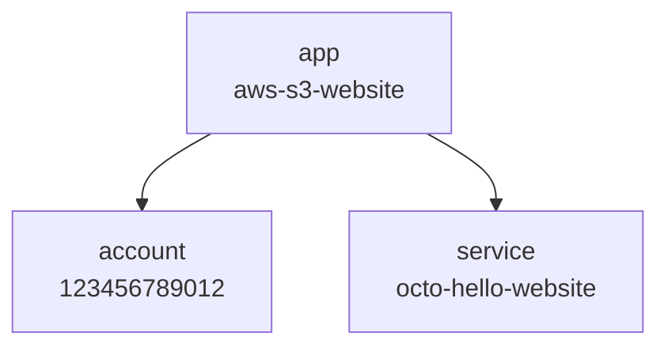

This page builds a static website and puts it on the internet. By the end you will have two HTML
pages served out of an S3 bucket, on a public URL you can open in a browser.

Three modules describe it, a module being one of the building blocks the
[introduction](/docs/introduction#building-blocks) described, packaged so it can be named in a file
and given inputs. These three:



An app to hold the other two together, the AWS account everything is created in, and the website
itself, which is a service.

:::info[Costs]
A bucket holding two small HTML files costs a fraction of a cent per month, and nothing at all under
the AWS free tier. The teardown at the end removes it.
:::

:::tip[Fun Fact]
This is the exact same mechanism through which this documentation website is hosted as well.
:::

## The scaffold

If you followed [Installation](/docs/getting-started/installation#creating-a-project), this project
already exists and you can skip the command. Otherwise it is one line, and the `-t` flag picks which
starting file you get:

```bash
npx @quadnix/octo-build create-app -t aws-s3-website -n hello-website
cd hello-website
```

What comes out is a small Node project. Two things in it matter here, the definition file and the
website:

```text
hello-website/
├── octo.yaml
├── package.json
├── ...
└── website/
    ├── error.html
    └── index.html
```

Two HTML files, and they are the website. The module points at that directory and uploads what it
finds there, so anything you add to it ships on the next run.

## What to change

Open `octo.yaml`. It is 60 lines, nearly all of them filled in by the template. Two values and a
profile are yours to set, and the rest of this section is what the template already wired up.

The `env` block at the top holds values the rest of the file refers to. It ships with a placeholder
account number and the bucket name `my-website-unique-bucket`, and both need replacing:

```yaml title="octo.yaml"
env:
  - key: AWS_ACCOUNT_ID
    kind: string
    value: "123456789012"     # your AWS account number
  - key: AWS_S3_WEBSITE_BUCKET_NAME
    kind: string
    value: octo-hello-website # your own name, not this one
```

S3 bucket names are unique across the whole of AWS rather than within your account, so the second
one has to be a name no other customer is using. Do not copy `octo-hello-website`; it is the name
this page was captured with, and it appears in every block below where yours goes.

The `terraform` block declares the provider Octo writes into every generated folder. If your
credentials live under a profile other than `default`, change `spec.profile`:

```yaml title="octo.yaml"
terraform:
  requiredVersion: "1.6.0"
  requiredProviders:
    aws:
      source: hashicorp/aws
  providers:
    - providerType: aws
      accountId: "${env.AWS_ACCOUNT_ID}"
      regionId: us-east-1
      spec:
        profile: default
```

`${env.AWS_ACCOUNT_ID}` reads the `env` block above. The value there is a default: an environment
variable of the same name in your shell wins over it, which is how one file works on a laptop and in
CI.

The `modules` block is the part that decides what gets built:

```yaml title="octo.yaml"
modules:
  - moduleId: app-module
    moduleClass: SimpleAppModule
    moduleInputs:
      name: aws-s3-website

  - moduleId: account-module
    moduleClass: AwsIniAccountModule
    moduleInputs:
      accountId: "${env.AWS_ACCOUNT_ID}"
      app: "${{app-module.model.app}}"

  - moduleId: s3-website-service-module
    moduleClass: AwsS3StaticWebsiteServiceModule
    moduleInputs:
      account: "${{account-module.model.account}}"
      awsRegionId: us-east-1
      bucketName: "${env.AWS_S3_WEBSITE_BUCKET_NAME}"
      directoryPath: website
```

The third module is where the work happens: `AwsS3StaticWebsiteServiceModule` produces every cloud
resource on this page. The first two name the application, whose name is yours to pick, and the AWS
account it deploys into, read from `~/.aws/credentials`, which is the `Ini` in the account module's
name. Each module is given what an earlier one made, and `${{...}}` is how: two
braces, a module ID, and what to take from it.

A `model` is an intent node, so that reference means
the app node `app-module` created, the top box in the diagram. The list is flat, and those
references are what make it the graph the introduction showed. [The Definition
File](/docs/using-octo/the-definition-file) has the full list of what can be referenced that way.

The AWS words in this block belong to the modules rather than to the app, account, and service they
produce, because a module is where a cloud gets chosen. A class name in `moduleClass` is bound to a
package by the `imports` block further up the file,
which the template filled in for these three. The [AWS Module
Catalog](/docs/reference/aws-module-catalog) lists the rest, and the inputs each one takes.
`directoryPath: website` is relative to where you run the commands, which is the project root.

To deploy somewhere other than `us-east-1`, change the region in two places, `regionId` in the
provider and `awsRegionId` in the module, because the first says where Terraform authenticates and
the second says where the bucket goes.

## The run

The four commands, in order, with one more in front of the last two:

```bash
npm run octo:generate
npm run octo:validate

LOCK_ID=$(npm run --silent octo:lock)
npm run octo:apply -- --lockId $LOCK_ID
npm run octo:commit -- --lockId $LOCK_ID
```

`octo lock` takes the app lock and prints its ID. Apply and commit are the two steps that write
shared state, so both require it, which is what stops two runs writing at once. The commit releases
it, so you take it once and never think about it again.

`generate` reads the definition file and writes Terraform. It needs no credentials, and touches
nothing outside your project. One folder comes out, because one of the three modules has cloud
resources to create:

```text
INFO: Started "generate" on "aws-s3-website".
INFO: Wrote 1 terragrunt folder(s) to ".octo-tf".
    written: [
      "s3-website-service-module"
    ]
INFO: Finished "generate" in 6ms.
```

`validate` plans that folder and reports the plan back against your intent. This is the first
command that reaches AWS: Terraform reads your credentials to produce a plan, and creates nothing.
The first run is slower than the timings below, because Terragrunt initializes the folder and
downloads the AWS provider before Terraform can plan.

```text
aws-s3-website — octo validate — changes (approximate)
2026-08-19 12:23:26 UTC · 3ms octo · 6.0s terraform

You added service=octo-hello-website-s3-static-website. That creates 6 new things.
- 0 destroy   ± 0 replace   + 6 create   ~ 0 update

WHAT WILL CHANGE
  + added service=octo-hello-website-s3-static-website  [service=octo-hello-website-s3-static-website,app=aws-s3-website | s3-website-service-module | +6]
      + bucket-octo-hello-website
          + aws_s3_bucket_policy.bucket-octo-hello-website_website_bucket_policy
          + aws_s3_bucket_public_access_block.bucket-octo-hello-website_website_bucket_public_access
          + aws_s3_bucket_website_configuration.bucket-octo-hello-website_website_bucket_config
          + aws_s3_bucket.bucket-octo-hello-website_website_bucket
          + aws_s3_object.bucket-octo-hello-website_file_errorhtml
          + aws_s3_object.bucket-octo-hello-website_file_indexhtml
```

The report has three levels. Outermost is the piece of intent you asked for, the website service,
followed in brackets by its identity, the module that produced it, and the number of Terraform
changes underneath it. Below that is one Octo resource, `bucket-octo-hello-website`, an Octo
resource being the unit Octo tracks and compares between runs. Below that again are the six
Terraform resources that build it. The top line names the request and the numbers count what the
request takes.

The names are derived from the inputs you gave, which is why the bucket name runs through all of
them, and why the service reads `octo-hello-website-s3-static-website` here while the diagram
above calls it by the bucket name alone.

Serving a public website from S3 takes all six: the bucket has to exist, be told which file is the
index and which is the error page, have its public access block opened, and carry a policy allowing
anonymous `s3:GetObject`. The order matters as well. Leave the public access block at its default
and AWS refuses the policy that comes after it, and the site answers 403 to everyone. That sequence
is what the module already knows.

It ends up in the generated folder as ordinary Terraform, in `depends_on`:

```hcl title=".octo-tf/s3-website-service-module/main.tf"
resource "aws_s3_bucket_website_configuration" "bucket-octo-hello-website_website_bucket_config" {
  provider = aws._123456789012-us-east-1
  bucket = aws_s3_bucket.bucket-octo-hello-website_website_bucket.id
  error_document {
    key = "error.html"
  }
  index_document {
    suffix = "index.html"
  }

  depends_on = [aws_s3_bucket.bucket-octo-hello-website_website_bucket]
}

resource "aws_s3_object" "bucket-octo-hello-website_file_indexhtml" {
  provider = aws._123456789012-us-east-1
  bucket = aws_s3_bucket.bucket-octo-hello-website_website_bucket.id
  content_type = "text/html"
  etag = filemd5("${var.OCTO_PROJECT_ROOT}/website/index.html")
  key = "index.html"
  source = "${var.OCTO_PROJECT_ROOT}/website/index.html"

  depends_on = [aws_s3_object.bucket-octo-hello-website_file_errorhtml]
}
```

The `provider` line names the provider from your `terraform` block, one per account and region, and
Octo writes it on every resource it generates. Terraform resources belonging to the same Octo
resource are chained with `depends_on` in the order the module declared them. For the bucket and its
settings that order is the required one; for the two files it only means one upload waits for the
other.

Those two files are the last two resources in the report, one `aws_s3_object` each, with
`content_type` looked up from the extension and `etag` a checksum of the file on disk. Add a
stylesheet and there are seven.

`var.OCTO_PROJECT_ROOT` is how a generated folder names a file on your disk without writing down a
path that only exists on your machine. Octo declares the variable in `variables.tf` and fills it in
when it runs Terragrunt, so the folder reads the same for everyone who checks it out.

`apply` creates them. It never stops to ask, because Terraform runs with `-auto-approve` underneath.
What scrolls past is Terragrunt's own output, resource by resource, and the command ends with
`==== Apply complete ====`; this stack takes under a minute, where one with a load balancer in it
takes several. The one time apply stops is when something would be destroyed, which is Octo's check
rather than Terraform's, and the teardown at the end of this page runs into it. If an apply stops
part way, fix what it complained about and run it again.

`commit` reads the outputs Terraform recorded and writes them into `.octo/`, where Octo keeps its
picture of your infrastructure. It is a separate command because apply is pure Terragrunt and knows
nothing about Octo, so reading the results back is a step of its own. Skip it and the next
`generate` plans against a world where none of this exists.

```text
WHAT OCTO RECORDED — values that moved
  @octo/s3-website=bucket-octo-hello-website Arn: - → arn:aws:s3:::octo-hello-website
  @octo/s3-website=bucket-octo-hello-website awsRegionId: - → us-east-1
```

`@octo/s3-website` is the type of the resource and `bucket-octo-hello-website` is its ID, the same
one the validate report grouped six Terraform resources under. Both values were unknown until AWS
answered.

## Open it

An S3 website endpoint address is the bucket name, the words `s3-website`, and
the region, so this bucket in `us-east-1` is:

```
http://octo-hello-website.s3-website-us-east-1.amazonaws.com
```

Ask for a path that does not exist and `error.html` comes back with a 404, which is what the
`error_document` in the generated Terraform bought you.

In another region the separator before the region may be a dot rather than a dash, because AWS
changed the form and kept the old one working for the regions that had it. The bucket's Properties
tab in the S3 console prints the exact endpoint.

This endpoint is HTTP only. S3 website hosting does not terminate TLS, so a real site needs
CloudFront in front of it. The module puts one there, and closes the bucket behind it, when you give
it a `cloudFront` input, which the [AWS Module Catalog](/docs/reference/aws-module-catalog)
describes. The certificate it serves is still yours to create.

## When it fails

Three things go wrong often enough to name, and each surfaces at a different step.

1. `validate` fails before it plans anything when the credentials are not there: the AWS provider
   cannot configure itself. Check `spec.profile` against `~/.aws/credentials`, and that
   `aws sts get-caller-identity --profile <the one you named>` prints the account number you put
   in `AWS_ACCOUNT_ID`. Without `--profile` that command reads your default profile, which is a
   different account from the one Octo is using.

2. `apply` fails when the bucket name is taken. A plan cannot know that, because names are checked
   at creation, so `validate` passes and AWS rejects the create with `BucketAlreadyExists`. Pick
   another name in `AWS_S3_WEBSITE_BUCKET_NAME` and run the cycle again from `generate`.

3. The site answers 403 to everyone, with the apply having succeeded, when S3 Block Public Access is
   turned on for the whole account. The module opens the block on its own bucket, and the
   account-level setting overrides it. It is a control an administrator turns on rather than a
   default, so it mostly shows up in company accounts, and if it is on for a reason, a bucket
   serving a public website is not the argument to reverse it.

## Change a page

Edit `website/index.html`, add a line, and run generate and validate again:

```html title="website/index.html"
<h1>Hello from hello-website</h1>
<p>Deployed with Octo.</p>
```

```text
You added service=octo-hello-website-s3-static-website. That updates 1 thing in place.
- 0 destroy   ± 0 replace   + 0 create   ~ 1 update

WHAT WILL CHANGE
  + added service=octo-hello-website-s3-static-website  [service=octo-hello-website-s3-static-website,app=aws-s3-website | s3-website-service-module | ~1]
      ~ bucket-octo-hello-website
          ~ aws_s3_object.bucket-octo-hello-website_file_indexhtml
              etag: 43d707bebe2010beda60ccf02d98b646 → 0115cb00cb5d5142657ee12ce20c0bad
```

One resource, one field, and the two checksums that differ. The bucket, the policy, the access
block, and the other file are left alone, because Octo compared the file it uploaded last time with
the file on disk now.

The heading still says `added` while nothing was added. A card heading reports whether a piece of
intent is present in your definition file, and the website service still is. What changed is on the
resource lines, marked `~`. [Reading a Validate
Report](/docs/using-octo/reading-a-validate-report) covers the markers in full.

```bash
LOCK_ID=$(npm run --silent octo:lock)
npm run octo:apply -- --lockId $LOCK_ID
npm run octo:commit -- --lockId $LOCK_ID
```

Reload the page and the new line is there.

## Tear it down

Removing infrastructure is the same cycle. Comment out the website module in `octo.yaml`, leaving
the app and account modules:

```yaml title="octo.yaml"
  #- moduleId: s3-website-service-module
  #  moduleClass: AwsS3StaticWebsiteServiceModule
  #  moduleInputs:
  #    account: "${{account-module.model.account}}"
  #    awsRegionId: us-east-1
  #    bucketName: "${env.AWS_S3_WEBSITE_BUCKET_NAME}"
  #    directoryPath: website
```

```bash
npm run octo:generate
npm run octo:validate

LOCK_ID=$(npm run --silent octo:lock)
npm run octo:apply -- --lockId $LOCK_ID --auto-approve
npm run octo:commit -- --lockId $LOCK_ID
```

`validate` is worth running here, because it says why each resource is going away. And `apply` needs
`--auto-approve` this time. Without it, an apply that would destroy anything stops and prints what
it was about to do:

```text
This apply would DESTROY:
  [s3-website-service-module] aws_s3_bucket_policy.bucket-octo-hello-website_website_bucket_policy (delete)
  [s3-website-service-module] aws_s3_bucket_public_access_block.bucket-octo-hello-website_website_bucket_public_access (delete)
  [s3-website-service-module] aws_s3_bucket_website_configuration.bucket-octo-hello-website_website_bucket_config (delete)
  [s3-website-service-module] aws_s3_bucket.bucket-octo-hello-website_website_bucket (delete)
  [s3-website-service-module] aws_s3_object.bucket-octo-hello-website_file_errorhtml (delete)
  [s3-website-service-module] aws_s3_object.bucket-octo-hello-website_file_indexhtml (delete)

Refusing to apply. Run "octo validate" to see why each of these is being destroyed, then re-run with --auto-approve to proceed.
```

The URL stops answering, and the commit at the end reports the module as one that no longer renders
anything:

```text
MODULES THAT NO LONGER RENDER ANYTHING
  s3-website-service-module
```

The destroy happened because that folder is still there with its Terraform emptied out: Terragrunt
applied a configuration declaring no resources, so everything the folder held was removed. The empty
folder is safe to delete by hand now. [Destroying
Infrastructure](/docs/using-octo/destroying-infrastructure) explains why Octo empties a folder
rather than deleting it.
