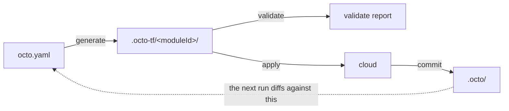

Working out what a change will do, and doing it, are usually the same command. Somebody types
`apply`, reads what scrolls past, and answers a prompt while the process holding the plan waits for
them. That works until the person who should read the plan is not the person at the keyboard, and
until an approval has to live somewhere other than a terminal session.

Octo splits the work into four commands, each its own process:

```bash
npm run octo:generate                       # 1. intent   -> terragrunt module folders
npm run octo:validate                       # 2. folders  -> a report against intent  (optional)

LOCK_ID=$(npm run --silent octo:lock)       # steps 3 and 4 write shared state
npm run octo:apply -- --lockId $LOCK_ID     # 3. folders  -> real infrastructure
npm run octo:commit -- --lockId $LOCK_ID    # 4. outputs  -> octo state, and the lock is released
```

Nothing reaches the cloud before step 3, the first two need no permission to change anything, and a
pipeline can put a human between any two of them.

Steps 3 and 4 are the two that write shared state, so both require the **app lock** — that is what
keeps two runs from writing at once. The commit releases it however it ends, so a run that completes
leaves nothing behind. [The app lock](/docs/reference/cli#the-app-lock) covers taking it, and
breaking one a dead run left behind.



The dotted line is the part that makes the cycle a cycle. Octo does not read your cloud account to
work out what exists; it reads what it recorded the last time it ran. The shop from [Shop
Stack](/docs/getting-started/shop-stack) is the example throughout: a region, a receipts bucket, and
a checkout server that can read and write it.

## Generate

```bash
octo generate -o .octo-tf
```

Generate reads the definition file, loads every module, and builds the model graph. It runs every
model action over that graph to work out which cloud resources your intent implies, compares that
set against the resources it recorded at the last commit, and writes one Terragrunt module folder
per Octo module: `main.tf`, `variables.tf`, `outputs.tf`, `terragrunt.hcl`.

The comparison happens between resources, not between models. Your intent is rebuilt from scratch on
every run rather than diffed, which is why the same folder comes out of the same definition file
whatever ran before it. [How Octo Works](/docs/fundamentals/how-octo-works) follows that path in
full.

It saves the model state, in `.octo/models.json`. Resource state is not saved here, because nothing
has been created yet.

Three things about how it writes, all of which matter the first time you delete something:

- Folders are overwritten in place, not wiped. `terraform.tfstate`, `.terragrunt-cache`, and any
  folder Octo does not recognize survive a regenerate.
- A module you removed from your intent has its folder emptied, keeping the Terraform block and the
  providers but no resources. An empty configuration is what makes the next apply destroy the
  infrastructure that folder holds.
- Octo never deletes a folder. Deleting it would orphan whatever is in its state file.

If a module's inputs fail validation, generate throws before writing anything. A graph that does not
hold together never becomes a folder.

## Validate

```bash
octo validate --terragruntDir .octo-tf
```

Validate runs `terraform plan` on every folder itself, so there is no separate plan step, and then
correlates each plan against Octo's own diff. It answers two questions, and keeps them apart:

- What will change, and why. Including Terraform changes Octo did not ask for directly but can
  attribute to something it did, such as a referenced resource whose identity moved.
- What changed that your intent does not explain. That is drift, and it means somebody edited
  infrastructure outside Octo.

Validate is a report rather than a verdict. Drift and unexplained changes are findings to act on,
not exit codes. The only thing that fails the command is being unable to read a plan at all.

The report carries a confidence level, and it changes how much the drift section is worth. [Reading
a Validate Report](/docs/using-octo/reading-a-validate-report) covers it before you rely on one.

## Apply

```bash
octo apply --terragruntDir .octo-tf --lockId $LOCK_ID
```

The only step that changes live infrastructure, and the only one that loads none of your modules. It
reads no model or resource state either — the definition file is opened only for the state provider,
because the app lock lives there and apply verifies it before planning, so a run without the lock
fails having done nothing.

It runs `terragrunt run --all -- apply` over the directory and streams the output as it goes, because
an ECS apply can run for tens of minutes and its progress is the only sign it is alive.

Terragrunt is given `-auto-approve`, so there is no prompt to answer. Octo puts its own gate in
front instead: apply plans first, and refuses to run if anything would be destroyed.

```text
This apply would DESTROY:
  [region-module] aws_internet_gateway.igw-eu-west-1 (delete)
  [receipts-module] aws_s3_bucket.bucket-shop-receipts (delete)

Refusing to apply. Run "octo validate" to see why each of these is being destroyed, then re-run with --auto-approve to proceed.
```

`--auto-approve` skips that check, and it is required for every destroy, including one you meant. If
a folder cannot be planned at all, apply also refuses, because it cannot say whether that folder
would destroy something and will not guess.

| Flag                        | Effect                                                |
|-----------------------------|-------------------------------------------------------|
| `--lockId <id>`             | The app lock, from `octo lock`. Required.             |
| `--auto-approve`            | Skip the destroy check. Required to destroy anything. |
| `--terraformBinary tofu`    | Sets `TG_TF_PATH`, so Terragrunt drives OpenTofu.     |
| `--terragruntBinary <path>` | Use a specific Terragrunt binary.                     |
| `--timeoutInMs <n>`         | Per-command timeout. The default is 60 minutes.       |

## Commit

```bash
octo commit --terragruntDir .octo-tf --lockId $LOCK_ID
```

Commit reads every folder's Terraform outputs and records them into Octo's state: each resource's
response, meaning the ARNs, generated IDs, and endpoints the provider handed back, along with the
resource graph and the mapping from each Octo resource to the Terraform addresses that render it.

It is also the step that ends a run, so it **releases the app lock** — on a clean commit, and on one
that throws.

It is all or nothing. If an expected output is missing, which is what a partial apply looks like,
commit throws before touching state rather than writing half a record. Re-running a commit that
failed is safe. Outputs for a folder Octo does not track are ignored and reported as a warning.

When the apply itself failed, `--partial` is the way through: it records every resource whose
outputs did resolve and leaves the rest out, so the half that was built is not lost. What it skips
comes back as warnings.

:::warning[Do not skip it]
Without a commit, the next run has no record that any of this exists, and will propose creating all
of it again. Commit is also what runs the delete action of an [external
resource](/docs/building-modules/create-an-external-resource), because Terraform cannot: by the time
it would, the resource's configuration is already gone.
:::

## What each step touches

|            | Cloud         | Model state | Resource state | Generated folders | App lock           |
|------------|---------------|-------------|----------------|-------------------|--------------------|
| `generate` |               | writes      |                | writes            |                    |
| `validate` | reads a plan  |             |                | reads             |                    |
| `apply`    | **writes**    |             |                | reads             | requires           |
| `commit`   | reads outputs | writes      | writes         | reads             | requires, releases |

Generate is the only step that runs without credentials of any kind. Apply is the only one that does
not load your modules; the other three boot Octo and will fail on a definition file whose imports do
not resolve.

Generate writes model state, but only into your own working copy's state directory — it is
bookkeeping about the folders it just wrote, so that a module you delete before ever applying it
still gets its folder emptied. That is why it needs no lock.

## In a pipeline

The split is what makes gating possible. A pull-request job runs the two read-only steps and
publishes the report. A merge job, after somebody has read it, applies.

```yaml
# On a pull request. No credentials that can change anything, and no lock.
- run: npm run octo:generate
- run: npm run octo:validate

# On merge to main, after a human approved the report above.
- run: npm run octo:generate
- run: |
    LOCK_ID=$(npm run --silent octo:lock)
    echo "LOCK_ID=$LOCK_ID" >> $GITHUB_ENV
- run: npm run octo:apply -- --lockId $LOCK_ID
- run: npm run octo:commit -- --lockId $LOCK_ID
```

Regenerate on the merge job rather than carrying the folders over from the pull-request job.
Generate is deterministic and takes milliseconds, and doing it again guarantees the folders match
the definition file that was actually merged. [GitHub Actions
Pipeline](/docs/techniques/github-actions-pipeline) has the complete workflow, including where the
state directory has to live for any of this to be safe.

## The command you never run

`octo run-action` exists, and is not part of the cycle. Terraform invokes it mid-apply for [external
resources](/docs/building-modules/create-an-external-resource), the ones whose lifecycle Terraform
does not manage. `octo apply` prepares what that callback needs, so it works whether you use the npm
scripts or call the binary directly.
