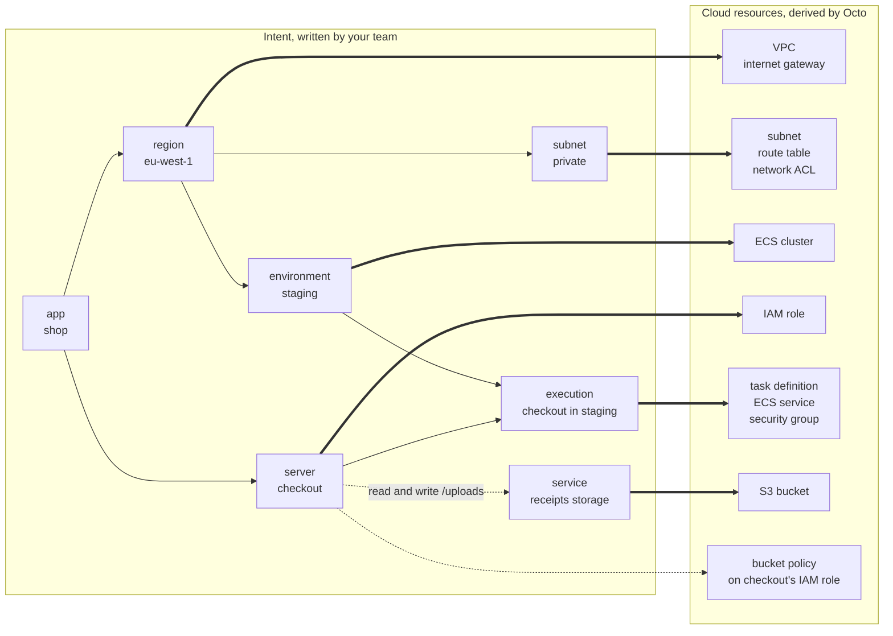

Infrastructure is written today with tools like Terraform and the cloud vendors' own CDKs, and they
are good at the job they set out to do: capture a cloud account exactly, one resource at a time.
What comes out of that is an inventory of cloud primitives. Reading it tells you that eleven subnets
and forty roles exist. It does not tell you that six of them are there for the checkout service, and
anyone outside the infrastructure team is left to work that out on their own.

Octo is an infrastructure-as-code framework that turns the description around. You write intent: an
application, the accounts and regions it runs in, its environments, the servers and services it
needs, and how those relate to each other. Cloud resources are encapsulated behind those words, so
what you maintain lines up with how you already talk about your services, and the infrastructure a
service depends on stays attached to that service.

From that intent Octo derives the cloud resources required, writes the Terraform for them, and
leaves the applying to the toolchain your team already runs. It replaces nothing in that toolchain.
It adds the layer above, where infrastructure decisions are made and recorded.

## Philosophy

Every line in an infrastructure repository follows from a decision that was never written down. The
address range is split into four because there are two regions and each one needs a public and a
private half. The security group exists because the checkout service calls the cache. The container
has a 2 GB memory limit because a load test showed it needed one. The code holds each consequence
and none of the reasons, so the next person to touch a line reconstructs the reason before they can
safely change it.

Octo is built on the idea that a model made of infrastructure components, being applications,
accounts, regions, environments, servers, and services, is more useful and lasts longer than one
made of cloud components such as virtual networks, subnets, security groups, and task definitions.
Teams already use the first model when they talk to each other. Octo makes it the thing you write
down, and derives the second model from it.

## Intent

A change to infrastructure usually starts as a sentence.

> Checkout needs somewhere to keep uploaded receipts, and only checkout should be able to read them.

Somebody translates that into a bucket, a role, a policy, and the wiring between them, and commits
the translation. The sentence stays in the ticket. Two years later the policy is in the repository
and nobody can say which service depends on it, and a plan creating nine resources is approved
because one of them has the word receipts in its name.

That sentence is intent, and in Octo it is what you write and keep. Octo records which resources
came from which request, so the bucket, the role, and the policy are listed under the request that
required them, and any one of them can be traced back to it. Intent also outlives what it produces.
Providers rename things, a service moves from virtual machines to containers, a storage class
changes, and checkout still needs somewhere to keep receipts.

## An example

Here is a small piece of an Octo project. The left column is written by hand. The right column is
what Octo derives from it.

Two things in that picture matter. The word AWS appears nowhere on the left: no VPC, no ECS
cluster, no bucket. And the dotted line, one line of intent saying checkout reads and writes a
directory, is the only reason the bucket policy on the right exists. Nobody wrote a policy document.
They stated a relationship, and the module that owns servers worked out what that requires.

## The context gap

Every box on the right of that diagram is somebody's decision. Which address range the VPC gets, why
the network ACL denies what it denies, whether staging shares an ECS cluster with production, which
role a policy may be attached to. In most companies one group holds all of it, along with the
history of which choices were made for an audit and which are safe to revisit.

Without the left column, everyone else works in the right column anyway. Adding receipts storage to
checkout means finding another service that already has a bucket, copying it, changing the names,
guessing which role the policy belongs on, and then reading a plan that mentions a bucket, a policy
document, and a role attachment, none of which are labelled checkout. The developer cannot check
their own work, and the reviewer is checking a translation rather than a request.

Intent gives both sides one file. The developer writes and reviews on the left, in terms they can
judge without opening a cloud console. The platform team owns the right, which is where their
knowledge of accounts, networks, and audits belongs. Neither side has to hold both columns at once.

## Building blocks

The two columns of that diagram have names. What you write on the left are **models**: the app, the
region, the server, the service, and the relationships between them. What Octo derives on the right
are **resources**: the VPC, the ECS cluster, the S3 bucket. Each arrow crossing between the two is a
**module**, and a module is a self-contained answer to one question. What a region is made of. What
a server is. What it takes to serve a static website. The module that owns regions in this picture
decided that a region is a VPC and an internet gateway, and that subnets are declared separately. A
different module could decide that a region spreads across three availability zones with a NAT
gateway in each.

Every company answers those questions today inside its own repository, where the answer is mixed in
with everything around it. A team that has settled what a region means has it spread over a folder
of Terraform: the VPC carries their naming convention, the address ranges are the ones their network
already uses, and the outputs are named for the modules that read them downstream. Another team
cannot take that folder without taking those decisions with it.

A module keeps one answer in one place, with the inputs it needs and the outputs it publishes
declared, which is what makes it usable by a project that did not write it. Octo ships a library of
modules for AWS to start from, and a team writes their own when the published answer is not the one
they want.

Each module declares what it needs and what it provides, so a combination gets checked before
anything is created. Handing the server module a region that publishes no subnets fails with a
message naming the input that was wrong, rather than halfway through an apply with a half-built
stack. Because modules are separable, swapping the region module changes the right column of the
diagram and leaves the left column exactly as it was.

## Beyond one cloud

Terraform code names its provider on every line: the resource types, the argument names, and the
module inputs are all specific to one cloud. That is what makes moving or mixing providers a rewrite
rather than a decision.

In the diagram, the provider only appears on the right. Intent names a region, a server, and a
storage service, and the modules underneath decide that those mean a VPC, an ECS task, and an S3
bucket. A different set of modules can decide otherwise.

So what you change when you move provider is which modules your project includes. The models stay as
they are, with the same names, the same relationships, and the same history, because nothing in them
said AWS in the first place. The servers can run on one provider and the storage on another for the
same reason: they are separate modules, and each one answers for its own half.

That has two costs. Somebody has to have written the modules for the provider you are moving to,
and the library we publish today covers AWS. And infrastructure that already exists still has to be
migrated: Octo tells you what will be created, replaced, and destroyed, and does not sequence that
move for you.

## The graph

Octo is built on a graph, and the pictures on this page are that graph rather than illustrations
drawn to explain it. Every model is a node, every relationship between two models is an edge, and
the resources derived from a model hang off it. Working out what a change does is a comparison of
two graphs: the one your project describes now, against the one Octo stored the last time you ran
it. Everything downstream, the Terraform it writes and the report it prints, comes out of that
comparison.

The graph is useful after the deploy as well. Architecture diagrams are usually drawn by hand and
go out of date; this one is generated from the infrastructure that exists. A question like which
services can write to the receipts bucket is answered by following an edge. A change reads as one
line, checkout gained read and write access to receipts, with the bucket policy underneath it,
rather than as nine resource diffs in a plan.

That last one matters more as more of the code is written by AI. Writing Terraform is not the part
AI finds hard; the cost lands on the person who has to review what comes back, which can be two
hundred changed resources for a request that was one sentence. Reviewed as intent, the same change
is the sentence and its consequences, with the resource diffs underneath for whoever wants them.
