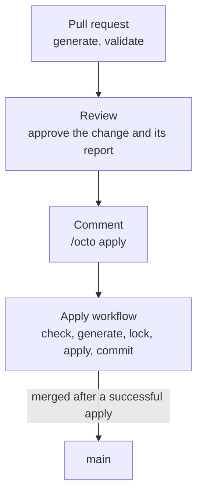

Octo keeps one record of what your infrastructure is, and that record has room for one writer at a
time. On a laptop that is fine: there is one of you, and you are watching the terminal. In a
repository several people work in, it is not. One person adds an order queue to the
[shop](/docs/getting-started/shop-stack) while another changes its checkout server, and whichever
applies second is planning against a record the first has already moved.

The pipeline below gives every change one path to the cloud: it is planned on its pull request,
applied from that pull request when somebody asks, and merged only once the apply succeeded. So
`main` never describes infrastructure that does not exist.

## The shape



Two workflows, and each one has a job the other cannot do.

The **plan workflow** runs `generate` and `validate` on every push to a pull request, and the report
is in its log. It writes nothing anywhere, so it runs with credentials that can only read.

The **apply workflow** runs when somebody comments `/octo apply` on an approved pull request. It
checks the pull request is up to date with `main`, applies it, and merges it. A concurrency group
keeps two of them from overlapping, and the app lock keeps anything else out while one runs.

Applying before merging is what keeps `main` truthful. A change merged first and applied second
leaves `main` describing infrastructure that may never have been built, and nothing points at the
gap. Applying first has the opposite failure, a pull request that applied and then never merged,
and that one shows up in the next report as changes nobody asked for.

## State

State lives in [remote state](/docs/techniques/state-providers#remote-state), where every runner
reads the same record and takes the same lock, and a runner that dies leaves both behind for
somebody to finish. Nothing is committed back to the repository, so add `.octo/` to `.gitignore`.

```yaml title="octo.yaml"
env:
  - key: OCTO_SESSION
    kind: string
    value: ""                          # a personal access token, supplied by the shell
  - key: OCTO_LOCK_CONTEXT
    kind: string
    value: "octo, run by hand"         # the pipeline supplies its run's URL

settings:
  stateProvider:
    type: RemoteStateProvider
    stateManagementServiceUrl: https://state.example.com/state   # your backend's address
    organizationId: shop-organization
    appId: shop
    sessionId: "${env.OCTO_SESSION}"
    lockContext: "${env.OCTO_LOCK_CONTEXT}"
    statePath: .octo
```

Create a personal access token for the account the pipeline acts as, and store it as a repository
secret named `OCTO_SESSION`. Both workflows hand it to every step. The apply workflow also sets
`OCTO_LOCK_CONTEXT` to the URL of its own run, so a lock it holds names the run that took it.

## 1. The rules

In the repository's **Settings**, under **Rules**, add a ruleset targeting `main` with these turned
on:

- **Restrict deletions** and **Block force pushes**.
- **Restrict updates**, so nothing reaches `main` except through the apply workflow. Add the
  identity from step 4 to the ruleset's **Bypass list**.
- **Require a pull request before merging**, with at least one approval, and with **Dismiss stale
  pull request approvals when new commits are pushed** ticked. An approval is an approval of one
  report, and a new push produces a new one.
- **Require status checks to pass**, with `Generate & Validate` added. That is the job name from
  step 2.

## 2. Pull requests

```yaml title=".github/workflows/octo-plan.yml"
name: Octo Plan

on:
  pull_request:
    branches: [ main ]

jobs:
  plan:
    name: Generate & Validate
    runs-on: ubuntu-latest
    permissions:
      contents: read
      id-token: write        # for OIDC role assumption
    env:
      AWS_ACCOUNT_ID: ${{ secrets.AWS_ACCOUNT_ID }}
      OCTO_SESSION: ${{ secrets.OCTO_SESSION }}
    steps:
      - uses: actions/checkout@v4

      - uses: actions/setup-node@v4
        with:
          node-version: 22
          cache: npm

      - uses: hashicorp/setup-terraform@v3
        with:
          terraform_version: 1.6.0
          terraform_wrapper: false      # the wrapper intercepts stdout

      - name: Install Terragrunt
        run: |
          curl -sSL https://github.com/gruntwork-io/terragrunt/releases/download/v1.0.8/terragrunt_linux_amd64.tar.gz | tar -xz
          sudo install -m 0755 terragrunt_linux_amd64 /usr/local/bin/terragrunt
          terragrunt --version

      - uses: aws-actions/configure-aws-credentials@v4
        with:
          aws-region: eu-west-1
          role-to-assume: ${{ secrets.AWS_PLAN_ROLE_ARN }}   # read-only

      - run: npm ci
      - run: npm run build            # only if the project holds modules of its own

      - name: Generate
        run: npm run octo:generate

      - name: Validate
        run: npm run octo:validate
```

Four things about that are easy to get wrong.

`terraform_wrapper: false` matters, because the wrapper intercepts stdout and Octo reads Terraform's
JSON output from there.

Credentials are needed even to plan. `octo validate` runs a real `terraform plan` against a real
provider, so the job needs a role. Give it one that can only read.

`generate` reads the newest state the backend holds before it plans, so the report is against what
exists now, not against whatever was on the branch when it was cut.

Terragrunt is installed by hand because the action Gruntwork publishes for it runs in a container,
which leaves nothing on the runner for the steps below to call. Expect a run to download a few
hundred megabytes of tooling and cache none of it.

## 3. Applying

```yaml title=".github/workflows/octo-apply.yml"
name: Octo Apply

on:
  issue_comment:
    types: [ created ]

# One apply at a time. `cancel-in-progress: false` lets a run finish rather than killing it.
concurrency:
  group: octo-apply
  cancel-in-progress: false

jobs:
  apply:
    name: Apply & Merge
    # A comment on a pull request, starting with the command, from somebody who can write here.
    if: >-
      github.event.issue.pull_request &&
      startsWith(github.event.comment.body, '/octo apply') &&
      contains(fromJSON('["OWNER", "MEMBER", "COLLABORATOR"]'), github.event.comment.author_association)
    runs-on: ubuntu-latest
    permissions:
      contents: read
      id-token: write
      pull-requests: write
    env:
      AWS_ACCOUNT_ID: ${{ secrets.AWS_ACCOUNT_ID }}
      GH_TOKEN: ${{ github.token }}
      OCTO_LOCK_CONTEXT: ${{ github.server_url }}/${{ github.repository }}/actions/runs/${{ github.run_id }}
      OCTO_SESSION: ${{ secrets.OCTO_SESSION }}
      PR_NUMBER: ${{ github.event.issue.number }}
      REPOSITORY: ${{ github.repository }}
    steps:
      # Refuse a fork, an unapproved change, and a branch that is behind `main`.
      - name: Check the pull request
        id: pr
        run: |
          PR=$(gh api "repos/$REPOSITORY/pulls/$PR_NUMBER")
          HEAD_SHA=$(echo "$PR" | jq -r .head.sha)

          if [ "$(echo "$PR" | jq -r .head.repo.full_name)" != "$REPOSITORY" ]; then
            echo "A pull request from a fork is never applied."
            exit 1
          fi
          if [ "$(gh pr view "$PR_NUMBER" --repo "$REPOSITORY" --json reviewDecision --jq .reviewDecision)" != "APPROVED" ]; then
            echo "The pull request is not approved."
            exit 1
          fi
          BEHIND=$(gh api "repos/$REPOSITORY/compare/main...$HEAD_SHA" --jq .behind_by)
          if [ "$BEHIND" != "0" ]; then
            echo "The pull request is $BEHIND commit(s) behind main. Update it, and comment again once it is approved."
            exit 1
          fi

          echo "head_sha=$HEAD_SHA" >> "$GITHUB_OUTPUT"

      - uses: actions/checkout@v4
        with:
          ref: ${{ steps.pr.outputs.head_sha }}

      - uses: actions/setup-node@v4
        with:
          node-version: 22
          cache: npm

      - uses: hashicorp/setup-terraform@v3
        with:
          terraform_version: 1.6.0
          terraform_wrapper: false

      - name: Install Terragrunt
        run: |
          curl -sSL https://github.com/gruntwork-io/terragrunt/releases/download/v1.0.8/terragrunt_linux_amd64.tar.gz | tar -xz
          sudo install -m 0755 terragrunt_linux_amd64 /usr/local/bin/terragrunt
          terragrunt --version

      - uses: aws-actions/configure-aws-credentials@v4
        with:
          aws-region: eu-west-1
          role-to-assume: ${{ secrets.AWS_APPLY_ROLE_ARN }}   # can create and change things

      - run: npm ci
      - run: npm run build            # only if the project holds modules of its own

      - name: Generate
        run: npm run octo:generate

      - name: Lock
        id: lock
        run: |
          LOCK_ID=$(npm run --silent octo:lock)
          echo "LOCK_ID=$LOCK_ID" >> "$GITHUB_ENV"

      # `continue-on-error` so the steps after this one still run. The last step turns a failed
      # apply back into a failed job.
      - name: Apply
        id: apply
        continue-on-error: true
        env:
          COMMENT: ${{ github.event.comment.body }}
        run: |
          if [ "$(echo "$COMMENT" | head -n 1 | tr -d '\r')" = "/octo apply --auto-approve" ]; then
            npm run octo:apply -- --lockId "$LOCK_ID" --auto-approve
          else
            npm run octo:apply -- --lockId "$LOCK_ID"
          fi

      # `--partial` records the resources that did apply and leaves the ones with missing outputs
      # alone, so a half-finished apply still leaves a usable record behind.
      - name: Commit
        id: commit
        if: ${{ !cancelled() && steps.lock.outcome == 'success' }}
        run: |
          if [ "${{ steps.apply.outcome }}" = "success" ]; then
            npm run octo:commit -- --lockId "$LOCK_ID"
          else
            npm run octo:commit -- --lockId "$LOCK_ID" --partial
          fi

      # A commit that fails keeps the lock. This runner cannot fix it, so finish the run as it
      # stands: Terraform's record of what was built is already saved.
      - name: Release the lock
        if: ${{ !cancelled() && steps.commit.outcome == 'failure' }}
        run: npm run octo:unlock -- --lockId "$LOCK_ID"

      - name: Merge
        id: merge
        if: ${{ steps.apply.outcome == 'success' && steps.commit.outcome == 'success' }}
        env:
          GH_TOKEN: ${{ secrets.OCTO_MERGE_TOKEN }}   # see step 4
        run: |
          gh pr merge "$PR_NUMBER" --repo "$REPOSITORY" --squash \
            --match-head-commit "${{ steps.pr.outputs.head_sha }}"

      - name: Report back
        if: ${{ !cancelled() }}
        run: |
          if [ "${{ steps.merge.outcome }}" = "success" ]; then
            BODY="Applied and merged. $OCTO_LOCK_CONTEXT"
          else
            BODY="Not merged. The run says why: $OCTO_LOCK_CONTEXT"
          fi
          gh pr comment "$PR_NUMBER" --repo "$REPOSITORY" --body "$BODY"

      - name: Fail the run if apply failed
        if: steps.apply.outcome != 'success'
        run: exit 1
```

The `--` in front of `--lockId` is npm's, and belongs only to npm. `pnpm run` hands it to the script
instead of consuming it, and it then terminates the CLI's own options, so the flag behind it is
parsed as a positional and silently ignored: `octo apply` fails asking for the lock id it was just
given. On pnpm the separator comes out: `pnpm run octo:apply --lockId "$LOCK_ID"`.

A comment workflow always runs the copy of itself that is on `main`, never the one on the branch it
was asked to apply, so a pull request cannot change the checks it is about to go through. The checks
are why it is safe to hand the branch's code credentials that can change your infrastructure: only
somebody who can write to the repository can ask, a fork is never applied, and the change has been
approved.

The branch has to be up to date with `main`, and the check refuses it otherwise. Another change may
have been applied since this one was planned, and it is in `main`'s definition file and not in this
branch's. A branch that is behind would plan against the new state without that change, and read
it as something to destroy. Updating the branch runs the plan workflow again, which dismisses the
old approval, so a reviewer approves the report as it now stands before anybody comments again.

Generate runs again here, instead of trusting the folders committed on the branch, because the state
may have moved since the pull request was planned. Generate is deterministic and takes
milliseconds, and `octo lock` refuses outright if the state moves between the two.

Do not cancel a run of this workflow. The lock and everything the run saved are in the backend, so
a cancelled run is recoverable, but it holds the lock until somebody finishes it, and until then no
other change can apply.

## 4. The merge identity

`main` is closed to everything except the bypass list now, so the workflow needs an identity that
is on it to merge.

Create a fine-grained personal access token, or an installation token for a GitHub App you own, with
**Contents** and **Pull requests** read and write on the repository. Store it as the
`OCTO_MERGE_TOKEN` secret, and add that identity to the **Bypass list** on the ruleset from step 1.
Only the merge step uses it; every other step runs as the workflow's own token.

## When apply fails

The run records what it managed to build, releases the lock, does not merge, and says so on the
pull request. The pull request is now ahead of `main`: part of it exists in the cloud, and `main`
does not describe it yet.

Finish it on the same pull request. Push the fix, wait for the new report, get it approved, and
comment `/octo apply` again. The folders that applied come back with nothing to change, and the
failed one runs again.

If the change is abandoned instead, close the pull request. What it built stays until an apply
removes it, and the next pull request's report shows those resources as destroys, so that apply
needs `/octo apply --auto-approve` once somebody has read the list.

## When a run dies

A run cancelled part way, or on a runner that died, leaves its lock held in the backend, and the
next `/octo apply` fails at the lock step, naming the run that holds it. Everything it saved is in
the backend with the lock, so nothing it recorded is lost, but nobody can apply until the run is
finished.

[Recovering a Failed Run](/docs/using-octo/recovering-a-failed-run#with-remote-state) has the steps:
from your own machine, at the pull request's head commit, as an organization administrator or with
the pipeline's token, resume the lock and apply and commit through it. Then comment `/octo apply`
on the pull request again. The apply finds nothing left to change, and the run merges it.

## Destroying

`octo apply` refuses to run when the plan would
[destroy](/docs/using-octo/destroying-infrastructure) anything, so a pull request that removes a
service fails its apply and prints what would go. A destroy is the one change this pipeline does
not make on its own.

Read the list, and when it is what you meant, comment `/octo apply --auto-approve` instead. That
passes `--auto-approve`, which skips the destroy check for that run only.

## Several deployments

A deployment that must not share state with another is a separate definition file naming its own
app in the backend, with its own output directory, its own concurrency group, and its own copy of
the apply workflow listening for its own command, such as `/octo apply prod`. The `octo:*` scripts
a new project ships with have `octo.yaml` and `.octo-tf` built into them, so a second deployment
calls the CLI directly:

```yaml
concurrency:
  group: octo-apply-prod      # its own group, so production never waits on the default
  cancel-in-progress: false

# ...

      - name: Apply production
        env:
          OCTO_DEFINITION_FILE_PATH: octo.prod.yaml
          AWS_ACCOUNT_ID: ${{ secrets.AWS_PROD_ACCOUNT_ID }}
        run: |
          node_modules/.bin/octo generate -o .octo-tf-prod
          LOCK_ID=$(node_modules/.bin/octo lock)

          # A run that reached the apply always ends in a commit, the same way the apply workflow
          # above does. Testing the apply rather than letting it end the step is what makes that
          # possible in a single `run` block.
          if node_modules/.bin/octo apply --terragruntDir .octo-tf-prod --lockId "$LOCK_ID"; then
            node_modules/.bin/octo commit --terragruntDir .octo-tf-prod --lockId "$LOCK_ID"
          else
            node_modules/.bin/octo commit --terragruntDir .octo-tf-prod --lockId "$LOCK_ID" --partial
            exit 1
          fi
```

Every deployment ends in a commit, whatever the apply did, because `commit` is what writes down what
was built and what releases the lock. `--partial` is for the apply that failed: it drops the check
that every declared output came back, which is safe only once the apply is already known to be
incomplete. A successful apply commits without it, so an output that never arrived is still an
error rather than a warning.
