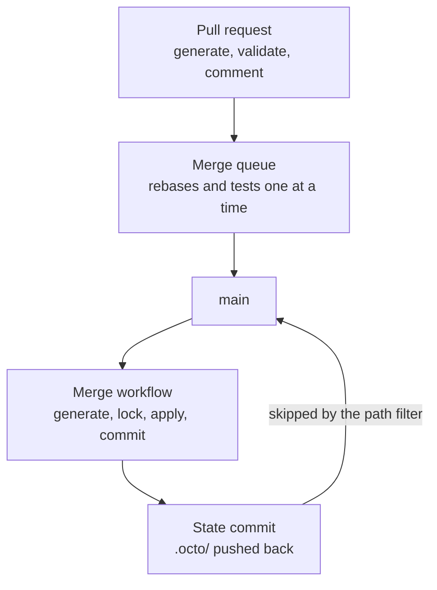

Octo keeps one record of what your infrastructure is, in the files under `.octo/`, and that record
has room for one writer. On a laptop that is fine: there is one of you, and you are watching the
terminal. In a repository several people work in, it is not. One person adds an order queue to the
[shop](/docs/getting-started/shop-stack) while another changes its checkout server, the two applies
overlap, and the record is left describing something the cloud no longer holds. Nothing warns anyone
at the time. The next plan does, by offering to build things that already exist.

The pipeline below removes the overlap instead of detecting it: every apply happens in one place,
one at a time.

## The shape



Three parts, and each one has a job the other two cannot do.

The **pull request workflow** runs `generate` and `validate` and posts the result as a comment. It
writes nothing anywhere, so it runs with credentials that can only read.

The **merge queue** is GitHub's own feature. You press "Merge when ready" and forget about it.
GitHub puts your pull request in a line behind the ones already waiting, rebases it onto them, runs
its checks again, and merges it when its turn arrives. Nobody has to click "Update branch" and wait
for the checks a second time.

The **merge workflow** runs on `main` and does the work that changes things: generate, lock, apply,
commit, then push the updated `.octo/` back. A concurrency group keeps two of them from overlapping.

State lives in the repository, so it has to be encrypted. The project uses
[`LocalEncryptionStateProvider`](/docs/techniques/state-providers), with the key in a repository
secret named `OCTO_STATE_ENCRYPTION_KEY`, and both workflows hand it to every step:

```yaml title="octo.yaml"
env:
  - key: OCTO_STATE_ENCRYPTION_KEY
    kind: string
    value: ""        # supplied by the shell, never written here

settings:
  stateProvider:
    type: LocalEncryptionStateProvider
    encryptionKey: "${env.OCTO_STATE_ENCRYPTION_KEY}"
    statePath: .octo
```

## Merge and forget

It is safe to walk away because nothing in the run replays a decision taken earlier. The merge
workflow generates from the [definition file](/docs/using-octo/the-definition-file) at the commit it
is sitting on, and applies the folders that came out of it. An apply started from the tip of `main`
therefore covers everything merged up to that moment, including whatever landed while an earlier
apply was still running. The end state follows `main`, whatever order things arrived in, so no merge
order can leave you somewhere `main` does not describe.

One limit comes with that, and your team needs to know it. The report on a pull request is computed
against `main` as the queue found it, which is before the previous merge's apply finished writing
state, so on a busy day it can differ from what the merge workflow ends up doing. What actually
happened is in the merge workflow's own report, which the same listener writes.

## 1. The queue

In the repository's **Settings**, under **Rules**, add a ruleset targeting `main` with four rules
turned on:

- **Restrict deletions** and **Block force pushes**.
- **Require a pull request before merging.**
- **Require status checks to pass**, with `Generate & Validate` added. That is the job name from
  step 2.
- **Require merge queue.** Set the merge method to squash, and set the maximum pull requests to
  build to `1`, so the queue tests and merges one entry at a time.

One detail decides whether the queue works at all. A queued pull request is tested on a branch
GitHub builds for it, and that produces a `merge_group` event rather than a `pull_request` event. A
required check that only triggers on `pull_request` is never reported for the merge group, and the
entry sits in the queue until it times out. The workflow in step 2 triggers on both.

## 2. Pull requests

```yaml title=".github/workflows/octo-plan.yml"
name: Octo Plan

on:
  pull_request:
    branches: [ main ]
  # Required. Without this the merge queue waits forever for the check below.
  merge_group:

jobs:
  plan:
    name: Generate & Validate
    runs-on: ubuntu-latest
    permissions:
      contents: read
      id-token: write        # for OIDC role assumption
      pull-requests: write   # to comment the report
    env:
      AWS_ACCOUNT_ID: ${{ secrets.AWS_ACCOUNT_ID }}
      OCTO_STATE_ENCRYPTION_KEY: ${{ secrets.OCTO_STATE_ENCRYPTION_KEY }}
    steps:
      - uses: actions/checkout@v4

      - uses: actions/setup-node@v4
        with:
          node-version: 22
          cache: npm

      - uses: hashicorp/setup-terraform@v3
        with:
          terraform_version: 1.6.0
          terraform_wrapper: false      # the wrapper intercepts stdout

      - name: Install Terragrunt
        run: |
          curl -sSL https://github.com/gruntwork-io/terragrunt/releases/download/v1.0.8/terragrunt_linux_amd64.tar.gz | tar -xz
          sudo install -m 0755 terragrunt_linux_amd64 /usr/local/bin/terragrunt
          terragrunt --version

      - uses: aws-actions/configure-aws-credentials@v4
        with:
          aws-region: eu-west-1
          role-to-assume: ${{ secrets.AWS_PLAN_ROLE_ARN }}   # read-only

      - run: npm ci
      - run: npm run build            # only if the project holds modules of its own

      - name: Generate
        run: npm run octo:generate

      - name: Validate
        run: npm run octo:validate

      - name: Comment the report
        if: always() && github.event_name == 'pull_request'
        uses: actions/github-script@v7
        with:
          script: |
            const fs = require('fs');
            const dir = '.octo/reports';
            const latest = fs.readdirSync(dir)
              .filter((f) => f.endsWith('-validate.json'))
              .sort()
              .pop();
            const report = JSON.parse(fs.readFileSync(`${dir}/${latest}`, 'utf8'));
            const t = report.totals;
            const body = [
              `### Octo plan, \`${report.confidence}\` confidence`,
              '',
              report.headline,
              '',
              `\`- ${t.delete} destroy\`  \`± ${t.recreate} replace\`  \`+ ${t.create} create\`  \`~ ${t.update} update\``,
              report.drift.length > 0
                ? `\n⚠️ **${report.drift.length} drift**, infrastructure changed outside Octo.`
                : '',
            ].join('\n');
            await github.rest.issues.createComment({
              body,
              issue_number: context.issue.number,
              owner: context.repo.owner,
              repo: context.repo.repo,
            });
```

Four things about that are easy to get wrong.

`terraform_wrapper: false` matters, because the wrapper intercepts stdout and Octo reads Terraform's
JSON output from there.

Credentials are needed even to plan. `octo validate` runs a real `terraform plan` against a real
provider, so the job needs a role. Give it one that can only read.

The comment step is guarded on the event. A merge group has no pull request attached, so
`context.issue.number` is undefined there and the call would fail.

The [HTML report listener](/docs/using-octo/reading-a-validate-report#the-html-report) is what
writes the JSON the script reads. Register it in `octo.yaml` or there will be no
`.octo/reports/` directory to look in.

Terragrunt is installed by hand because the action Gruntwork publishes for it runs in a container,
which leaves nothing on the runner for the steps below to call. Expect a run to download a few
hundred megabytes of tooling and cache none of it.

## 3. Merges

```yaml title=".github/workflows/octo-apply.yml"
name: Octo Apply

on:
  push:
    branches: [ main ]
    # The state commit at the end of this workflow touches nothing but `.octo/`, so this filter is
    # what stops that commit starting another run. Keep the commit to that one path.
    paths-ignore: [ '.octo/**' ]
  workflow_dispatch:
    inputs:
      autoApprove:
        description: 'Allow this run to destroy resources'
        default: false
        type: boolean

# One apply at a time. `cancel-in-progress: false` lets a run finish rather than killing it. A run
# still waiting when a newer one arrives is dropped, which costs nothing: the newer one generates
# from the tip of `main` and covers the dropped change as well.
concurrency:
  group: octo-apply
  cancel-in-progress: false

jobs:
  apply:
    name: Apply & Commit
    runs-on: ubuntu-latest
    permissions:
      contents: write
      id-token: write
    env:
      AWS_ACCOUNT_ID: ${{ secrets.AWS_ACCOUNT_ID }}
      OCTO_STATE_ENCRYPTION_KEY: ${{ secrets.OCTO_STATE_ENCRYPTION_KEY }}
    steps:
      - uses: actions/checkout@v4
        with:
          token: ${{ secrets.OCTO_PUSH_TOKEN }}   # see step 4
          fetch-depth: 0                          # the rebase below needs real history

      - uses: actions/setup-node@v4
        with:
          node-version: 22
          cache: npm

      - uses: hashicorp/setup-terraform@v3
        with:
          terraform_version: 1.6.0
          terraform_wrapper: false

      - name: Install Terragrunt
        run: |
          curl -sSL https://github.com/gruntwork-io/terragrunt/releases/download/v1.0.8/terragrunt_linux_amd64.tar.gz | tar -xz
          sudo install -m 0755 terragrunt_linux_amd64 /usr/local/bin/terragrunt
          terragrunt --version

      - uses: aws-actions/configure-aws-credentials@v4
        with:
          aws-region: eu-west-1
          role-to-assume: ${{ secrets.AWS_APPLY_ROLE_ARN }}   # can create and change things

      - run: npm ci
      - run: npm run build            # only if the project holds modules of its own

      - name: Generate
        run: npm run octo:generate

      - name: Lock
        id: lock
        run: |
          LOCK_ID=$(npm run --silent octo:lock)
          echo "LOCK_ID=$LOCK_ID" >> "$GITHUB_ENV"

      # `continue-on-error` so the two steps after this one still run. The last step turns a failed
      # apply back into a failed job.
      - name: Apply
        id: apply
        continue-on-error: true
        env:
          AUTO_APPROVE: ${{ github.event.inputs.autoApprove }}
        run: |
          if [ "$AUTO_APPROVE" = "true" ]; then
            npm run octo:apply -- --lockId "$LOCK_ID" --auto-approve
          else
            npm run octo:apply -- --lockId "$LOCK_ID"
          fi

      # `--partial` records the resources that did apply and leaves the ones with missing outputs
      # alone, so a half-finished apply still leaves a usable record behind.
      - name: Commit
        if: ${{ !cancelled() && steps.lock.outcome == 'success' }}
        run: |
          if [ "${{ steps.apply.outcome }}" = "success" ]; then
            npm run octo:commit -- --lockId "$LOCK_ID"
          else
            npm run octo:commit -- --lockId "$LOCK_ID" --partial
          fi

      - name: Push the state commit
        if: ${{ !cancelled() }}
        run: |
          git config user.name "github-actions[bot]"
          git config user.email "github-actions[bot]@users.noreply.github.com"

          if [ -z "$(git status --porcelain .octo)" ]; then
            echo "No state changes to push."
            exit 0
          fi

          git add .octo
          git commit --no-verify -m "chore(infra): octo state"

          # The queue can have merged something while this apply was running. The state commit
          # touches only `.octo/`, which a merge never does, so the rebase replays it cleanly.
          for attempt in 1 2 3; do
            git pull --rebase origin main && git push origin HEAD:main && exit 0
            echo "main moved while pushing, retry $attempt"
          done

          echo "Could not push the state commit."
          exit 1

      - name: Fail the run if apply failed
        if: steps.apply.outcome != 'success'
        run: exit 1
```

The `--` in front of `--lockId` is npm's, and belongs only to npm. `pnpm run` hands it to the script
instead of consuming it, and it then terminates the CLI's own options, so the flag behind it is
parsed as a positional and silently ignored: `octo apply` fails asking for the lock id it was just
given. On pnpm the separator comes out: `pnpm run octo:apply --lockId "$LOCK_ID"`.

Generate runs again here, instead of the pull request's folders being carried over, because this is
the first time the definition file as merged has been on disk anywhere. Generate is deterministic
and takes milliseconds, and running it again is what guarantees the folders match what landed.

Recording the result takes two steps, because they do different halves of the job. `octo commit`
reads Terraform's outputs back and updates the files under `.octo/`. The git push is what carries
those files to the next run, on a fresh runner that has none of this workspace. One git commit
carries both records, Octo's and Terraform's, because Terraform's state lives under `.octo/` too.

That commit adds `.octo/` and nothing else. The `.octo-tf/` folders are regenerated by every run and
are already committed by whoever opened the pull request, so pushing them again would only break the
path filter that keeps this workflow from starting itself.

A commit that fails keeps its lock, and here the lock is a file on the runner, so it goes when the
runner does. The push step runs anyway, which carries Terraform's record of what the apply built to
`main` even when Octo's could not be written.

Do not cancel a run of this workflow. Octo writes Terraform's state back into `.octo/` after every
Terraform command and on a timer during a long apply, but that write goes to the runner's workspace,
and cancelling takes the workspace with it. Anything the run created is then real and unrecorded,
and the next run tries to create it again. If a run is cancelled anyway, or its runner dies,
[Recovering a Failed Run](/docs/using-octo/recovering-a-failed-run#in-ci-with-state-in-the-repository) has the
steps, and the first of them is to stop the next run.

## 4. The push

`main` is protected now, so a plain push from Actions is rejected. Give the workflow an identity
that is allowed past the ruleset.

Create a fine-grained personal access token, or an installation token for a GitHub App you own, with
**Contents: read and write** on the repository. Store it as the `OCTO_PUSH_TOKEN` secret, and add
that identity to the **Bypass list** on the ruleset from step 1. Passing it to `actions/checkout`,
as above, is what makes the later `git push` use it.

Which token you pick does not decide whether the state commit starts the workflow again. The
`paths-ignore` filter does that, and it holds for any token. It has two consequences to know about.
A push that changes only `.octo/` never triggers an apply, so reverting a bad state commit by hand
does nothing on its own, and running the workflow from the Actions tab is how you follow it up. And
the filter holds only while this workflow's commit stays limited to `.octo/`. Add a second path to
that commit and the push no longer matches the filter, and the workflow starts triggering itself.

That is the piece worth proving before this pipeline points at anything you care about. On a
throwaway repository and a throwaway account, merge two pull requests in quick succession and watch
what the state commit does: one apply per merge, and no run started by the push at the end of one.

## One writer

`octo apply` and `octo commit` both require a lock id from `octo lock`. In CI that lock is a file on
the runner, so a fresh runner always finds it free: the `concurrency` group above is what actually
keeps two applies apart.

What none of this covers is an apply run from somebody's laptop while the merge workflow is going.
Their lock is a file on their disk, which the runner never sees. Apply only through this workflow.

## When apply fails

The merge workflow records what it managed to build, pushes it, and fails. The queue does not
notice, and keeps merging pull requests onto infrastructure that is now part-built. Nothing in
GitHub links the two.

Watch for it instead. Turn on notifications for the Octo Apply workflow failing, and when it does,
remove the entries waiting in the queue and fix `main` before letting anything else through. The
fix is a normal pull request: the next apply generates from the tip of `main` and reconciles
whatever the failed one left behind.

## Destroying

`octo apply` refuses to run when the plan would
[destroy](/docs/using-octo/destroying-infrastructure) anything, so a merge that removes a service
fails the workflow and prints what would go. A destroy is the one change this pipeline does not make
on its own.

Run it yourself from the **Actions** tab: pick **Octo Apply**, **Run workflow** on `main`, and tick
**Allow this run to destroy resources**. That passes `--auto-approve`, which skips the destroy check
for that run only.

## Several deployments

A deployment that must not share state with another is a separate definition file with its own
`statePath`, its own output directory, its own concurrency group, and its own copy of the merge
workflow. The `octo:*` scripts a new project ships with have `octo.yaml` and `.octo-tf` built into
them, so a second deployment calls the CLI directly:

```yaml
concurrency:
  group: octo-apply-prod      # its own group, so production never waits on the default
  cancel-in-progress: false

# ...

      - name: Apply production
        env:
          OCTO_DEFINITION_FILE_PATH: octo.prod.yaml
          AWS_ACCOUNT_ID: ${{ secrets.AWS_PROD_ACCOUNT_ID }}
        run: |
          node_modules/.bin/octo generate -o .octo-tf-prod
          LOCK_ID=$(node_modules/.bin/octo lock)

          # A run that reached the apply always ends in a commit, the same way the merge workflow
          # above does. Testing the apply rather than letting it end the step is what makes that
          # possible in a single `run` block.
          if node_modules/.bin/octo apply --terragruntDir .octo-tf-prod --lockId "$LOCK_ID"; then
            node_modules/.bin/octo commit --terragruntDir .octo-tf-prod --lockId "$LOCK_ID"
          else
            node_modules/.bin/octo commit --terragruntDir .octo-tf-prod --lockId "$LOCK_ID" --partial
            exit 1
          fi
```

Every deployment ends in a commit, whatever the apply did, because `commit` is what writes down
what was built and what releases the lock. `--partial` is for the apply that failed: it drops the
check that every declared output came back, which is safe only once the apply is already known to
be incomplete. A successful apply commits without it, so an output that never arrived is still an
error rather than a warning.

The state commit and the path filter follow from that. This workflow pushes `.octo-prod/` where the
default one pushes `.octo/`, and every copy has to ignore both paths, or one deployment's state
commit starts the other deployment's apply.
