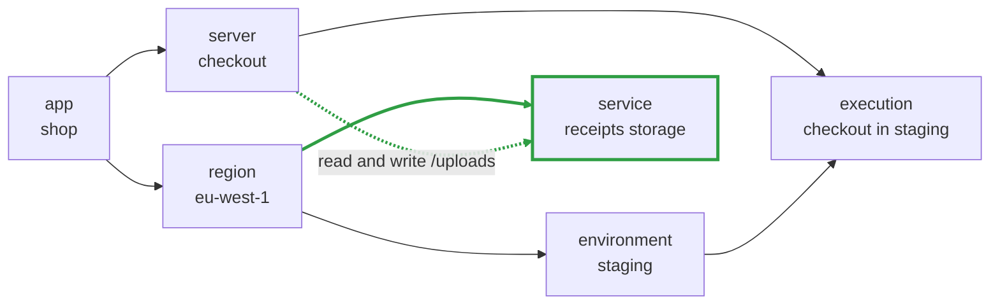

The introduction finished with [a diagram of a small application](/docs/introduction#an-example): a
shop, running on AWS, with a checkout server, and a bucket where checkout keeps the receipts
customers upload. That diagram showed the finished state. This page follows the change that gets you
there, first the way it is done today, then the way Octo does it.

## The task

Checkout has to store receipts. In the language people use with each other, the request is one
sentence:

> Give checkout a place to put receipts, and let it read and write the uploads directory in there.

In the language AWS uses, the same request is four things. A bucket. A policy document listing which
actions are allowed on which paths. A policy holding that document. An attachment tying the policy
to the role checkout runs as. The request did not get bigger; that is what carrying it out in AWS
takes.

## In Terraform

Somebody writes the four out. The bucket is a few lines of its own, and this is the part that
carries the permission:

```hcl
resource "aws_iam_policy" "checkout_receipts_access" {
  name = "checkout-receipts-access"

  policy = jsonencode({
    Version = "2012-10-17"
    Statement = [
      {
        Sid      = "AllowReadWriteUploads"
        Effect   = "Allow"
        Action   = ["s3:GetObject", "s3:PutObject", "s3:DeleteObject"]
        Resource = "${aws_s3_bucket.receipts.arn}/uploads/*"
      }
    ]
  })
}

resource "aws_iam_role_policy_attachment" "checkout_receipts_access" {
  role       = "checkout"
  policy_arn = aws_iam_policy.checkout_receipts_access.arn
}
```

Writing this requires knowing that reading an object is `s3:GetObject` and not `s3:ListBucket`, that
the resource ARN needs `/uploads/*` on the end or the permission covers the whole bucket, and that
the attachment goes on checkout's role rather than on the bucket. That knowledge is real and it sits
with a small number of people.

Then comes the review. This is the plan Terraform produces for those three resources, trimmed only
where marked:

```text
Terraform will perform the following actions:

  # aws_iam_policy.checkout_receipts_access will be created
  + resource "aws_iam_policy" "checkout_receipts_access" {
      + arn              = (known after apply)
      + attachment_count = (known after apply)
      + id               = (known after apply)
      + name             = "checkout-receipts-access"
      + name_prefix      = (known after apply)
      + path             = "/"
      + policy           = (known after apply)
      + policy_id        = (known after apply)
      + tags_all         = (known after apply)
    }

  # aws_iam_role_policy_attachment.checkout_receipts_access will be created
  + resource "aws_iam_role_policy_attachment" "checkout_receipts_access" {
      + id         = (known after apply)
      + policy_arn = (known after apply)
      + role       = "checkout"
    }

  # aws_s3_bucket.receipts will be created
  + resource "aws_s3_bucket" "receipts" {
      + bucket                      = "shop-receipts"
      + force_destroy               = false
      ... 15 more attributes and 9 blocks
    }

Plan: 3 to add, 0 to change, 0 to destroy.
```

A reviewer has two questions about that plan. Did checkout get read and write on the uploads
directory, and did anything else change?

The plan does not answer the first question. The permission is computed at apply time, so it prints
as `policy = (known after apply)`. Change `/uploads/*` to `/*` and the plan above is identical, byte
for byte, while the grant widens from one directory to the entire bucket. The name
`checkout-receipts-access` is text, and says nothing about what the policy allows.

It does not answer the second question either. `role = "checkout"` is a string, and nothing has
checked that a role by that name exists, or that it is the role checkout runs as. The counter says
`3 to add`, which counts resources rather than requests, so a change elsewhere in the repository
that added a fourth resource would produce a similar-looking plan.

In practice the review is: find the word receipts, check that nothing says destroy, approve. The
plan does not contain the information the review needs.

## In Octo

The same change in Octo is a line of intent: checkout gets read and write access to the uploads
directory of the receipts storage. The four cloud resources are not written by anyone, because the
module that owns servers already knows what granting that access requires.

Here is that change drawn the way Octo holds it, against the same graph from the introduction. The
highlighted pieces are the entire change.



One node and two edges: the bucket sits in the region, and checkout reaches it. The region, the
environment, and the execution are untouched, and nothing about checkout itself changed except that
it now reaches something new.

The bucket, the policy document, the policy, and the attachment do not appear, because they are not
part of what anyone asked for. They are what the server module does with the request. What you add
is a node and a relationship, and the four AWS resources are a consequence you can look at when you
need to.

:::note[The relationship is a node too]
Octo records that dotted line as a node of its own rather than as an edge between two others, which
is what lets it be diffed, traced, and owned by a module. It is drawn as an edge here because the
distinction does not matter until you write one.
:::

Octo runs Terraform's plan and then reports it against what changed in your intent:

```text
shop — octo validate — changes (approximate)
2026-08-19 12:07:08 UTC · 5ms octo · 18.3s terraform

You added service=shop-receipts-s3-storage (+1 other change). That creates 4 new things.
- 0 destroy   ± 0 replace   + 4 create   ~ 0 update

WHAT WILL CHANGE
  + added service=shop-receipts-s3-storage  [service=shop-receipts-s3-storage,region=eu-west-1,account=123456789012,app=shop | receipts-module | +2]
      + bucket-shop-receipts
          + aws_s3_bucket_policy.bucket-shop-receipts-policy
          + aws_s3_bucket.bucket-shop-receipts
  + added server=checkout  [server=checkout,app=shop | checkout-server-module | +2]
      ~ iam-role-ServerRole-checkout
          + aws_iam_policy.iam-role-ServerRole-checkout_aws-ecs-server-s3-access-overlay-937a53bb02a4
          + aws_iam_role_policy_attachment.iam-role-ServerRole-checkout_aws-ecs-server-s3-access-overlay-937a53bb02a4_attach
```

Every line is at a level somebody can check. The first card says a receipts service was added, and
under it are the bucket and the policy on it. The second says checkout's role changed, and the two
lines under it are the policy and the attachment, listed as consequences of that one request rather
than as four unrelated creations. The reviewer's second question, did anything else change, is
answered by the fact that there is no third card.

The first question, whether the permission is right, is not answered by reading a policy document
here either. It is answered somewhere else. Whether `s3:GetObject` against `/uploads/*` is the right
grant is a property of the server module, written once and used by every service that asks for the
same access, so it is not rewritten for each request. What the reviewer checks is the sentence:
should checkout be able to read and write receipts.

There is one more line the plan cannot produce. If somebody had widened that policy by hand in the
console, Octo would report it under a heading called drift, because a change appeared that nothing
in your intent explains. Terraform can see that the policy differs from the code. Intent is what
says nobody asked for the difference.

Reviewing is where the difference shows up first, on the day the change is made. The sections below
are about what the same change costs later on.

## Wiring

Look again at the last line of the Terraform above:

```hcl
role = "checkout"
```

That is how one piece of infrastructure refers to another: by name, as text. Terraform can check
that the value is a string. Whether a role called checkout exists is not something it can know.

Say the role is actually called `shop-checkout`, because somebody renamed it and missed this
reference. The plan looks exactly as it did above. The apply then runs in dependency order: the
bucket is created, the policy is created, and the attachment fails, because nothing by that name is
there. Two of the three resources exist and the change is half applied.

Names are used this way throughout an infrastructure codebase. A network id handed to a module. A
bucket name read out of another team's state file. An output wired into an input. Each one is text
that AWS understands and the tool holding it does not, and each one is checked only when the apply
reaches it.

In intent you hand over the thing rather than its name. Checkout is given the receipts service
itself, the node in that graph, and the module that builds checkout states what it is willing to
accept: an account, which has to publish AWS account details, and storage, which has to publish S3
details. Point checkout at something that is not storage and the run stops while the graph is being
assembled, names the input that was wrong, and creates nothing, because no Terraform has been
written yet.

A Terraform module can check that a string looks like a network id. It cannot check that the network
is in the account you are deploying into. CDK constructs and Pulumi components do better, catching a
wrong type when the program compiles; where they stop is between libraries, because each author's
interface is their own and joining two of them is work you do by hand.

## Decisions

Two months later the invoices service needs the same arrangement, except it only reads.

The quickest path in a Terraform repository is to copy the policy and delete two actions. That
works. It also means the codebase now holds two definitions of what read access means, and when a
third service turns up somebody copies whichever they find first. A year later there are five
variations of the same permission, differing in ways nobody chose on purpose, and no way to tell
which one is right.

The usual remedy is a shared module with variables: bucket, role, prefix, actions. But a module
cannot know which actions the next caller needs, so it accepts them as input, which returns the
decision to the caller, who often does not know which actions are correct. Each new special case, a
KMS key or object versioning, becomes one more variable, because a module has exactly one boundary
and everything has to pass through it.

Octo has two layers, so the same question has two possible homes. The choice here is what kind of
access, and the options are `READ`, `READ_WRITE`, and `WRITE`. Which policy actions each one means
is settled inside the server module. The invoices team asks for `READ` and gets exactly the policy
that was reviewed for receipts. When somebody discovers that reading also needs permission to list
the directory, that is one fix, in one module, applied to every service that ever asked for `READ`.

This is where SST and Encore sit too, with one difference: they decide the whole set for you, and
the line cannot be moved. In Octo the team that owns the module decides where the line goes, and can
move it when the answer changes.

## Swapping

The shop runs in a single availability zone, because that was the cheap way to start. A year in,
that is no longer acceptable.

In Terraform the region is a module somebody called, and everything downstream consumes its outputs
by name: the network id, the subnet ids, the route table ids. The replacement module has its own
variables and its own output names, so the change is the call site, then every consumer of the old
outputs, and the apply is where you find out whether any were missed.

In Octo, a region is whatever your region module says it is. Somebody on your team wrote the one you
started with, and it said a region is a network in one availability zone. When the requirement
changes, somebody writes a second module that spreads a region across several. The only thing that
has to hold is that the new one publishes the same region details the old one did.

Downstream, the subnet and server modules were never handed ids. They were handed the region node,
and they accept anything that publishes what they require, so they cannot tell the two apart. The
swap is the region entry in your definition file. No line of intent below it moves.

Our AWS library happens to contain both of those modules, one taking a `regionId` and one taking
`regionIds`, and they are there as examples of the pattern rather than as an answer to your network
layout. Most teams will want a region that means something specific to them. The point is that a
change of this size stops at the module boundary instead of spreading through the repository.

Moving live infrastructure from one region module to the other is still a migration. Octo tells you
what will be created, replaced, and destroyed, and does not yet sequence that transition for you.

## Agents

Hand the receipts task to an AI working in a Terraform repository. It has to pick the actions, get
the ARN suffix right, know which role the attachment belongs on, and put the resource blocks in
the files your team keeps them in. It will usually produce something that looks right. What comes
back for review is the plan from earlier on this page, where the permission reads
`(known after apply)`, so the plan does not show the permission the AI wrote.

Hand it the same task in intent and the change is one node and two edges. A request the modules
cannot satisfy, such as pointing checkout at something that is not storage, stops the run before
anything exists. What comes back for review is the report, which says checkout changed and lists
what changed underneath it.

There is a longer-term point here as well. AI is good at rewriting code that already exists, so an
abstraction that exists mainly to read better than HCL is worth less over time. What AI cannot do is
recover a decision nobody wrote down. Intent is the one part of an infrastructure repository that
cannot be derived from the rest of it.

## Where it sits

|                           | What it gives you                                                                 | Where it stops                                                                    |
|---------------------------|-----------------------------------------------------------------------------------|-----------------------------------------------------------------------------------|
| Terraform modules         | Reuse, and a smaller surface than raw resources                                   | The contract with the caller is untyped, and the plan is still the review surface |
| CDK and Pulumi components | Real types, in a real language                                                    | Contracts are per-author, and the diff a reviewer reads is resource-level         |
| Crossplane                | Claims over compositions, with typed contracts between                            | Needs Kubernetes, and claims are written in cloud primitives                      |
| SST and Encore            | Infrastructure hidden completely, which is the right trade for their applications | Anything the model does not cover is out of reach                                 |
| Octo                      | Intent over modules, typed by shape, reviewed at the level of the request         | The published module library covers AWS, and modules are authored in TypeScript   |

## When it pays

Octo is a layer, and a layer costs something: an install, a vocabulary to learn, and one more thing
to understand when a deploy fails. The receipts change is worth that cost
when the same request comes back for the fifth service, when the person making it is not the person
who knows what `s3:PutObject` implies, and when somebody has to review both without having written
either.

A single engineer running a single stack has none of those problems, and Terraform modules are less
machinery for that job. Octo starts paying at the point where infrastructure has to be explained by
one person to another.
