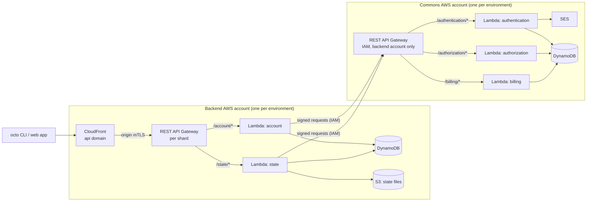

# Octo — Model Vocabulary & Module Catalog Expansion Plan

> Working document (2026-07-12, amended 2026-08-26). Plans two things: (1) splitting the
> overloaded `service` model into a richer — but still small and fixed — model vocabulary, and
> (2) the next waves of octo-aws-cdk modules. Then two platform features that ride on the catalog
> (out-of-the-box advanced debugging, AI log-expectation learning), and three shippable units that
> ride alongside it (the migration planner, capture, and guards on the terraform JSON Octo parses).
>
> Altitude: planning, not full design. Each wave gets a detailed design (schemas, anchors,
> actions, tests) when it is scheduled, following the anatomy of existing modules
> (`aws-ecs-alb-service` is the reference: module schema with anchor-constrained inputs,
> module-owned models/overlays/actions, snapshot tests).

## Why this catalog matters (the AI thesis)

Modules are the **tested building blocks of "how"**. Anything done in infra today is fair game
for Octo: if a team can set it up by hand, a module can set it up as a custom-made, reviewed,
reusable solution. When AI later operates on infrastructure, it does not invent Terraform — it
selects, composes, replaces, and parameterizes these blocks. The catalog is therefore the AI's
action space: every module added is a new verified move the AI can make. Breadth and
composability of this catalog is a direct investment in the AI product.

---

# Part I — Splitting the `service` model

## Problem

`Service` is documented as "third-party services hosted outside your infrastructure," but in
practice it is the catch-all: today's catalog puts DynamoDB (a database), ALB (a load balancer),
S3 storage, and S3 static websites all under `service`. This muddies the review surface ("added 1
service" says nothing), blocks decision-surface abstraction (a database exposes different knobs
than a load balancer), and weakens the vocabulary that the model graph's readability depends on.

## Proposal

Introduce new first-class model kinds as siblings of `Server`/`Service` (each an `AModel`
subclass with its own `NODE_NAME` and schema). Committed set:

| Model kind     | Meaning                                     | Absorbs / first modules                                                                                                                                      |
|----------------|---------------------------------------------|--------------------------------------------------------------------------------------------------------------------------------------------------------------|
| `database`     | Stateful query-addressed store              | `aws-dynamodb-service` → `aws-dynamodb-database`, `aws-dynamodb-global-service` → global variant; later RDS/Aurora                                           |
| `cache`        | Volatile keyed store                        | ElastiCache Redis (Wave B)                                                                                                                                   |
| `queue`        | Message transport (queues, topics, streams) | SQS, SNS, MSK, Firehose (Wave A)                                                                                                                             |
| `loadbalancer` | Traffic entry/distribution                  | `aws-ecs-alb-service` → `aws-alb-loadbalancer`                                                                                                               |
| `storage`      | Object storage                              | `aws-s3-storage-service` → `aws-s3-storage`; static website stays a service-level variant or becomes `aws-s3-static-website-storage` — decide at design time |

Candidates, added only when their first module lands (keep the vocabulary small — every addition
must earn its place): `gateway` (KrakenD, API Gateway), `identity` (Keycloak, Cognito).
`filesystem` already exists and keeps meaning "mountable" (EFS) as distinct from `storage`
(object). `Service` remains — restored to its documented meaning: genuinely external third-party
managed services Octo does not provision.

## Mechanics & migration

- Each new kind: `packages/octo/src/models/<kind>/` (model + schema), same parent rules as
  `Service` (child of `app`), registered in the diff/serialization machinery like existing kinds.
- **Context strings change** (`service=my-db,app=x` → `database=my-db,app=x`): breaking for
  persisted state. Needs a one-shot migration over the committed `models.json`/`resources.json`,
  run before the first `generate` on the new vocabulary — design it alongside the split, not after.
- Module moves are renames + schema-import updates; actions/resources are untouched (resources
  never knew their model kind).
- Downstream: the FE graph parser is already forward-compatible with unknown node kinds (it
  falls back + warns); add theme colors/levels for the five new kinds. The review-surface
  summarizer gains precision for free ("added 1 database" vs "added 1 service").

---

# Part II — Module waves

Waves are dependency-ordered, not priority-ordered; items within a wave are independent. The
original request groups (2)–(6) map onto waves as noted. Per-module notes give: model kind,
resources provisioned, anchor relationships (consumed ◂ / produced ▸), and risks. All modules
follow the standard anatomy and ship with module tests against the existing
`aws-localstack-account` / `aws-moto-account` test harness where the service is supported, plus
snapshot tests.

## Wave A — Platform primitives (groups 2 & 6)

Small, self-contained, high leverage — most later modules consume these anchors.

| Module                                         | Kind                                                               | Notes                                                                                                                                                                                                                                  |
|------------------------------------------------|--------------------------------------------------------------------|----------------------------------------------------------------------------------------------------------------------------------------------------------------------------------------------------------------------------------------|
| `aws-route53-dns`                              | new `dns` capability on region/app (decide: model kind vs overlay) | Hosted zones, record sets. ▸ `DnsZoneAnchor` consumed by https, loadbalancer, gateway modules. Decide early whether DNS is a model (visible node) or an overlay (relationship); leaning model — users think about domains.             |
| `aws-acm-https`                                | overlay on `loadbalancer`/`gateway`                                | Certificate request + DNS validation (◂ DnsZoneAnchor), listener attachment. ▸ `TlsCertificateAnchor`.                                                                                                                                 |
| `aws-kms`                                      | overlay/anchor provider                                            | CMKs, aliases, key policies. ▸ `EncryptionKeyAnchor` consumed by database/storage/queue/secrets modules ("encrypted with your key" as a decision-surface knob).                                                                        |
| `aws-ssh`                                      | capability on `server`                                             | EC2 key pairs and/or SSM Session Manager access profile (prefer SSM: no open port 22, IAM-audited). ▸ `ShellAccessAnchor` — later consumed by the debugging feature (Part III).                                                        |
| `aws-sqs-queue` / `aws-sns-queue`              | `queue`                                                            | Queues/topics + DLQs, subscriptions; IAM policies wired to consuming executions via overlays.                                                                                                                                          |
| `aws-msk-queue`                                | `queue`                                                            | Managed Kafka. The "aws kafka" ask — recommend MSK **before** self-hosted Kafka (group 3); same model kind, so consumers can later swap modules (the Octo wedge).                                                                      |
| `aws-firehose-queue`                           | `queue`                                                            | Delivery streams; ▸ into `storage`/ELK targets. Pairs with observability wave.                                                                                                                                                         |
| `aws-codebuild-cicd` + `aws-codepipeline-cicd` | `pipeline` (model exists)                                          | Finally gives `Pipeline.instructionSet` meaning: build projects, pipeline stages, source hooks. This is *app* CI/CD provisioning — distinct from the platform's infra-CICD view (frontend plan 09), which observes Octo's own applies. |

## Wave B — Data & compute expansion (group 3)

| Module                                                | Kind                                            | Notes                                                                                                                                                                                                                                                                                                             |
|-------------------------------------------------------|-------------------------------------------------|-------------------------------------------------------------------------------------------------------------------------------------------------------------------------------------------------------------------------------------------------------------------------------------------------------------------|
| `aws-elasticache-cache`                               | `cache`                                         | Redis replication groups, subnet groups, auth token (◂ EncryptionKeyAnchor). ▸ `CacheEndpointAnchor` for executions.                                                                                                                                                                                              |
| `aws-lambda-server` (+ deployment/execution variants) | `server` family                                 | Serverless compute as an alternative to `aws-ecs-server`: same model vocabulary, function + roles + event sources instead of tasks. Proves module substitution on the compute axis.                                                                                                                               |
| `aws-eks-*` family                                    | `server`/`environment`/`execution`/`deployment` | The elephant: a full parallel to the ECS family (cluster, node groups/Fargate profiles, IRSA, deployments as k8s manifests via TF kubernetes provider). Schedule as its own effort; it unlocks Tilt (Wave C) and self-hosted stacks. Migration ECS→EKS is the flagship scenario for the migration planner (IV.1). |
| `kafka-on-eks-queue`                                  | `queue`                                         | Self-hosted Kafka for teams outgrowing MSK's constraints. ◂ EKS anchors. Only after EKS + MSK exist.                                                                                                                                                                                                              |
| `krakend-gateway`                                     | `gateway` (new kind)                            | API gateway as containers (◂ ECS or EKS server anchors) + loadbalancer in front; route config as module inputs.                                                                                                                                                                                                   |
| `nginx-consul-registrator-stack`                      | composite (`gateway` + discovery overlays)      | The classic self-hosted service-discovery trio on ECS/EC2. Worth doing as the exemplar of a *multi-piece composite module* — proves modules can encode whole architectures, which is exactly the "custom solutions" thesis.                                                                                       |

## Wave C — Delivery & developer experience (group 4)

| Module              | Kind                       | Notes                                                                                                                                                                                                                                                                                                                                                                    |
|---------------------|----------------------------|--------------------------------------------------------------------------------------------------------------------------------------------------------------------------------------------------------------------------------------------------------------------------------------------------------------------------------------------------------------------------|
| `tilt-on-eks`       | dev-environment capability | The motivating example: your local dev loop running in the cluster. Provisions a dev namespace, registry access (◂ ECR image anchors), RBAC-scoped kubeconfig, and emits Tiltfile scaffolding for the user's repo. ◂ EKS. Novelty: the module's output is partly *developer-machine config*, not only cloud resources — a new module output type to design deliberately. |
| `opa-policy`        | overlay                    | OPA sidecar/admission (on EKS) or OPA-as-authorizer for gateways; policy bundles from user repo. Also a candidate *internal* consumer: compliance rules (frontend plan 09 §9.9) could compile to OPA policies — keep the door open.                                                                                                                                      |
| `keycloak-identity` | `identity` (new kind)      | Keycloak on ECS/EKS + `database` dependency + realm/client provisioning. ▸ `OidcProviderAnchor` consumed by gateways/ALB auth rules — composes with the "auth in front of everything" feed example.                                                                                                                                                                      |

## Wave D — Observability integrations (group 5)

Consistent with the vision's "no observability platform": these modules **install and wire** the
user's chosen stack into their infra; Octo does not ingest telemetry itself.

| Module                   | Kind                                                                  | Notes                                                                                                                                                                                                                               |
|--------------------------|-----------------------------------------------------------------------|-------------------------------------------------------------------------------------------------------------------------------------------------------------------------------------------------------------------------------------|
| `datadog-observability`  | overlay on servers/executions                                         | Agent sidecars/daemonsets, API key from secrets (◂ SecretRefAnchor — depends on platform secrets service, or user-provided SSM ref in v1), unified tags matching Octo's context tags — which makes DD dashboards graph-addressable. |
| `newrelic-observability` | overlay                                                               | Same shape as Datadog; second implementation proves the observability anchor contract is real.                                                                                                                                      |
| `elk-stack`              | composite (`database`-ish OpenSearch + `queue` firehose + dashboards) | Self-hosted/managed OpenSearch + ingestion (◂ Firehose from Wave A) + Kibana behind ◂ identity/loadbalancer anchors. Also the natural artifact store for Part III's log features.                                                   |

## Wave E — Serverless edge, gateways, private networking and accounts

Added 2026-10-06 from deciding how octo's own backends deploy. Everything octo could build that
came up is here, whether or not those backends use it. E.0 is where those backends are headed;
the pieces it needs are marked **(target)**; the rest is demand-driven. E.7 records how the
backends grow past E.0. The facts below were checked against AWS documentation in October 2026
unless marked unverified.

### E.0 The target for Quadnix's own backends

Where `octo-backend` and `quadnix-commons` are headed, decided 2026-10-05 and revised 2026-10-06.
They go live first on the $0 design in `docs/serverless-backend-plan.md`, built from what octo
already has, and move here one piece at a time as the pieces below are built, so the change of
infrastructure under a live product is itself exercised.

A request pays for itself; nothing runs while idle. No ALB, NAT gateway, Fargate task or anything else
billed by the hour.

No function has a URL: each gateway is the only way into its functions. QA and prod run the same
design, so QA tests what prod runs.

**The organization — decided 2026-10-05.** Quadnix is one AWS organization with consolidated
billing, created by hand. The root account holds the organization and `quadnix.com`'s DNS (NS, MX),
and delegates one subdomain per product (`octo.quadnix.com`, `bodhi.quadnix.com`, and deeper ones
like `chat.bodhi.quadnix.com`). Each product has one account per environment (`qa`, `prod`), which
keeps AWS limits and security apart. One octo project describes a whole product: its app holds every
environment's account. Commons is a product of its own, internal, in its own accounts. Commons will
later host the shared systems that relay data between products (Redis, Kafka or other event systems,
perhaps Temporal); SES may become an endpoint of commons that products call. Neither is planned yet.

**Two octo projects.** `octo-backend` runs behind CloudFront. `quadnix-commons` is called only by other
products' services. Two octo projects cannot reference each other, so each side names the other by a
literal: commons admits the backend's **account id**, and the backend is configured with commons'
URL.

**Commons authenticates no caller today.** None of its three services registers a guard, so the
gateway's IAM check is its *only* protection.

**How requests are protected — decided 2026-10-06** (replaces the 2026-10-05 ruling, which had
CloudFront in front of function URLs). Every hop refuses anything that is not from its one caller,
with no shared secret, and nothing is billed by the hour:

- **Backend:** CloudFront presents a client certificate to the shard's REST gateway (origin mTLS,
  CloudFront since 2026-01). The gateway checks it against a truststore in S3, on its custom domain,
  and its default `execute-api` URL is turned off, or anyone could skip the check. The certificate
  comes from a CA of our own, imported into ACM (free); an ACM public certificate cannot be used,
  and AWS Private CA costs $50–400 a month.
- **Commons:** a public **REST** gateway with IAM auth, and a resource policy admitting only the
  backend account. The backend signs every request with its function's role (SigV4, one axios
  interceptor), so commons' code sees a plain HTTP call.
- **Each function** has no URL, and its resource policy lets only its gateway invoke it.

Why this and not the alternatives:

- **Why a gateway behind CloudFront at all.** WebSockets, later: a function URL cannot hold one,
  and an API Gateway WebSocket API can. CloudFront carries a WebSocket to its origin but never sees
  the messages, so it cannot turn them into calls. A shard gateway also gives each shard a regional
  endpoint of its own, which a WebSocket client may connect to directly.
- **Why CloudFront in front of the gateways.** Any edge takes the request, and a CloudFront Function
  routes it to the right shard (see *Shards* below). Use `PriceClass_All`: `PriceClass_100` serves only
  North America and Europe, so an Indian user lands in Europe.
- **Not CloudFront with an origin access control.** It cannot sign for API Gateway, which supports
  only S3, Lambda function URLs and two media services. Lambda@Edge could sign with a role, but it
  is billed on every request, floods included, and cannot read a body over 1 MB.
- **No secret header.** Origin mTLS replaces it.
- **CloudFront cannot front commons.** An origin access control would re-sign every request as
  CloudFront, so commons would never see the backend's signature.
- **REST, not HTTP API.** Only REST has a resource policy (to admit another account), a private mode,
  WAF, and mTLS for this; HTTP API is $1 per million against $3.50.
- **Not private yet.** A private gateway is reachable only through an `execute-api` endpoint in the
  caller's VPC: the backend's functions would move into a VPC and pay about $7 a month per AZ for
  that endpoint, plus endpoints or NAT for everything else they call. CloudFront cannot reach a
  private gateway at all: its VPC origins are ALBs, NLBs and EC2 only. See E.7.
- **Not a Lambda invoke.** The backend calling commons through the Lambda API would make the call
  look like a Lambda call in code, and change again on a move to servers.
- **Not QA on function URLs and prod on gateways.** QA would stop testing prod's limits.

**What a flood costs.** Requests a gateway refuses (failed authorization, no matching route,
throttled) are not billed. A refused mTLS handshake fails before any request exists, so is expected
not to be (unverified). CloudFront bills every request it receives (about $1 per million, plus $0.10
for a CloudFront Function); that is the one exposure left. Gateway throttling and reserved
concurrency on each function cap the rest. CloudFront's flat-rate plans remove it (no overage,
attacks included, WAF bundled), but Terraform cannot select them yet (AWS added the API in
2026-09); adopt one when it can. Until then, a Budgets alert in every account. WAF alone does not
lower the bill: CloudFront still bills what WAF blocks, and WAF adds about $5 a month, $1 per rule
and $0.60 per million.

**Shards — decided 2026-10-05.** One shard to start. When a product has more than one, a CloudFront
Function picks the origin per request (`cf.updateRequestOrigin()`, viewer request only, with a
KeyValueStore mapping organization to shard gateway). An organization moves between shards without
its URLs changing; no shard prefix appears in any URL or id. Not yet checked: how routes without an
organization id (login, sign-up, `/account/*`) pick a shard, and KeyValueStore's size limit against
the number of organizations.

**A NestJS app runs on Lambda unchanged.** Each Dockerfile adds AWS's Lambda Web Adapter
(`COPY --from=public.ecr.aws/awsguru/aws-lambda-adapter:<version> /lambda-adapter
/opt/extensions/lambda-adapter`). It turns each REST gateway event into a plain HTTP request to the
app's own port. `main.ts` and docker-compose do not change. WebSocket events are the exception: the
adapter does not translate them and POSTs them raw to `/events` (see E.1).

**Limits.**

- **Uploads: about 4.5 MB per request**, in any design. Lambda caps a buffered invocation at 6 MB and
  binary bodies arrive base64-encoded; the gateway's own 10 MB cap (hard) never comes into play.
  State files no longer pass through it: the state service signs S3 URLs both ways, and holds each
  app to its own limits (by default 20 MB a file, 1000 files a write, 100 MB in all).
- **Downloads past 6 MB need streaming.** REST gateways stream Lambda responses since 2025-11, for up
  to 15 minutes (5 minutes idle), past 10 MB but throttled to 2 MB/s beyond the first 10 MB.
  Unproven: one older source says Lambda proxy integrations cannot stream.
- **Timeouts.** 29 s per buffered request by default; a regional or private gateway can be raised by
  a quota request, which may lower the account's throttle quota. A streamed response runs up to
  15 minutes.
- **Cold starts.** A first request after a quiet period can take 5–8 s, since a state call wakes four
  functions in turn.

**Cost.** Idle is about $1 a month (Route 53 zone, ECR storage). Beyond the free tiers, roughly $12 per
million public API calls, because each state call is 5 invocations, plus about $1 per million at
CloudFront and $3.50 per million at each gateway a call passes.

---

### E.1 API Gateway

Three API types, three module families. `service` with type `gateway`.

**REST API (v1)** **(target)** — $3.50 per million calls, nothing idle.

- Lambda proxy integration: the gateway invokes a function through the Lambda API, so the function
  needs no URL, and its resource policy admits only that gateway. The Lambda Web Adapter translates
  REST events, so a web app runs unchanged.
- IAM auth (SigV4), and a resource policy, which is how another account is admitted and how a private
  gateway names the endpoints it accepts (`aws:SourceVpce`). Only REST has a resource policy.
- Endpoint types: regional, edge-optimized, private. A private gateway has no public address and is
  reachable only through an `execute-api` interface endpoint in the caller's VPC, across accounts
  too (E.4 prices it).
- Custom domain, base path mappings, and turning off the default `execute-api` URL. mTLS lives on the
  custom domain (truststore in S3), so the default URL left on lets anyone skip it.
- Response streaming from Lambda since 2025-11: up to 15 minutes, idle limit 5 minutes (regional,
  private) or 30 s (edge-optimized), past 10 MB but throttled to 2 MB/s beyond the first 10 MB.
  Unverified: one older source says Lambda proxy integrations cannot stream; prove it with a
  download over 10 MB.
- 29 s integration timeout by default; a quota request raises it for regional and private gateways,
  never edge-optimized, and may lower the account's throttle quota.
- Request payload 10 MB, hard. Behind it Lambda's own 6 MB applies first (E.3).
- Throttling per stage and method, and per client through usage plans and API keys. Requests that
  fail authorization, match no route or are throttled are not billed.
- WAF attachable; response caching and request validation exist.
- A VPC link to an NLB or ALB, for when compute moves to servers: the gateway, its URL and its
  callers' signatures stay.

**HTTP API (v2)** — $1 per million, a little faster, fewer features. IAM auth and JWT authorizers.
No resource policy, so another account's caller must first assume a role in the API's account; no
private type; no WAF. The cheap default when neither matters.

**WebSocket API** — the only way to serve WebSockets on Lambda: a function cannot hold a connection,
and CloudFront only carries one (E.2).

- Routes by a field of the message (route selection expression, e.g. `$request.body.action`), plus
  `$connect`, `$disconnect` and `$default`. Each message is one Lambda invocation.
- Auth happens once, by an authorizer on `$connect`; clients reaching it directly cannot carry mTLS.
  Unverified: whether WebSocket APIs support mTLS at all (believed not).
- The backend pushes to a client through the `@connections/{id}` API, which needs
  `execute-api:ManageConnections`; the user-to-connection map is the app's, in a table the module
  could provision.
- About $1 per million messages and $0.25 per million connection-minutes; nothing idle.
- **Quirk for the app:** the Lambda Web Adapter does not translate WebSocket events (its
  `lambda_http` build leaves out `apigw_websockets`). It POSTs each event raw to
  `AWS_LWA_PASS_THROUGH_PATH` (`/events`), so the app dispatches on `routeKey` in an ordinary
  controller; NestJS's `@WebSocketGateway` does not apply, and local development needs a shim that
  plays the gateway. Module documentation should say so.

### E.2 CloudFront

Extends `aws-cloudfront-service`.

- **API Gateway as an origin kind** **(target)**, with **origin mTLS** (CloudFront since 2026-01,
  for API Gateway and ALB origins): CloudFront presents a client certificate from ACM, issued by AWS
  Private CA ($50–400 a month) or by a CA of your own imported into ACM (free), never an ACM public
  certificate. Unverified: Terraform provider support. If the module makes the CA with terraform's
  `tls` provider, the CA's private key lands in terraform state.
- **Origin access control supports S3, Lambda function URLs, MediaStore and MediaPackage v2 only**,
  never API Gateway. It re-signs every request as CloudFront, so it must never front a service that
  checks *who* its caller is. A function URL behind it makes clients send the body's SHA-256 as
  `x-amz-content-sha256` on `POST` and `PUT`.
- **Price class** **(target)**: `PriceClass_100` serves North America and Europe only;
  `PriceClass_All` serves every edge for slightly higher per-request rates, nothing fixed.
- **Flat-rate pricing plans**: Free, Pro ($15), Business ($200), Premium ($1,000) a month, bundling
  WAF, DDoS protection, Route 53 and more, with no overage charges: attacks and requests WAF blocks
  never count, and traffic past the allowance is served more slowly instead of billed. AWS added
  the API in 2026-09; the Terraform provider cannot select them yet. Add when it can. Pay-as-you-go
  bills every request, about $1 per million in the US and Europe.
- **CloudFront Functions**: $0.10 per million, sub-millisecond, JavaScript. Origin switching per
  request with `cf.updateRequestOrigin()` (runtime 2.0, viewer request only), reading a
  **KeyValueStore**: the tenant-to-shard routing pattern. No network calls, no AWS credentials, no
  request body. Unverified: KeyValueStore's size limit.
- **Lambda@Edge**: can call the network, sign requests with its role and change origins, but is
  billed on every request (floods included) and sees at most 1 MB of body.
- **WebSockets**: CloudFront carries them to a custom origin. Functions run on the upgrade request
  only, never on messages.
- **VPC origins** reach ALBs, NLBs and EC2 instances in a VPC only, not `execute-api` endpoints, so
  CloudFront cannot reach a private API Gateway without an ALB or NLB between them.
- **The ALB origin is wired but not safe** (wired 2026-10-01, never applied live). CloudFront reads the
  ALB's DNS name and routes to it; nothing else is done. Two gaps, to close before anything relies on
  it:
  1. **Anyone can skip CloudFront.** The ALB's security group admits port 80 from `0.0.0.0/0`, so its
     DNS name answers the whole internet directly. Fixes, not decided: a secret header CloudFront
     adds and an ALB listener rule requires (both halves exist: `customHeaders` on the origin,
     `AlbListenerRuleHttpHeaderConditionSchema` on the listener), or a security group rule from AWS's
     managed CloudFront prefix list (security group rules take only `CidrBlock` today). A third
     since 2026-01: origin mTLS, which ALBs accept, once the ALB has an HTTPS listener (gap 2) and
     the API Gateway origin has built the client certificate.
  2. **CloudFront reaches the ALB over plain HTTP.** The ALB has only an HTTP listener, so the origin
     is `http-only` on port 80 and the hop crosses the internet unencrypted. Closing it needs an HTTPS
     listener and a certificate on the ALB.
- **WAF web ACL** (on CloudFront, REST gateways or ALBs): about $5 a month, $1 per rule, $0.60 per
  million requests. Rate rules and header checks. It does not lower CloudFront's bill: blocked
  requests are still billed there.

### E.3 Lambda

Extends the Lambda execution.

- **No function URL** **(target)**, invoked only by a gateway that its resource policy names.
- **Reserved concurrency** **(target)**, the cap on what a flood can spend; provisioned concurrency,
  aliases, versions and layers are listed under *Lambda features not built* in E.7.
- Limits module documentation should state: a buffered invocation carries at most 6 MB each way,
  about 4.5 MB of binary body once base64-encoded, whatever sits in front; streaming lifts the
  response to 200 MB. A function URL refuses a bad signature before invoking, so a flood of
  unsigned calls is not billed (third-party source, consistent with how Lambda bills).
- In a VPC, a function never gets a public IP, even in a public subnet: every AWS service it calls
  needs an endpoint, and everything else needs NAT (E.4). Its image is still pulled by the Lambda
  service, never through the VPC, so it needs no ECR endpoint.

### E.4 Private networking

Everything here is billed by the hour, which is why the backends do without it for now.

- **Gateway endpoints** for S3 and DynamoDB: free.
- **Interface endpoints** (PrivateLink): about $7 a month per AZ each, for every other service a
  VPC must reach privately (`execute-api`, SES, SQS, SNS, EventBridge, STS, Secrets Manager, KMS,
  Lambda). Endpoint policies restrict what passes. PrivateLink always ends in a VPC: something with
  no VPC cannot use it.
- **NAT gateway**: about $32 a month per AZ, plus data. The only way out to non-AWS addresses.
- **Between VPCs**: peering (no hourly charge, data only, no transitive routing), Transit Gateway
  (about $36 a month per attachment), VPC Lattice (per service per hour), and PrivateLink endpoint
  services (fronted by an NLB).
- **Private hosted zones** (Route 53) change what a name resolves to inside a VPC; they do not make
  a public service private.

### E.5 Organization, accounts and DNS

- **AWS Organizations**: member accounts, organizational units, service control policies,
  consolidated billing. Ours is made by hand for now.
- **Several accounts in one app** **(target)**: one account per environment under a product's app.
  The account modules take credentials and never assume a role into a member account
  (`OrganizationAccountAccessRole`); no e2e builds two accounts in one app.
- **Delegated DNS** **(target)**: the root zone in one account, a product's subdomain zone in
  another, joined by an NS record in the root zone, which crosses projects and so is a literal.
  Extends Wave A's `aws-route53-dns`.
- **Certificates** **(target)**: CloudFront's must be in `us-east-1`; a regional gateway's custom
  domain takes one in its own region; DNS validation records may have to go into a zone in another
  account. Extends Wave A's `aws-acm-https`. The first release of the backends requests its
  certificate by hand, in the backend account, validated in the zone in the management account
  (see `docs/serverless-backend-plan.md`).
- **SES sending domain**: domain identity, DKIM and MAIL FROM records in the zone. Leaving the SES
  sandbox is a request to AWS by hand. Commons goes live inside the sandbox, sending only to
  verified addresses (decided 2026-10-06), and leaves it once everything else is proven.
- **AWS Budgets alerts**: one per account, the early warning for a flood that costs money.

### E.6 Cross-account messaging and data

- **Events between products**, e.g. a customer deletion one product publishes and others consume:
  EventBridge buses that admit other accounts, and SNS topics and SQS queues whose resource policies
  admit other accounts. No VPC, nothing idle. Extends the SQS and SNS modules with policies naming
  other accounts by literal.
- **Presigned S3 URLs**: clients upload and download objects directly, past every Lambda and gateway
  limit. The app signs them; the module side is the function's grant on the bucket and, for
  browsers, the bucket's CORS rules. S3 has not billed requests refused with a 403 from outside
  the account or organization since 2024.
- **Temporal**: a candidate for commons' shared systems, alongside Wave B's Redis and Kafka.

### E.7 Later: how the backends grow

Not steps. They record how this setup grows, so nothing built now blocks it.

**More regions and data residency.** Lambda, tables, buckets and function URLs are regional;
CloudFront and IAM are global. Residency means a full stack per region and one home region per
organization, with a small global directory (`hash(email)` and `organizationId` → region, nothing
personal) as a DynamoDB global table. An idle region costs about $0. Keep these true now (also
listed in `docs/serverless-backend-plan.md`):

1. Every table's partition key starts with the organization or account, wherever the data belongs to
   one.
2. No personal data in a global table, ever.
3. Region is configuration. The services hard-code `us-east-1` in `local.environment.ts`; production
   config must read it from the environment.
4. Keep `organizationId` in the path of every org-scoped endpoint.

**Lambda code as a zip.** The Lambda family runs container images only (see *Lambda family rulings* in
`docs/serverless-backend-plan.md`): the backend is images, and an image keeps a deployment portable between ECS and Lambda. We do not need zip, but users will, so it gets built. What it takes:

- **The hard part is getting the zip to terraform.** Terragrunt runs from a cache directory and the
  generated `.octo-tf` is committed, so neither a relative nor an absolute path in the HCL works on
  every machine. The likely fix mirrors `EcrImageTag`: an external resource that, at apply, zips a
  directory relative to the project root, uploads it to S3, and outputs its key and hash. The
  function references it, so the code always exists before the function.
- **Which bucket holds the archives** is a decision of its own: one passed in, or one per serverless
  region.
- **The deployment** gets a third code kind, `{ kind: 'zip', directory, handler, runtime }`, likely
  renaming `image` to `code`. ECS executions reject it at generate.
- **`LambdaFunction`** gets a zip branch: `package_type = "Zip"`, `handler`, `runtime`, `s3_bucket`,
  `s3_key`, `source_code_hash` in place of `image_uri` and `image_config`. `command` means nothing
  for a zip, so the Lambda execution rejects it.
- **Bundling stays the user's job**, as the Dockerfile is today: octo zips the directory as it is.
- **Check the state size.** Whatever carries the zip must not put its content into terraform state:
  a state file is held to 20 MB by default. A resource like `aws_s3_object` with inline `content_base64`
  would store the whole archive in state; an upload done by the external resource's action stores
  only the key and hash. Measure the state of a real zip function before calling it done.

**Lambda logs.** Lambda functions write no logs: the role gets no permission to, so Lambda creates
no log group behind octo's back (see *Lambda family rulings* in `docs/serverless-backend-plan.md`). The CloudWatch log group
becomes a resource of its own once CloudWatch is settled. Until then, an out-of-memory kill or a
timeout leaves no trace, and neither does the `REPORT` line with the memory a call used, so memory
cannot be tuned. Left out of the first release on purpose (decided 2026-10-06); revisit before the
backend carries real traffic. The fork: the permission alone (Lambda creates its own log group, kept
forever unless someone sets retention), or a log group resource with retention.

**Lambda features not built.** Provisioned concurrency, aliases and versions, and
layers. Nothing here needs them: a new version is a new deployment and execution, side by side, and
traffic moves by repointing the CloudFront origin.

**VPC Lambdas, and so Redis.** ElastiCache lives in a VPC, and a Lambda in a VPC needs a NAT gateway
to reach the internet, which is billed hourly. The backend uses DynamoDB only. A VPC Lambda needs
the execution to take subnets and security groups, which the serverless subnet does not carry.

**Private commons.** Make commons' gateway private once its cost is worth paying: the backend's
functions move into a VPC with an `execute-api` endpoint (about $7 a month per AZ), the gateway's
policy admits only that endpoint, and the backend needs endpoints or NAT for anything else it calls
beyond S3 and DynamoDB (free gateway endpoints). Commons' functions stay outside any VPC.

**A private backend gateway.** CloudFront cannot reach a private gateway: its VPC origins are ALBs,
NLBs and EC2 only. The backend's gateway stays public behind origin mTLS until servers bring an ALB
anyway.

**Moving off Lambda.** Price is rarely the reason; the crossover is about 30–50M API calls a month per
region. Latency per hop, cold starts at the tail, websockets, or a relational database are likelier
triggers. Application code and data do not change. In octo it is a change of modules under the same
intent graph. Commons' gateway stays: it becomes private and reaches an internal ALB through a VPC link, and the
backend keeps calling the same URL with the same signature. The backend's CloudFront reaches its
ALB as a VPC origin. Keep the `app-e2e` suites running against concurrent servers (docker-compose), so code
that is only safe one-request-per-instance stays visible while production runs on Lambda.

---

# Part III — Platform features riding on the catalog

## III.1 Out-of-the-box advanced debugging (flame graphs, heap dumps, memory snapshots)

**What it is:** any server provisioned through Octo can produce profiling artifacts without the
team building a profiling pipeline.

**Shape:** a `diagnostics` capability overlay on `server`/`deployment` modules:

- **Continuous profiling:** agent sidecar (Pyroscope/Parca-style, or language agents) enabled by
  a module input; flame graphs always available at low sampling overhead.
- **On-demand capture:** heap dump / memory snapshot / thermal CPU profile triggered per
  execution. The trigger is an actuation-plane action (frontend plan 09): UI button → operator
  runs the capture (SSM command via ◂ ShellAccessAnchor from Wave A) → artifact lands in a
  module-provisioned S3 diagnostics bucket with retention policy.
- **Surfacing:** artifacts are keyed by context string → the platform UI lists them on the
  node's inspector; flame graph viewer in the FE reads from the diagnostics bucket via the BE.
- **Composes with:** the debug-routing feature-flag flow (frontend plan 09 §9.2) — route one
  request to a debug-enabled execution, capture everything about it.

**Flags:** per-language agent matrix is real work (start Node.js + JVM); captures on production
pods need the same authorization story as debug routing; heap dumps contain user data → the
diagnostics bucket must be encrypted (◂ EncryptionKeyAnchor) with tight IAM and retention.

## III.2 AI log-expectation learning ("this request should produce these logs")

**What it is:** the AI learns, per request route, the expected log signature by observing
successful requests; when a request fails or stalls, the missing/extra log lines localize the
failure before a human reads anything. Auto-adapts as paths and logs evolve.

**Honest decomposition (each step is independently useful):**

1. **Correlation convention (prerequisite, module-enforced):** a request ID injected at the
   entry point (loadbalancer/gateway modules add the header; server modules inject env config for
   structured logging). Without correlation, nothing above it works. This is a *module catalog*
   deliverable, which is why the feature belongs in this doc.
2. **Log template mining:** cluster raw lines into templates (Drain-style algorithm — well-trodden
   prior art, not research) over the telemetry plane's log access. Output: template ids per
   service.
3. **Route fingerprints:** for observed-successful requests (join by correlation ID), learn the
   set/partial-order of template ids per route + variant (the "different use cases" the owner
   described). Store fingerprints keyed by route + commit id — a new fingerprint store in the BE.
4. **Divergence detection:** incomplete request → diff its trail against the fingerprint →
   "expected `payment.charge` log after `cart.validate`; missing — failure likely between X and
   Y (contexts …)". Surfaced in the UI on the flow view and fed to the AI assistant as a
   diagnosis prior.
5. **Drift adaptation:** fingerprints are versioned by commit; new paths/log changes after a
   deploy re-learn automatically (grace window after each apply before divergence alerts arm).

**Flags:** logs contain PII → template mining must run on the user's side of the boundary or
under explicit opt-in with masking; log-scan cost must be bounded (sample successful requests,
don't read everything); step 3+ needs the telemetry plane and the event stream (deploy markers)
from the platform plan. This feature is far downstream — but step 1 (correlation convention) is
cheap and should be baked into every Wave A/B module from day one, because retrofitting it is
painful.

---

# Part IV — Independent shippable units

Three units that sit alongside the catalog rather than inside it. All three were carried out of
docs that have since been deleted (`octo-v2-plan.md`, `octo-v2-plan-impl.md`, `octo-vision.md`);
what those docs still had open is recorded here and nothing else survives them.

## IV.1 — Migration planner

**Status:** not started; nothing in `packages/` implements it. A separate product layer, deferred
to a later version — this is vision Milestone 5, and the flagship scenario depends on Wave B.

**What it is.** A planner that takes a current model graph, a desired model graph, and user
constraints (zero downtime, cost ceiling, blast radius), and derives an ordered sequence of
single-step Octo changes plus the workflow steps between them. Execution is driven by an external
durable workflow engine such as Temporal. Humans approve at the gates the planner identifies; an
automatic safe-migration system without human gates is explicitly out of scope.

**Octo's side of the seam** — the only part that lands in this repository:

- Execute each requested single-step change accurately. This is the existing
  generate → validate → apply → commit lifecycle; no new execution machinery is required.
- Expose the per-step diff to the planner as a stable interface. The artifact already exists and
  is already machine-readable (`validate.mode.ts` plus the reporters in `octo-event-listeners`), so
  what is missing is a supported API surface over it, not the data behind it.

Nothing else in octo is required, which is why the planner can be built as a separate layer later
without holding up the catalog.

**Dependencies:** Wave B's EKS family, for the flagship ECS → EKS migration; and Part I's
vocabulary split, because substitution is expressed as swapping the module behind a model kind, and
"swap the database" is only a sentence once `database` is a kind.

**Current honesty in the docs:** `why-octo.mdx` already states the limit in its Swapping section —
Octo reports what will be created, replaced and destroyed, and does not yet sequence the
transition. Nothing needs walking back when this ships.

**Exit criteria:** a real migration (a database engine version upgrade with traffic shift) planned,
reviewed and executed end to end, with humans approving each gate and Octo executing each step.

---

## IV.2 — Capture: adopting infrastructure Octo did not create

**Status:** not built, and not expressible. There is no `capture` command in
`octo-build/src/commands/`, no terraform `import` or `moved` block generation in
`terraform.service.ts`, and nothing in the octo.yaml schema that could name an existing resource —
its eight top-level keys are `env`, `hooks`, `imports`, `modules`, `settings`, `tags`, `terraform`
and `version`, and `imports` is TypeScript class imports (`className` + `importPath`), not
terraform ones.

**Reframe first, because the old design is obsolete.** The original `octo capture <path-to-tfstate>`
was written when Octo emitted HCL and never ran terraform: capture was the only way results came
back into the model. That is no longer the gap — `validate` compares the plan against intent and
`commit` reads responses back through terraform outputs, so the round trip for resources Octo
created is closed. What remains unsolved is the other direction: **adoption**, pointing Octo at
resources that already exist and were never created by it. Anyone rebuilding the tfstate-reader
design will be solving a problem that no longer exists.

**Why this blocks real adoption.** A team with an existing terraform estate cannot start using Octo
incrementally. Their VPC is in state as `aws_vpc.main`; Octo's generated address is
`aws_vpc.<resourceId>`, because the name passed to `addTerraformResource(type, name, …)` is chosen
inside `toHCL()` and is conventionally `this.resourceId`, with no per-instance override. Applying
Octo's HCL against that estate creates a second VPC rather than adopting the first. The only path
today is `terraform state mv` by hand for every resource, which is not an adoption story.

**Why it lands in octo.yaml.** octo.yaml is the supported surface: if it cannot express something,
that thing is not supported and is not documented. Adoption is a per-deployment fact — *this*
environment's VPC already exists at *that* address — so it belongs in the definition file, not in
module code, and not in a flag. This is the first feature that needs a new top-level key since
`tags`.

**Design questions, all open:**

- **Address mapping.** Does octo.yaml map octo resource id → existing terraform address, or does
  Octo emit `import` blocks and let terraform do the matching? The `import` block route keeps Octo
  out of state manipulation entirely and is the reason to prefer it.
- **Granularity.** Per resource is precise and verbose; per module is terse and cannot express a
  partially-adopted module. A real estate will need both.
- **Validation strictness.** When adopting, how much of the live resource must match what the
  module declares — response-mapped attributes only, every declared property, or declared
  properties with extras tolerated. Strict is right for correctness and will make adoption fail
  constantly on estates that drifted; this is the decision that determines whether the feature is
  usable.
- **Gap reporting.** The half-adopted estate is the normal state for months. Octo needs to name
  what it models that the estate lacks, and what the estate has that Octo does not model, without
  blocking progress on either.

**Relationship to Part I.** Both this and the vocabulary split rewrite committed state — one
rewrites context strings, the other writes entries Octo never created. Design the state-rewriting
step once and use it for both.

**Exit criteria:** a project with an existing terraform-managed VPC can declare it in octo.yaml,
run `generate` → `validate` → `apply` → `commit`, and end with that exact resource under Octo's
management, with no resource created, replaced or destroyed by the adoption itself.

---

## IV.3 — Guards on the terraform JSON Octo parses

**Status:** open. Small, cheap, and the only unit here whose trigger is outside your control — it
fires when HashiCorp ships something, not when you write something.

**Note the ownership moved.** This was recorded against `TerragruntUtility` in octo-build. Those
invocations now live in `TerraformUtility`
(`packages/octo/src/utilities/terraform/terraform.utility.ts`): `plan(dir, { json: true })` feeds
`validate` and `output(dir, { json: true })` feeds `commit`, routing every terraform call through
one class in octo core.

**No format assertion.** `readPlan` (`:449`) and `readOutputs` (`:423`) are both a bare
`JSON.parse(stdout) as T`. Neither checks `format_version`, so a payload in a shape Octo does not
know is not rejected — it is coerced into the expected type and misparsed. Whatever falls out of
that surfaces as a wrong diff, or as nothing at all, rather than as an error naming the version.

**No ceiling on the version that produces it.** The generated config block writes
`required_version = ">= 1.6.0"` (`terraform.service.ts:1240`) — a floor with no upper bound. Octo
tells terraform that every future release is acceptable and then parses whatever JSON comes back
without checking what produced it. Those two facts are only safe together by luck.

**Unknown actions read as drift.** `validate.mode.ts:362` treats a change as no-change only when
`actions` is empty or is exactly `['no-op']` or `['read']`. Anything else is a real change. So
`forget` — added in terraform 1.7 for `removed` blocks, and therefore already inside the declared
`>= 1.6.0` range — does not fail; it surfaces as a spurious mismatch against Octo's diff, in the
one report a reviewer is supposed to trust. An action Octo does not recognise should be an
explicit "unknown action" error, not a diff disagreement.

**Scope:** assert `format_version` at both parse sites against the versions Octo has been written
against, and fail with the version in the message; classify terraform actions exhaustively in
validate, with an explicit error for anything unrecognised.

**Exit criteria:** a plan payload carrying an unknown `format_version`, and a plan carrying an
unknown action, each fail with a message naming what was not recognised — neither reaches the
report as a diff result.

---

## IV.4 — Moving a resource between accounts and regions

**Status:** open, and unverified against a live stack. Raised out of the ECR image-tag work
(`docs/aws-ecr-image-publishing.md`), where the rule was settled for one resource — a resource's
identity belongs in its resource id, and what is not identity is not a diff. Every other resource in
`octo-aws-cdk` is on the other side of that rule for two of its properties.

**What was counted.** All 23 resource families under `octo-aws-cdk/src/resources` carry
`awsAccountId` and `awsRegionId` in `properties`. **None of the 23 resource ids contains the
account.** Eight contain the region — `alb`, `ecr`, `ecr-image-tag`, `efs`, `efs-mount-target`,
`internet-gateway`, `security-group`, `vpc`. The other fifteen identify by a name
(`ecs-cluster-<cluster-name>`, `dynamodb-<table-name>`, `bucket-<bucket-name>`, …) that is
region-scoped by convention and nothing else.

**Why that is a problem.** Those two properties do not describe the resource; they select the
provider it is created through. So "move this to another account" or "move this to another region"
reaches octo as an in-place property change to the same resource, which is a thing no cloud API can
do. What each resource makes of it is then per-resource and accidental. `DynamoDB.diffProperties`,
for example, turns any change outside its five-field ignore list into a `REPLACE`, so an edited
account or region reads as "recreate the table" — in a provider block that now points somewhere
else, with the original table left behind in the old account and no longer in octo's graph to
delete. Resources without a `diffProperties` override fall through to `DiffUtility.diffObject` and
emit an `UPDATE`, which is either unhandled or handed to an update action that cannot honour it.

**The shape of a fix, not yet decided.** Put the account and the region in the resource id
everywhere, so a move is an add and a delete of two resources — the same answer `ecr-image-tag`
already gives for its tag, and the one that needs no new kind of action. What that costs is a
resource-id rewrite over committed state, which is the third feature in this document to need one:
design that step once with Part I's context-string migration and IV.2's adoption entries.

Open before it can be designed: whether an account move and a region move are the same problem
(they select the provider the same way, but an account move also crosses a credentials boundary);
what terraform does with an existing address whose provider alias changed, which nothing here has
measured; and whether any resource is legitimately account- or region-agnostic — `bucket-<name>`
is the candidate, S3 bucket names being globally unique.

**Exit criteria:** editing `awsAccountId` or `awsRegionId` on a declared module produces a diff
naming both the resource leaving the old location and the one arriving at the new one, and an apply
leaves nothing behind in the old one.

---

## IV.5 — Sensitive values leave the folder that marked them

**Status:** open, and currently latent. The marking machinery exists and has no callers, so nothing
generated today is marked sensitive — which is why none of this has bitten yet, and why it is cheap
to fix before it does.

**What exists.** `OctoTerraformResourceScope.output(outputs, { sensitiveKeys })` records a per-key
flag, and `TerraformOutput.render` writes `sensitive = true` onto the output block
(`terraform.type.ts:536`). `TerraformModuleScope.variable(name, type, { default, sensitive })` does
the same for an author-declared variable. That flag is not a nicety: terraform refuses to plan a root
output carrying a sensitive value without it, so the feature was built to satisfy terraform, and the
redaction is a side effect of that.

**No caller.** Grepping `packages/` and `apps/`, no resource in `octo-aws-cdk` passes
`sensitiveKeys`. Every generated output is unmarked. The first resource that needs it will find the
three problems below rather than a working feature.

**1. The mark does not survive a folder boundary.** A cross-folder reference generates its auto
variable as `variable "<name>" {}`, or `type = map(string)` for an external producer
(`terraform.service.ts:678`) — never `sensitive = true`. Terragrunt reads the producer's output
through `terraform output -json` and passes the value as an input, and the mark does not travel with
it. So a value the producer folder was forced to mark is an ordinary variable in the consumer folder,
free to be printed in its plan. The producer's flag is already in hand at the point the variable is
recorded (`producer.outputs.get(ref.key).sensitive` in `computeWiring`), and is simply not carried.

**2. An external resource can never mark anything.** Its whole-result output is constructed with
`sensitive: false` (`terraform.service.ts:340`) and takes no option. This one is structural rather
than an oversight — an external resource's response shape is unknown at generation time, since the
action has not run, so there are no keys to mark. The decision to make is whether an external
resource can declare its whole response sensitive, which is the only granularity available to it.

**3. `response` is written to state in plaintext.** `terraform output -json` returns sensitive values
in full; commit maps them onto each resource's `response`; `synth()` includes `response`; and
`saveModelState`/`saveResourceState` write it into `resources-actual.json` and `resources-old.json`.
No provider encrypts state, so the protection is where state is kept — `RemoteStateProvider` keeps it
out of the repository, `LocalStateProvider` does not — and depends on a choice made in octo.yaml
rather than on the value being marked. Worth deciding whether a marked response key should force the
choice, or at least warn.

**Already safe, and should stay that way:** terragrunt's `mock_outputs` are seeded from the producer
schema's *declared* response defaults and never from the live response, precisely so a regenerate
after a commit cannot inline a real applied value.

**Scope:** carry the producer's flag onto the generated auto variable in `computeWiring`; decide the
external-resource granularity; decide what a marked key implies for the state provider. Then mark the
first real key in `octo-aws-cdk`, since an unused mechanism is an untested one.

**Exit criteria:** a resource declares a response key sensitive; the value is marked in the producer
folder's output, in the consumer folder's variable, and absent from any plan output on either side;
and a test asserts it, so the wiring cannot silently regress to unmarked.

---

## IV.7 — A listener of your own cannot be registered from octo.yaml

**Status:** open, and documented as a gap rather than as a feature.

**What exists.** Octo narrates its whole run as events, and the stream is public: forty-five event
classes in nine families, `@OnEvent` subscribes by class, and subscribing to a base class catches
its subclasses. Two listeners ship, `LoggingEventListener` and `JournalEventListener`, and
`settings.listeners` names them by type.

**What does not.** `settings.listeners` accepts those two types and nothing else. Registering a
listener class of your own means `octo.initialize(stateProvider, [{ type: MyListener }])`, which is
driving Octo from TypeScript, and there is no path from a definition file to that call.
`techniques/events-and-listeners.mdx` says so plainly today rather than teaching the call, which is
the right treatment for an unreachable extension point, and it leaves the three things the page
suggests building (a pull request comment, an audit trail, a gate) reachable only by parsing the
terminal report out of the log.

**Why it matters more than it looks.** The events stream is the seam the platform's own features are
meant to ride on, and a seam nobody outside the framework can attach to is a seam in name only.
IV.8 is the same shape on a different method, and the two should be answered together.

**Design questions, all open:**

- **How a class is named.** `imports` already binds a class name to a package for modules, and a
  listener could reuse it. `hooks` takes a different shape, an `importPath` plus a `method`
  returning what to register, which suits a listener less well because there is nothing to return.
- **Whether the same key covers IV.8.** A schema translation is registered against the same object
  at the same moment. One mechanism that registers whatever a project brings, listeners and
  translations alike, is probably one key rather than two.
- **What a listener may do.** A listener that throws is a hook by accident. The distinction the docs
  draw, that a listener observes and a hook participates, has to survive contact with user code, so
  decide whether an exception from a listener is swallowed or fatal.
- **Ordering.** Two listeners on one event, and the built-ins among them: `LoggingEventListener`
  owns stdout, so a user listener that prints has to be told to use stderr or be sequenced after it.

**Relationship to the rest of this document.** No state rewrite, no migration, and no dependency on
Part I. It is a definition-file surface addition, the same class of change as IV.2's adoption key,
and worth doing at the same time as that one because both add a top-level concern to octo.yaml.

**Exit criteria:** a project declares its own listener class in `octo.yaml`, the class receives the
events it subscribed to on a real run, and `techniques/events-and-listeners.mdx` teaches the
declaration instead of naming the gap.

---

## IV.8 — A schema translation cannot be registered from octo.yaml

**Status:** open, and documented as a gap rather than as a feature.

**What it is for.** Matching on shape is what lets two modules from two libraries interoperate, and
the cost of that is that changing an anchor's shape breaks every consumer matching on it. A
translation is the escape hatch: register the schema consumers ask for, the schema producers now
publish, and a function from the second to the first, and a lookup for the old shape finds anchors
publishing the new one and translates them on the way out. Old consumers keep working while they
migrate.

**What exists.** `Octo.registerSchemaTranslation(from, to, translator)` delegating to
`SchemaTranslationService`. Working, and reachable only from in-process TypeScript.

**What does not.** Any way to call it. There is no `octo.yaml` key, `octo-build` never calls it, and
a `hooks` export is invoked with no arguments, so nothing a project writes ever holds the `Octo`
instance. Across `packages/` it is called exactly once, by `model.abstract.spec.ts`.
`techniques/schema.mdx` and `fundamentals/anchors.mdx` used to teach the call and now name the gap,
with the slower migration in its place: publish both shapes from your model for a release, and
remove the old one once nothing matches it.

**Why it is worth closing rather than deleting.** The two-shapes migration works when one team owns
both the producer and the consumer, and that is the case the catalog will least often be in. The
whole argument for anchors is that a module written elsewhere satisfies your contract; the day an
anchor shape has to change is the day those consumers are the ones that cannot be edited. Publishing
both shapes also has a ceiling: it needs the producer to be willing and able to publish a shape it
no longer believes in, which a third-party module will not do.

**Design questions, all open:**

- **Where a translation is declared.** It is a property of a deployment, not of a module, in the
  same way adoption is: this project's old consumers need this bridge. That argues for octo.yaml
  and against a module-level API. It is also the argument for sharing one key with IV.7.
- **Where the translator function lives.** Unlike a listener, a translation carries code that has to
  be written somewhere, so the declaration needs an `importPath` and an export name the way `hooks`
  does, rather than a bare class name.
- **Scope.** The service registers one translation per source schema, globally for the run. Whether
  that is right, or whether it should be per module instance, has never been exercised because
  nothing outside a unit test has used it.
- **Whether it survives a release.** A translation is by definition temporary. There is no mechanism
  that says when one can be removed, and an unremoved one keeps two shapes agreeing by hand forever.
  A warning when a translation matched nothing during a run would answer it cheaply.

**Relationship to the rest of this document.** Same class of change as IV.7 and IV.2: a top-level
addition to octo.yaml, no state rewrite, no dependency on any wave. It becomes load-bearing the
moment Part I lands, because splitting `service` into `database`, `queue`, `storage` and the rest is
precisely a breaking shape change across every consumer of the old vocabulary.

**Exit criteria:** a project declares a translation in `octo.yaml`, a module asking for the old
anchor schema receives an anchor publishing the new one, and `techniques/schema.mdx` teaches the
declaration instead of naming the gap.

---

# Sequencing summary

1. **Part I vocabulary split** — inside the v2 serialization window (context-string migration).
2. **Wave A** primitives (+ correlation-ID convention baked in from the start).
3. **Wave B** — MSK/Redis/Lambda early (small); EKS as its own scheduled effort; KrakenD /
   nginx-consul composite after compute settles.
4. **Wave C** — Tilt right after EKS (it's the demo that sells EKS); OPA/Keycloak independent.
5. **Wave D** — after the anchor contracts from A/B are stable; Datadog first, New Relic proves
   the contract, ELK last (largest composite).
6. **Part III** — III.1 after Wave A (`aws-ssh`) + actuation plane; III.2 steps 2–5 after the
   telemetry plane; step 1 immediately (convention, not a system).
7. **IV.1** — after Wave B's EKS family. A separate product layer, sequenced outside octo.
8. **IV.2** — demand-driven: it is worth nothing until a team with an existing estate wants in,
   and worth everything the day one does. Design its state-rewriting step with Part I.
9. **IV.3** — whenever there is an hour spare, and before any deliberate bump of the terraform
   versions Octo is tested against.
10. **IV.4** — before the catalog grows much further, because every module added lands one more
    resource family on the wrong side of the rule. Its state-rewriting step is shared with Part I
    and IV.2, so schedule it against whichever of the three moves first.
11. **IV.5** — before the first module that has a secret to declare, which is `aws-kms` or the
    secrets dependency behind Wave D at the latest. Cheap while nothing is marked; a migration once
    something is.
12. **IV.7** and **IV.8** — together, and with IV.2, since all three add a top-level key to
    octo.yaml and the shape of one informs the others. No dependency on any wave, but IV.8 wants to
    be in hand before Part I, whose vocabulary split is itself a breaking shape change.
13. **Wave E** — after octo's own backends are live on the $0 design (`docs/serverless-backend-plan.md`),
    the items marked **(target)** one at a time, each moving those backends a step toward E.0; the
    rest when a user asks, or alongside the piece they extend.

Every module lands with: schema-documented decision surface, anchors declared, actions
single-responsibility, localstack/moto module tests + snapshots, and one end-to-end verification
against real AWS before catalog inclusion.
