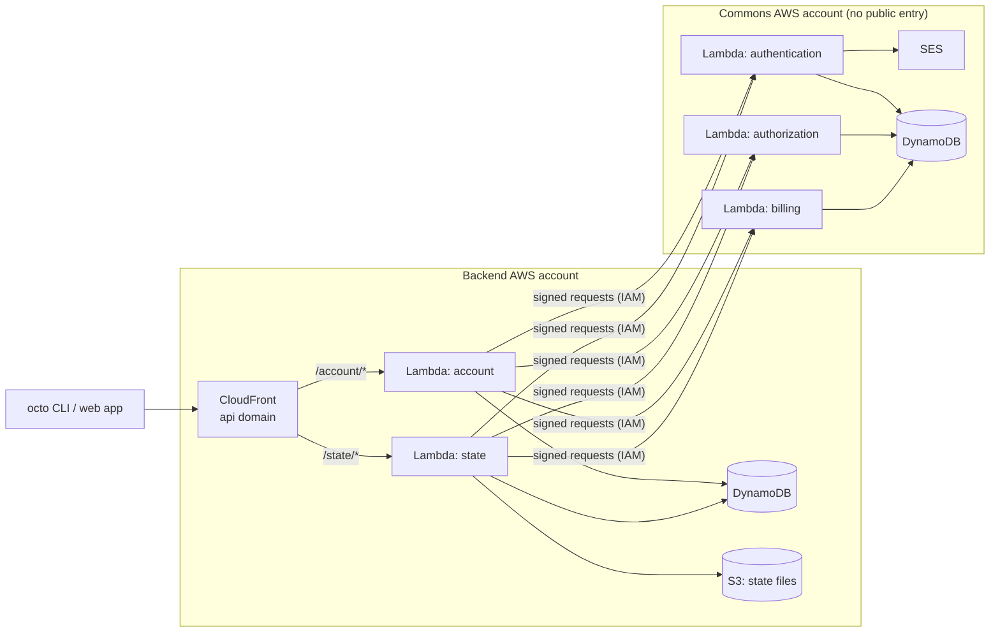

# Serverless backend plan

Written 2026-09-25. Hosts `quadnix-commons` (authentication, authorization, billing) and
`octo-backend` (account, state-management) on AWS **with octo**, in a way that costs almost nothing
while nobody uses it. Most of the work is in octo: the modules this needs do not exist yet. The
backend comes last, as the first real user of those modules.

## How to use this doc

- This is a high-level plan. It fixes the target and the order of the big steps, and nothing
  finer. Each piece is designed when it is started, because what we learn building one piece
  changes the next.
- **Decide** items are forks with their tradeoffs written out. Rahul picks; do not start the step
  until he has. Record the answer and remove the losing options.
- When a step is done, shorten it to a status line and whatever later steps still need from it.
- Delete this doc once both backends are deployed. Anything still open moves to
  `docs/OPEN-ITEMS.md`.

---

## The target

A request pays for itself; nothing runs while idle. No ALB, NAT gateway, Fargate task or anything else
billed by the hour.

**Two octo projects, one AWS account each.** `octo-backend` runs behind CloudFront. `quadnix-commons`
**cannot be called from the internet**; only the backend's services call it. Two octo projects cannot
reference each other, so each side names the other by a literal: commons admits the backend's
**account id**, and the backend is configured with commons' URLs.

**Commons authenticates no caller today.** None of its three services registers a guard, so keeping
commons private is its *only* protection.

**How commons stays private — decided 2026-09-25: IAM-signed function URLs.** Each commons function
URL uses `AuthType = AWS_IAM`, and a resource policy admits only the backend account. The backend signs
every request with its function's role (SigV4, one axios interceptor). It costs nothing idle, gives
commons its first real caller identity, and survives a later move to a private API Gateway or VPC
Lattice: both verify the same signature.

**A NestJS app runs on Lambda unchanged.** Each Dockerfile adds AWS's Lambda Web Adapter
(`COPY --from=public.ecr.aws/awsguru/aws-lambda-adapter:<version> /lambda-adapter
/opt/extensions/lambda-adapter`). It turns each invocation into a plain HTTP request to the app's own
port. `main.ts` and docker-compose do not change. `AWS_LWA_INVOKE_MODE=response_stream`, with the
function URL in `RESPONSE_STREAM` mode, lets downloads pass Lambda's 6 MB buffered limit.

**Limits we accept.** Request bodies up to about 4.5 MB. A first request after a quiet period can take
5–8 s, since a state call wakes four functions in turn.

**Cost.** Idle is about $1 a month (Route 53 zone, ECR storage). Beyond the free tiers, roughly $12 per
million public API calls, because each state call is 5 invocations.

---

## How the model graph carries it

The model graph is intent; modules are how it is delivered. The same graph must hold whether the
compute is Lambda or ECS. Switching is a change of modules, never of intent.

- **Compute is the server family, not a `Service`.** Each backend service is a Server, a Deployment
  and an Execution, delivered by a Lambda family of modules.
- **Region, Subnet and Environment are still there**, and may create no resource. For Lambda, one
  Subnet covers the whole region.
- **HTTPS is an overlay** on the entry point. The certificate is how a module delivers it and never
  shows in the graph.
- **Components and behavior stay out of the graph**: VPCs, certificates, cold starts, body limits.
  Those are module documentation.
- **How two services talk is implementation.** The link to commons is a literal URL.

**Open until the Lambda family is built — not decided:** Lambda and ECS executions may one day share a
Region and Environment, for example while moving one service at a time. Either the Lambda modules
accept the ECS region and environment anchors (and a VPC exists that Lambda does not use), or Lambda
gets its own region and environment modules that create nothing, so a switch also swaps those.
Both are valid.

---

## Steps

### 1. Decide whether to split the service layer — **Decide**

**Status:** not started.

**The problem.** `Service` is the catch-all today: DynamoDB, S3 storage, the S3 website and the ALB
are all `Service`. This project adds more nodes that land there: the DynamoDB tables in both
accounts, the state bucket, the CloudFront entry point, the DNS zone and the SES sending domain.
In a model graph of this backend, most nodes would read "service", and a reader cannot tell a table
from an API entry point. `docs/module-catalog-plan.md` Part I already proposes a split (`database`,
`cache`, `queue`, `loadbalancer`, `storage`; `gateway` and `identity` as candidates) but never
scheduled it.

**The options.**

|                           | **(a) Split now, before the serverless modules**                                                                                                            | **(b) Build first, split later**                                                                                | **(c) Never split**                                                              |
|---------------------------|-------------------------------------------------------------------------------------------------------------------------------------------------------------|-----------------------------------------------------------------------------------------------------------------|----------------------------------------------------------------------------------|
| **What happens**          | New model kinds in `packages/octo`; existing service modules move onto them; the new modules are built on the right kind from the start.                    | New modules are built as `Service`; the split comes as its own project later.                                   | `Service` stays the catch-all.                                                   |
| **Graph of this backend** | Reads true: databases, storage, an entry point, servers.                                                                                                    | Reads "service" everywhere until the split.                                                                     | Reads "service" everywhere, for good.                                            |
| **Breaking change**       | Yes, once. A node's context string changes (`service=x` → `database=x`), so committed state needs a one-shot migration, and it is a `major` release.        | Yes, the same one, later, and it then also covers every module built in between.                                | None.                                                                            |
| **Cost now**              | The largest: choosing the kinds (the vocabulary is fixed on purpose, so each one must earn its place), the migration, and moving five modules.              | None.                                                                                                           | None.                                                                            |
| **Risk**                  | Picking kinds before the modules that use them exist. Mitigation: add only the kinds this project needs, and leave the catalog plan's candidates for later. | The serverless modules are designed against a node kind they will leave, so their anchors and names get redone. | The graph fails its purpose for exactly the users octo-aws-cdk is meant to show. |

Committed state that the migration would touch in this repo: octo-docs' `.octo-tf` (S3 website),
the `octo-templates` suites, and `../octo-examples`.

**Recommendation: (a), limited to the kinds this project needs.** The backend is the showcase for
octo's modules. Building it on `Service` means designing five or six new modules against a node kind
they will leave, then migrating them too.

**If (a), the kinds to settle in this step:** at least one each for the tables, the bucket and the
entry point. Whether DNS and the SES domain are nodes, overlays or stay `Service` is part of the same
decision.

### 2. Draw both projects' model graphs

**Status:** not started. Depends on step 1.

The intent graph of `quadnix-commons` and of `octo-backend`, in the agreed vocabulary: every node, and
every overlay. This is the target the modules are built to. Nothing is built until Rahul has agreed
it.

### 3. Build the pieces, one at a time

**Status:** not started. Depends on step 2.

Each piece is designed when it starts, with its own commits, tests and live e2e. The list below is
what the graph needs, not an order; pick the next one from what the last one taught.

- The Lambda family: server, deployment, execution (image-based), and whatever region, subnet and
  environment modules it needs. Branch `ai/pipeline-and-lambda` holds a zip-based Lambda verified live;
  read its `docs/pipeline-and-lambda-handoff.md` before reusing any of it.
- Granting compute access to tables, buckets and email.
- The API entry point (CloudFront routing paths to functions).
- HTTPS as an overlay, and the DNS it needs.
- The SES sending domain.
- Private, signed access to commons (function URLs with `AWS_IAM`, admitting another account).

### 4. Release

**Status:** not started. Depends on step 3.

The backend repos install octo from the registry. Release the changed packages per `nx.json`, then
confirm the new modules load from `octo.yaml` in `../octo-examples`.

### 5. Deploy commons, then the backend

**Status:** not started. Depends on step 4.

1. **Prepare both backends.** Nothing in this depends on octo; do it last. Production config is the
   local config today: it points at localhost and localstack. SES reads credentials from `~/.aws`,
   which Lambda does not have. The SDK production URLs are placeholders. The Dockerfiles need the
   adapter line, and the commons SDK clients must sign requests in production only.
2. **Deploy `quadnix-commons`** in its own account. It has no public entry point. Verify that a signed
   request from the backend account gets through, and that an unsigned request or one from any other
   account gets 403.
3. **Deploy `octo-backend`.** Its own octo project must never keep its state in the state service it
   deploys, or an outage would lock out the apply that fixes it.

---

## Independent of the design

These do not wait on step 1. Do them whenever there is room.

- **Terraform chains every block to the one before it.** `TerraformService` makes each block depend on
  the previous block of the same resource
  (`packages/octo/src/services/terraform/terraform.service.ts:346-348`). The S3 website emits one block
  per file, so octo-docs' state is 16.9 MB, 13.6 MB of it dependency lists: too large for the remote
  state service's 5 MB cap, and uploads run one at a time. The options (opt-out per block, chain only
  leading blocks, or no implicit chain) still need Rahul's pick.
- **Docker build options.** `docker.service.ts:30` runs a plain `docker build`. The backend images
  need a BuildKit secret (the private package token), a `NODE_ENV` build arg, and a fixed platform.
  Secrets never enter octo's state, HCL or logs: octo stores only the environment variable's name.
- **By hand, with long waits:** file the SES sandbox exit request with AWS; create the commons AWS
  account; find out where `quadnix.com`'s DNS lives today; set an AWS Budgets alert in each account.

---

## Later

Not steps. They record how this setup grows, so nothing built now blocks it.

**More regions and data residency.** Lambda, tables, buckets and function URLs are regional;
CloudFront and IAM are global. Residency means a full stack per region and one home region per
organization, with a small global directory (`hash(email)` and `organizationId` → region, nothing
personal) as a DynamoDB global table. An idle region costs about $0. Keep these true now:

1. Every table's partition key starts with the organization or account, wherever the data belongs to
   one.
2. No personal data in a global table, ever.
3. Region is configuration. The services hard-code `us-east-1` in `local.environment.ts`; production
   config must read it from the environment.
4. Keep `organizationId` in the path of every org-scoped endpoint.

**Moving off Lambda.** Price is rarely the reason; the crossover is about 30–50M API calls a month per
region. Latency per hop, cold starts at the tail, websockets, or a relational database are likelier
triggers. Application code and data do not change. In octo it is a change of modules under the same
intent graph. The one real redesign is commons' private link, since an ALB cannot check SigV4; VPC
Lattice can. Keep the `app-e2e` suites running against concurrent servers (docker-compose), so code
that is only safe one-request-per-instance stays visible while production runs on Lambda.
