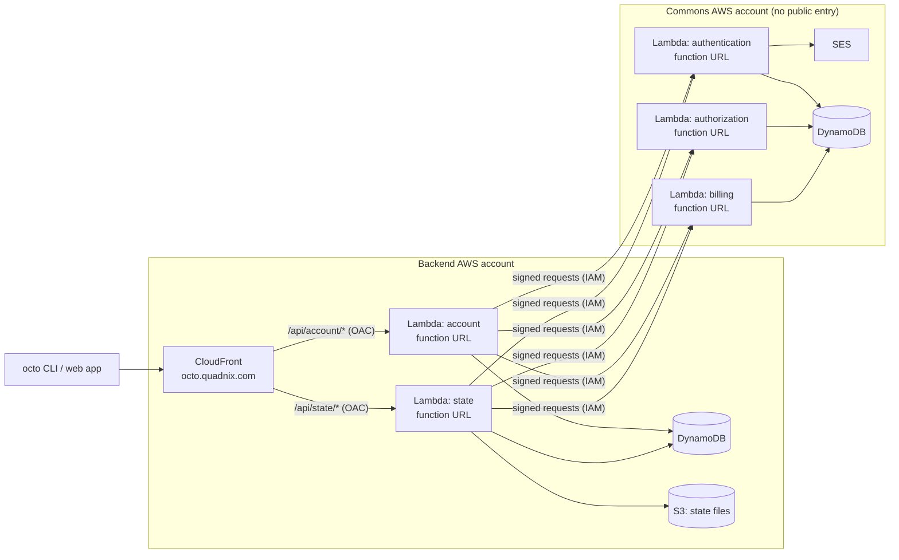

# Serverless backend plan

Written 2026-09-25, cut down 2026-10-06. Gets `quadnix-commons` (authentication, authorization,
billing) and `octo-backend` (account, state-management) live on AWS **with octo**, as soon as
possible, costing about nothing while nobody uses it, built from what octo already has. Corners are
cut on purpose: getting to a working state is the whole goal.

Where the backends go after that is `docs/module-catalog-plan.md`, Wave E: E.0 is the target
design, E.7 how it grows. The backends move there one piece at a time, under real traffic, as octo
gains the modules. That move is itself the point: octo changing live infrastructure and showing the
change of intent.

## How to use this doc

- This plan fixes the path to going live, and nothing past it. Anything not needed to go live goes
  to Wave E in the catalog, not here.
- **Decide** items are forks with their tradeoffs written out. Rahul picks; do not start the step
  until he has. Record the answer and remove the losing options.
- When a step is done, shorten it to a status line and whatever later steps still need from it.
- Delete this doc once both backends are live. Anything still open moves to `docs/OPEN-ITEMS.md`.

---

## The design for going live

No ALB, gateway, NAT, VPC or anything else billed by the hour. Idle is about $1 a month (ECR
storage; the zone is already paid for in the management account). Beyond the free tiers, roughly $12 per million public API calls, because each
state call is 5 invocations, plus about $1 per million at CloudFront.

**Two octo projects, two accounts, one environment — decided 2026-10-06.** `octo-backend` in a backend
account and `quadnix-commons` in a commons account, both members of the Quadnix organization (made by
hand, consolidated billing). Production only: a QA account under each app comes later, with Wave E's
*Several accounts in one app*. Two octo projects cannot reference each other, so each side names the
other by a literal: commons admits the backend's **account id**, and the backend is configured with
commons' three function URLs.

**How each hop is protected — decided 2026-09-25, restored 2026-10-06.**

- **Backend:** CloudFront signs every request with an origin access control; each function URL is
  `AWS_IAM` and admits only distributions of its own account. A direct call gets a 403.
- **Commons:** each function URL is `AWS_IAM`, and its resource policy admits only the backend account.
  The backend signs every request with its function's role (SigV4, service `lambda`, one axios
  interceptor), so commons' code sees a plain HTTP call. **Commons authenticates no caller of its
  own** (none of its services registers a guard), so this signature is its only protection.

**A NestJS app runs on Lambda unchanged.** Each Dockerfile adds AWS's Lambda Web Adapter
(`COPY --from=public.ecr.aws/awsguru/aws-lambda-adapter:<version> /lambda-adapter
/opt/extensions/lambda-adapter`). It turns each invocation into a plain HTTP request to the app's own
port. `main.ts` and docker-compose do not change. A Lambda execution with `invokeMode:
RESPONSE_STREAM` sets the function URL and the adapter to stream, which lets downloads pass Lambda's
6 MB buffered limit; octo sets the adapter's variables, the image need not.

**Accepted risks — 2026-10-06.**

- **Uploads up to about 4.5 MB per request.** Lambda caps a buffered invocation at 6 MB, and binary
  bodies arrive base64-encoded. State files do not pass through Lambda: the state service signs S3
  URLs both ways, so this ceiling does not apply to them.
- **Function URLs answer the internet.** Only a valid signature gets through, and a refused request
  never invokes the function, so it is not billed (a third-party source, consistent with how Lambda
  bills).
- **Clients send the body's SHA-256** in hex as `x-amz-content-sha256` on every `POST` and `PUT`: the
  origin access control signs the body, and without the header the function answers `403`.
- **Cold starts.** A first request after a quiet period can take 5–8 s, since a state call wakes four
  functions in turn.
- **Three raw commons URLs** in the backend's configuration, with no domain of their own.
- **No logs — decided 2026-10-06.** A function's role gets no CloudWatch Logs permission, so nothing
  is logged: an error, a timeout, an out-of-memory kill or an intrusion leaves no trace, and memory
  cannot be tuned. Logs are in the catalog's Wave E.7 and come after the first release.
- **SES stays in its sandbox — decided 2026-10-06.** Commons sends only to verified addresses, which
  is enough to prove sign-in end to end with Rahul's own address. Leaving the sandbox is in the
  catalog's Wave E.5, once everything else is proven.

**Risks found while planning — for Rahul to weigh, 2026-10-06.**

1. **Nothing caps what a flood costs.** CloudFront bills every request it receives, about $1 per
   million, and every request reaching a public route invokes a function, which is billed too.
   There is no WAF, CloudFront's flat-rate plans (no overage, attacks included) cannot be selected
   from Terraform yet. A Budgets alert (step 5) only tells you. The cheap cap is reserved
   concurrency on each function (step 3), which bounds how many run at once, and so the Lambda half
   of the bill; CloudFront's half stays.
2. **Secrets would land in plaintext.** Neither backend reads a secret today (checked 2026-10-06),
   but a value put in a deployment's environment is written into the generated `.octo-tf`, which is
   committed, and into terraform state. The first secret, likely billing's payment provider key,
   needs a secret store and a grant before it ships.
3. **A function admits every distribution of its own account.** Harmless while the backend account
   holds only this distribution; keep that account single-purpose.
4. **Deploy credentials and state.** Deploy with a role or user in each member account, never with
   the management account's keys. `octo-backend`'s own octo state must not live in the state service
   it deploys; if encrypted state is committed, its key must be long and random (catalog IV.6: the key
   is not stretched).

**How the member accounts use `quadnix.com` — 2026-10-06, path changed 2026-10-07.** The
management account (`099…`) keeps the `quadnix.com` hosted zone, and no member account takes it
over. A member account never owns the domain; it proves control of a name by asking for DNS records,
which are added by hand to the zone in `099…`. Delegating a subdomain zone to a member account is
the catalog's Wave E.5.

- **One host, by path.** The backend is served at `octo.quadnix.com/api/...`, beside the docs at
  `octo.quadnix.com/docs` and so on, from one distribution in the backend account. CloudFront passes
  the full path on, so every backend route carries the `/api` prefix itself (step 6).
- **Certificate.** A certificate cannot be shared between accounts, and CloudFront takes one only
  from its own account, in `us-east-1`. The backend account holds its own, for `octo.quadnix.com`
  and `*.octo.quadnix.com`, validated by a CNAME in the zone in `099…`.
- **The name is taken today.** The docs site's distribution in `099…` (`E2OSGI26XBB8HX`, bucket
  `octo-quadnix-com`) holds `octo.quadnix.com`, and CloudFront refuses a name already attached to
  another distribution. Before the backend's distribution can claim it, the docs site moves into
  the backend account and the alias leaves the old distribution, accepting a few minutes of
  downtime (step 7). The alias record for `octo.quadnix.com` in `099…` is then pointed at the new
  distribution; an alias may point at a distribution in another account.
- **SES.** SES is per account and per region, so commons verifies `quadnix.com` as an identity of
  its own, with its own DKIM CNAMEs in the zone in `099…`. The sandbox is per account too: every
  address commons sends to is verified in commons.

**Rules the backends keep now,** so the regions and data residency of Wave E (E.7) need no data
migration:

1. Every table's partition key starts with the organization or account, wherever the data belongs to
   one.
2. No personal data in a global table, ever.
3. Region is configuration. The services hard-code `us-east-1` in `local.environment.ts`; production
   config must read it from the environment.
4. Keep `organizationId` in the path of every org-scoped endpoint.

---

## How the model graph carries it

The model graph is intent; modules are how it is delivered. The same graph must hold whether the
compute is Lambda or ECS. Switching is a change of modules, never of intent.

- **Compute is the server family, not a `Service`.** Each backend service is a Server, a Deployment
  and an Execution, delivered by a Lambda family of modules.
- **Region, Subnet and Environment are still there**, and may create no resource. For Lambda, one
  Subnet covers the whole region.
- **HTTPS is an overlay** on the entry point. The certificate is how a module delivers it and never
  shows in the graph.
- **Components and behavior stay out of the graph**: VPCs, certificates, cold starts, body limits.
  Those are module documentation.
- **How two services talk is implementation.** The link to commons is a literal URL.
- **The accounts are nodes.** Each app holds its one account for now.

**Lambda has its own region, environment and subnet — decided 2026-09-30.** Lambda does not share
the ECS region and environment. It runs under `AwsServerlessRegionModule`,
`AwsServerlessEnvironmentModule` and `AwsServerlessSubnetModule`, which create nothing, so moving a
service between ECS and Lambda also swaps those modules.

**Lambda family rulings — decided 2026-09-30, reviewed 2026-10-02.** Settled while building the
family; reopen only with a reason the build did not have.

- **The server and the deployment are data-only.** They create nothing; the execution reads their
  anchors, checks them against its runtime's limits at generate, and creates the role, its grants
  and the function. So there is one role per execution, `ExecutionRole-<executionId>`, which caps
  a Lambda `executionId` at 50 characters.
- **Container images only, named by the `aws-ecr-image-tag` model**, so terragrunt always pushes the
  image before it creates the function. The deployment also takes a plain `imageUri`, for ECS
  running Docker Hub images; Lambda refuses it.
- **CloudFront reaches Lambda through the function URL**, `AWS_IAM`, signed by an origin access
  control. A function admits every distribution of its own account, not one distribution's ARN:
  the distribution already references the URL, so naming its ARN back would close a folder cycle.
- **Typed grants.** The server names a table or bucket model and an access level; octo writes the
  IAM actions. A table or bucket in another account is refused.
- **No log groups** until CloudWatch is settled (see *No logs* under *Accepted risks*).
- **ECS keeps one role** for the task and for pulling its image, where AWS advises two.

---

## Steps

### 1. Decide whether to split the service layer

**Status:** done 2026-09-28. Not split: `Service` stays one model kind, attached where it belongs
instead of under the app.

What it settled:

- A service is any infrastructure that is not compute. It is given its parents when it is built, and
  they can be any nodes: a region, a subnet, the account, or another service, as long as no cycle
  forms. Several parents are allowed (the ALB sits under both of its subnets). Parents are fixed for
  the service's lifetime.
- Each service carries a `type` from a fixed list (`cache`, `database`, `gateway`, `load-balancer`,
  `other`, `storage`) and a free-text `label` naming what it is (`dynamodb`, `s3`, `cloudfront`).
  Neither produces a diff.
- Nothing sits under the app. Placements so far: DynamoDB, S3 storage and the S3 website under
  their region (the website only under a serverless region), the global table under the table it
  replicates, the ALB under its public subnets, CloudFront under the account.
- `AwsServerlessRegionModule` is the region for serverless pieces; it creates nothing.
- Whether the DNS zone and the SES sending domain are services is open; both are made by hand for
  now (step 5). The shape allows the SES domain under the zone.

### 2. Decide how both projects are deployed

**Status:** done 2026-10-06, as *The design for going live* above. The target it grows into was
decided the same week and lives in the catalog's Wave E.

### 3. Build what octo lacks

**Status:** built, apart from the live proofs. Each piece gets its own commits, tests and live e2e.

Already built, and what going live uses:

- **The Lambda family** (2026-09-30): `aws-server`, `aws-deployment`, the serverless region,
  environment and subnet, `AwsLambdaExecutionModule`, container images only. Rulings are under
  *Lambda family rulings* above.
- **Typed grants** on tables and buckets, turned into policies by the execution's role.
- **CloudFront to function URLs**, signed by an origin access control, with custom domains
  (`aliases`, and a literal `certificateArn` from `us-east-1`).
- **Commons' half of cross-account access**: every function URL is `AWS_IAM`, and the execution's
  `invokerAccountIds` admits other accounts, with both `lambda:InvokeFunctionUrl` and
  `lambda:InvokeFunction`.
- **Response streaming** (`invokeMode`, committed in `bbe7ca0a`), not yet applied live.
- **IAM statements on a server** (`10603295`): `AwsServerModule`'s `iamStatements`, each
  `actions` and `resources` by ARN, allowed as written in one policy on the execution's role. No
  check on the actions, the account, or overlap with typed grants. This is the caller's half of
  cross-account access (`lambda:InvokeFunctionUrl` and `lambda:InvokeFunction` on commons'
  functions) and commons' SES send (`ses:SendEmail`, `ses:SendRawEmail` on the hand-made identity).
- **Resource identity** (2026-10-03): same-named resources in two regions no longer collide.

- **Docker build options** (2026-10-06, uncommitted): `AwsEcrImageTagModule`'s `buildArguments`
  (`--build-arg`) and `buildSecrets` (`--secret id=…,env=…`, each id mapped to the name of the
  environment variable holding it). Octo stores only the variable's name, and an apply where it is
  unset fails before anything is published. The backend Dockerfiles copy a ready-made `dist/`, so
  `nx build` runs before `octo apply`.
- **Reserved concurrency** (2026-10-06, uncommitted): `AwsLambdaExecutionModule`'s
  `reservedConcurrency`, the cheap cap for risk 1. An account whose Lambda limit is still 10 cannot
  reserve any; both member accounts were at 400 on 2026-10-07 (step 5).

Proven live 2026-10-06 by `aws-lambda-api` (7/7): three functions from one image, two behind one
distribution on different routes, a `POST` through the origin access control, an 8 MB stream, and
the greeter reaching the private function on its IAM statements alone, then refused once they were
removed. A call signed by an admin of the function's own account gets through on its IAM
permissions, whatever the URL's own policy says; AWS works that way, so the template no longer
asserts otherwise.

Still to prove live before releasing:

- a table or bucket grant on Lambda (the Lambda template grants nothing);
- a new image tag replacing the running one.

### 4. Release octo

**Status:** in progress. The template e2es are done; the release waits on step 3's two live proofs.

**Template e2es: all green live, 2026-10-06.** s3-website 3/3, cloudfront-website 5/5,
dynamodb-service 5/5, lambda-api 7/7, ecr-image 13/13, ecs-server drift 5/5, ecs-server main 24/24.
Fixed on the way, uncommitted: specs looked resources up by their pre-hash ids; and octo dropped the
provider block of an account a folder no longer used, so terraform could not destroy what it had
created there (`accountId change`). Teardown left nothing live. The ECS server snapshot was
re-recorded and reviewed by hand. Open from the review: see `docs/OPEN-ITEMS.md`.

The backend repos install octo from the registry. Release the changed packages per `nx.json`, then
confirm the new modules load from `octo.yaml` in `../octo-examples`.

The last releases are `octo@0.1.0` and `octo-aws-cdk@0.2.0`; 65 commits to `octo-aws-cdk` and 34
to `octo` have landed since (counted 2026-10-04), among them resource identity, `moved` blocks and
state moves between module folders. `octo-templates` is now private: a release versions it but no
longer publishes it. `octo create-app`
still offers only `aws-dynamodb-service`, `aws-ecs-server` and `aws-s3-website`, so a new user cannot
scaffold a serverless app.

### 5. Do the manual parts

**Status:** done 2026-10-07, checked account by account. What later steps need from it:

- **Accounts and access.** Organization members `Octo - Production` (the backend),
  `Quadnix Commons - Production` and `Octo - QA` (unused until Wave
  E). Deploy through IAM Identity Center profiles `octo-prod`, `commons-prod` and `root`; no
  account has an IAM user. Central root access management is not on.
- **Certificate.** In the backend account, `us-east-1`, issued for `octo.quadnix.com` and
  `*.octo.quadnix.com`:
  `arn:aws:acm:us-east-1:<octo-prod account>:certificate/96a222c9-4511-44a5-885c-9e45d76acc1d`. It is the
  distribution's `certificateArn`.
- **SES.** In commons, `us-east-1`: `quadnix.com` verified with DKIM signing, and `root@`,
  `support.octo@` and Rahul's address verified. A production access request was denied (case
  `179134609500186`); the account stays in the sandbox, as decided. The management account no
  longer has an SES identity, and its DKIM records are deleted.
- **Lambda.** Concurrency is 400 in both member accounts; 1000 is requested.
- **Budget.** One $10 monthly budget in the management account, covering the whole organization.

### 6. Prepare both backends

**Status:** not started. Nothing in this depends on octo.

- Production config is the local config today: it points at localhost and localstack. It must read
  the region and its endpoints from the environment.
- SES reads credentials from `~/.aws`, which Lambda does not have; use the function's role.
- The commons SDK production URLs are placeholders: they become the three function URLs.
- The Dockerfiles need the adapter line.
- Every `octo-backend` route carries the `/api` prefix, since CloudFront passes the path on unchanged.
- The commons SDK clients sign requests (SigV4, service `lambda`) in production only.
- The CLI and the web app send `x-amz-content-sha256` on `POST` and `PUT`.

### 7. Deploy commons, then the backend

**Status:** not started. Depends on steps 3–6.

1. **Deploy `quadnix-commons`** in its account. Verify that a signed request from the backend account
   gets through, and that an unsigned request or one from any other account gets 403.
2. **Move the docs site into the backend account**, with a few minutes of downtime: remove
   `octo.quadnix.com` from `E2OSGI26XBB8HX` in `099…`, so the backend's distribution can claim it.
3. **Deploy `octo-backend`,** with the docs site and `/api` on one distribution, then point the
   `octo.quadnix.com` alias records in `099…` at it. Its own octo project must never keep its state
   in the state service it deploys, or an outage would lock out the apply that fixes it. Verify that a direct call to a
   function URL gets 403 and the same call through CloudFront succeeds.

Known from the Lambda e2e: a new IAM role can take minutes to become assumable (eight minutes once,
2026-09-03). If creating a function fails with "role cannot be assumed", re-run before debugging.

### 8. Retell the docs' shop story

**Status:** not started. Do it last, once the backend shows what a real serverless stack looks like.

Getting Started's shop walkthrough grants the checkout server the receipts bucket and shows, in
captured output, the IAM role (`ServerRole-checkout`) and bucket policy that grant created. Since
the server became data-only, the grant creates nothing until an execution runs checkout, so that
output is false. Seven pages quote the role: `getting-started/shop-stack`,
`fundamentals/shop-stack-explained`, `fundamentals/state`, `fundamentals/resources`, `why-octo`,
`using-octo/reading-a-validate-report`, `using-octo/destroying-infrastructure`.
`fundamentals/overlays` tells the same grant story without naming the role. Three of those pages
(`shop-stack`, `shop-stack-explained`, `destroying-infrastructure`) also load `AwsEcsServerModule`,
which no longer exists on `main`: it became `AwsServerModule`. Decide what the shop becomes (e.g.
checkout gets a deployment and a Lambda execution in a serverless region), then capture its output
again.

Every resource id and terraform address the docs quote was captured before resource identity, so
none carries the scope hash: `queue-shop-orders` now renders as `queue-shop-orders-<hash>`, and the
same holds across Getting Started, Fundamentals and Building Modules. The recapture fixes them too;
the prose around them already describes the hash.

---

---

## Library cleanup

The second purpose of this plan: whatever building the serverless modules showed to be wrong in
the library, fixed before the doc is deleted. Found by reading the plan against the code on
2026-10-02. Ordered by how much each one costs a reader or a user. Items 1 and 5 are fixed, and
part of 3.

1. **Resource identity: done 2026-10-03.** A resource id is the author's `localResourceId` plus a
   hash of the scope octo derives from the model graph, the merge is removed, and AWS names are
   declared per resource and checked at generate. Its rules are in `docs/CODING-STANDARDS.md`.
2. **Anchors hold data their model does not have, against a written rule.** `CODING-STANDARDS.md`
   says an anchor's properties are read off its model and it holds no values of its own. The
   data-only server and deployment do the opposite: `AwsServer` and `AwsDeployment` hold only their
   key, and the grants, image, command, CPU, memory, ports and timeout live only on their anchors.
   The Lambda execution anchor's `invokerAccountIds` and the ECS execution anchor's `desiredCount` are
   the same. Either the rule changes ("an anchor may carry a module's own data") or the data moves
   onto the models. Until one of them gives, the library teaches two patterns. **Decide.**
3. **One fact is kept in three places.** A server's grants are on its anchor, on one grant overlay
   each, and copied again into the execution overlay's properties. A deployment's image is on its
   anchor, on the deployment-image overlay, and in the execution overlay. The grant overlays exist so
   the table and bucket anchors enter the server's boundary; their properties are never read. Keep
   one copy of each fact. The account rule is settled: only `IamRole` checks that a table or bucket
   is in the role's own account (the server's and the executions' copies were deleted 2026-10-03).
4. **The two executions read a deployment two ways.** ECS lets the execution override the
   deployment's CPU, memory, command and ports (`containerProperties`,
   `aws-ecs-execution.module.ts:263`); Lambda cannot. ECS turns an ECR image into a URI string
   (`:290`) and its action parses the string back (`add-aws-ecs-execution.overlay.action.ts:219`);
   Lambda keeps `imageId` and `imageTag`. ECS takes any `executionId` and checks the role name's
   length at runtime (`:336`); Lambda caps it at 50 in its schema. The grant lookup is copied
   verbatim between them, twice each (module and action). The data-only deployment was meant to be
   the one thing both runtimes read; ECS still carries the shape from before it.
5. **A module writes into another family's resources by convention: fixed, committed in `bbe7ca0a`.**
   The CloudFront Lambda origin action calls `LambdaFunction.allowCloudFrontOriginAccess()` in place
   of setting the property, as the bucket's `S3Storage.addPermission` does.
6. **Sixteen actions do nothing.** Every model and overlay diff must match an action
   (`diff-metadata.ts:40`), so each data-only node ships an action that returns its input unchanged:
   the server, both grant overlays, the deployment, its image overlay, both execution models, the
   serverless region, environment and subnet, the app, four account modules and the ECS environment.
   Each is about 60 lines with its factory. A way for a node to say it creates nothing would delete
   them all.
7. **Smaller.**
   - The region modules take the AWS region as `regionId` and store the user's name as the model's
     `regionId`. All three validate it with `minLength: 1` only, so `aws-moon-1` passes until the
     provider rejects it.
   - Overlay ids are a hash in some modules (`aws-server-*-access-overlay-<hash>`,
     `aws-deployment-image-overlay-<hash>`) and readable in others
     (`aws-lambda-execution-overlay-<regionId>-<executionId>`). Pick one.
   - `AwsCloudFrontServiceModule` still says an origin is "neither an S3 storage bucket nor an ALB",
     leaving out Lambda (`aws-cloudfront-service.module.ts:235`).
   - `IamRole.diffProperties` emits a DELETE when a role has no policies; deleting belongs to the
     graph, not to a property diff.
   - The ECS execution's default-egress block carries two paragraphs justifying itself, against the
     comment rules.
   - `packages/octo-templates/src/aws-codepipeline/` holds nothing but an ignored `.env`.

---

## Where this stands

Measured 2026-10-06. Shares are by rough effort, not by number of items.

| Track                          | Done                                                                                                     | Left                                                                                                                         | Share done |
|--------------------------------|----------------------------------------------------------------------------------------------------------|------------------------------------------------------------------------------------------------------------------------------|------------|
| Octo for going live (steps 1–3) | Steps 1 and 2; the Lambda family; table and bucket grants; CloudFront to function URLs with a domain; commons' half of cross-account access; streaming; IAM statements | the live proofs; committing Docker build options and reserved concurrency                                                           | about 90%  |
| Going live (steps 1–8)          | as above; the manual parts (step 5)                                                                                | also release, preparing and deploying both backends, the shop docs              | about 40%  |
| Library cleanup                 | items 1 and 5; the account rule in item 3                                                                | items 2–4, 6, 7                                                                                                              | about 20%  |

## After going live

Pick the next step toward Wave E's E.0 from what running live taught, one module at a time, each
landing as a change to the live backends: likely a QA account, then a REST gateway for commons.
